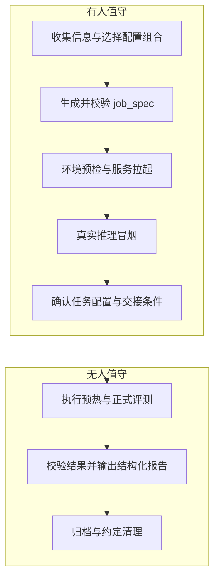
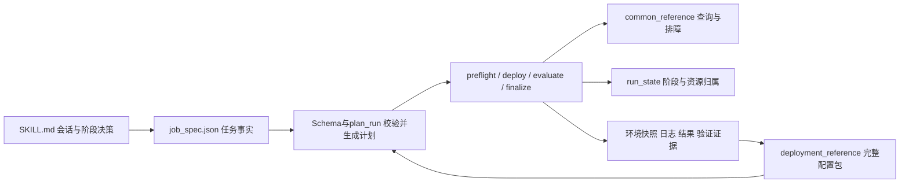

# 模型拉起与评测 Skill：早期方案记录

原方案日期：2026-10-30；状态说明更新：2026-11-01。

本文保留最初的配置包与部署评测设计，**不作为当前执行规范或能力清单**。其中配置候选匹配、配方库、旧版Schema和早期验收建议属于历史讨论。当前实现以 [当前设计](design.md)、[工程计划](project-plan.md) 和 [Skill](../SKILL.md) 为准。

当前只接受job_spec v3，配置存储仅做埋点，不加载旧recipe或实现配置库。五阶段、实例拓扑、任务容器复用和整组宿主机协调已实现；单个任务仍串行，整组可安排独立主机任务并发。默认容器挂载、阶段事件、北京时间观察及每60分钟Agent兜底策略见现行文档。真实验证边界与后续验收统一由工程计划维护。

## 历史方案正文（以下描述保留原时间语境）

## 1. 范围与核心取舍

首版面向单个测试任务：有人值守时完成信息收集、生成完整的结构化 job_spec、拉起模型服务并通过真实推理冒烟；满足交接条件后切换至无人值守状态，由 Agent 自主完成评测、结果校验与收尾。信息收集和配置包选择都是生成 job_spec 的组成步骤，不是独立于任务配置的目标。

设计应明确整体任务流程，持续优化 Skill reference，以提升执行效率和稳定性，并保证测试任务输出结构化结果。单个测试任务作为具有明确输入、输出和状态的独立节点，为后续多轮测试的拓扑编排与性能摸测扩展提供基础。首版先完成这个节点，不实现多任务编排。

通用排障命令放入 common_reference；模型配置以 run_p、run_d 与模型形成完整组合，按 vLLM release 版本组织候选。

首版采用模型和 vLLM release 的候选匹配，不要求镜像名称或摘要严格一致。匹配提供参考起点，当前环境能否运行由值守阶段预检和真实冒烟确认。硬件匹配预留扩展能力，暂不展开复杂规则。

## 2. Skill 完成后的单任务流程

### 有人值守与无人值守的边界

首版单任务指一套确定的部署配置和一个测试 case（含其预热及正式测量），具有独立任务 ID 和结果。多组 case 可以在任务清单中表达，但其跨节点编排、服务复用和切换清理不纳入本节流程。现有包含四组 case 的迁移示例属于测试目标清单，后续需映射成独立任务节点。

有人值守阶段至少持续到冒烟通过。job_spec 尚未收集完整或校验未通过时，只能继续信息收集与只读检查，不能开始后续部署测试，更不能进入无人值守。信息齐全也不等于可以立即离开：还需要完成预检、服务拉起、真实冒烟，并确定执行与清理边界。

PD 冒烟必须走代理，并有 P、D 两端参与及 KV 交接证据；health 或 HTTP200 不足以通过。无人值守入口需要完整 job_spec、绑定本次计划和服务的有效冒烟证据、明确的超时/重试/清理策略及可写结果目录。部署配置发生变化时，原冒烟证据失效，返回值守阶段重新验证。

冒烟证据须记录配置哈希、容器 ID、P/D/代理进程身份及启动时间，并关联实际请求、响应和 KV 交接日志。镜像、权重、P/D 启动参数、代理配置、端点文件或必要补丁变化，以及服务重启，均使原证据失效。

正式测试分别统计预热和测量，目标前缀比例与实际命中率分开。无人值守失败不得静默改变并发、模型或精度；允许的自动重试必须先确认服务健康且不存在上次请求残留，重试产物按尝试编号隔离。需要重部署或超出已定义恢复范围时，保存证据并等待值守处理。

同一容器内的 AISBench 评测须串行执行：现用工具会改写容器内的临时配置和数据集链接，独立结果目录本身不足以隔离并发任务。evaluate.py 应在运行前取得容器级独占锁，保存实际生效的工具配置、数据集链接和输出路径，并在退出时释放锁。成功判定须核对逐请求原始结果中的成功数、失败数、SSE 错误及实际 token 数；CSV 汇总用于交叉检查。工具内部的 tee 管道可能掩盖上游失败，进程退出码不能单独作为通过依据。

首版没有“检测已有服务并自动复用”的分支。任务按自己的部署流程拉起服务；发现目标资源或端口已被占用时由值守阶段处理，不自动接管或终止已有服务。

### 单任务输出与后续多任务边界

单任务输出应包含任务 ID、配置哈希、阶段状态、实际环境、冒烟证据、预热与正式测量结果、失败原因、产物索引，以及资源清理状态。未完成或失败也必须生成结构化记录，不能只有自然语言总结。该输出是后续拓扑节点的交接依据。

首版 cleanup 只描述本任务结束时停止请求进程、是否保留本任务服务及保留哪些产物；保留服务不等于授予下一个任务自动复用资格。多任务扩展另行设计：子任务依赖、服务归属交接、实际配置一致性证据、仅清理请求进程/重置缓存/重新部署的策略，以及策略对性能可比性的影响。当前不假设这些判断能力已经存在。

## 3. 模块与文件职责

| 文件/模块 | 职责与边界 |
| --- | --- |
| SKILL.md | 引导信息采集、选择配置包、解释脚本结果；不能用文字替代脚本校验 |
| job_spec + Schema | 本次目标、参数、测试与边界；字段和跨字段约束由代码执行 |
| plan_run.py / plan.json | 收敛并固化计划、配置哈希；不宣称运行环境已验证 |
| preflight.py | 核对实际镜像、源码、模型、硬件、文件、端口及资源占用 |
| deploy.py | 根据选定包渲染配置、记录差异、启动服务和执行冒烟 |
| evaluate.py | 验证本任务冒烟证据、执行单case预热与正式测量、检查失败并输出结构化指标 |
| finalize.py | 汇总、归档、按约定保留或清理本任务资源 |
| run_state.json | 阶段、尝试、错误、产物、PID及启动时间；不回写目标参数 |
| deployment_reference | 一套验证组合的环境条件、完整启动配置与证据 |
| common_reference | 占用查询、版本采集、日志检查等通用操作，仍需声明前置条件 |

### job_spec 顶层目标结构

| 字段 | 描述 |
| --- | --- |
| schema_version | 契约版本 |
| job | ID、任务目标、评测类型 |
| target | 主机、访问方式和工作目录，不保存凭据 |
| runtime | 容器、镜像摘要、软件版本、执行位置 |
| model | 权重、tokenizer、模型标识 |
| deployment | 实例、DP/TP/EP、卡、网络、KV、代理及启动参数 |
| benchmark | 工具、数据、case、轮次、预热与缓存隔离 |
| acceptance | 冒烟与评测通过条件 |
| execution | 值守模式、超时、重试、允许调整范围；调度可选 |
| artifacts | 结果、日志、快照输出位置及保留策略 |
| cleanup | 任务进程和临时文件清理范围、是否保留服务 |
| references | 配置包ID/修订及其哈希，通用参考引用 |
| unresolved | 待确认信息，禁止带未解决执行条件进入运行 |

上述结构已讨论确认，后续可优化。当前实现仍是较早的 v1 字段结构，迁移时必须同步修改 Schema、plan_run、示例和测试，不能只改文档或静默接受两种格式。参数要求与实测环境快照分离；状态ready只表示信息完整，不代表部署成功。

## 4. 模型配置包：首版思路

### 配置组合

将 **run_p + run_d + 模型** 看作一个配置组合，保存配套的 P/D 启动参数和环境变量。代理与必要补丁作为辅助内容关联，不将不同组合的 P、D 参数随意拼接。

现场 IP、网卡、目录和端口依据本次 job_spec 填写；DP/TP、KV Connector、精度及推测解码由组合提供参考，调整需留记录。测试负载仍由 benchmark 描述。

### 按 release 做候选匹配

首版按模型和 vLLM release 版本组织与查找组合，不以镜像名称或完整摘要作为严格匹配条件。同一 release 下的不同镜像可以参考同一组合；镜像摘要和实际软件信息留在验证记录中，用于追溯差异。

“模糊匹配”表示找到候选配置，不等于承诺镜像间兼容。当前只做 release 划分，不展开 nightly、rc、提交级别的自动匹配规则，也不设计评分和字段优先级。无法明确归入已有 release 的环境，由值守阶段判断并记录，不能自动视为已验证。

流程为：模型与实际 vLLM release → 查找候选 run_p/run_d 组合 → 值守核对并调整现场参数 → 拉起与真实冒烟 → 归档实际环境和验证结果。

换镜像后命令可能失效，因此匹配只提供起点。参数不支持、依赖缺失或补丁不适配应在值守阶段处理，通过现场预检与冒烟后才可进入无人值守。

### 存储与扩展

deployment_reference 保存组合、模型标识、vLLM release 和验证记录；common_reference 保存通用检查和排障。首版明确职责与组织思路，目录层级及字段细节在实现时确定。

硬件先记录为实际环境信息，预留后续按硬件筛选和扩展组合的能力，本版不展开硬件匹配规则。

## 5. 命令与配置归档流程

1. 现场成功执行时保存原始脚本、参数、镜像摘要、软件/源码差异、模型配置、日志及验收结果。
2. 模型启动命令以完整组合归档；无模型依赖且验证可复用的检查命令提取到 common_reference。
3. 去除凭据与个人路径，参数化现场字段，生成 candidate 配置包及哈希。保留许可证和来源。
4. 使用参数化后的包重新启动并通过明确验收；原始命令成功不自动证明模板成功。
5. 记录验证范围：例如只通过部署和短请求，不得称为长上下文64并发已验证。部署验证与各测试case结果分别记录。
6. 不同镜像的验证结果可关联到同一模型/release组合；脚本或核心参数变化时新增修订，保留旧证据。候选匹配范围不等于实际验证范围。

当前迁移材料仍为 candidate：代码修改和静态检查已完成。2026-10-30 的首次手工测试形成了基线记录：DeepSeek-V4-Flash-0731，单机 8 卡，P DP2/TP2、D DP4/TP1，64 条请求成功、失败 0；目标输入 2048 tokens，实际平均输入 2131 tokens，输出 1024 tokens。该结果只证明当次手工配置和负载，不能证明参数化配置包、Agent 全流程或四组 case 已通过。应逐项记录四组 case 的验证状态；参数化包重新启动并通过真实 PD 冒烟后，才可升级为已验证配置包。验证后按迁移说明清理重复快照，避免长期维护两套脚本。

## 6. 最小落地顺序与验收

1. 将 job_spec 归组落实到Schema与规划器，增加 references 的显式包选择。
2. 固化 run_p/run_d 与模型的组合，按 vLLM release 查找候选，实现现场参数填充与变更记录。
3. 实现 preflight 与 deploy，完成“核对环境→拉起→真实PD冒烟”闭环。
4. 接入 AISBench 四组case，处理上游退出码、SSE错误、缓存隔离、指标采集和结果判定。
5. 实现单任务归属清理、结构化结果与值守交接门槛，完成“值守准备与冒烟→无人值守评测”的单任务闭环；再扩展多任务拓扑、多轮测试和性能摸测。

首版应通过：镜像差异可追溯、候选匹配不替代现场验证、缺参数被拒绝、非法参数不进入命令、实例拓扑一致、真实冒烟证据可追溯、失败请求不计成功、清理不影响他人。没有任何已验证配置包时应明确返回缺失，不假装自动部署可用。

本报告形成时（2026-10-30）已实现：job_spec v1校验、plan_run计划生成、迁移源码包、信息收集文档；另有一次手工部署与性能测试基线。自动 preflight、deploy、evaluate、finalize 及参数化包的重启验证仍未完成；本报告只更新设计，不在服务器执行测试或启动服务。
