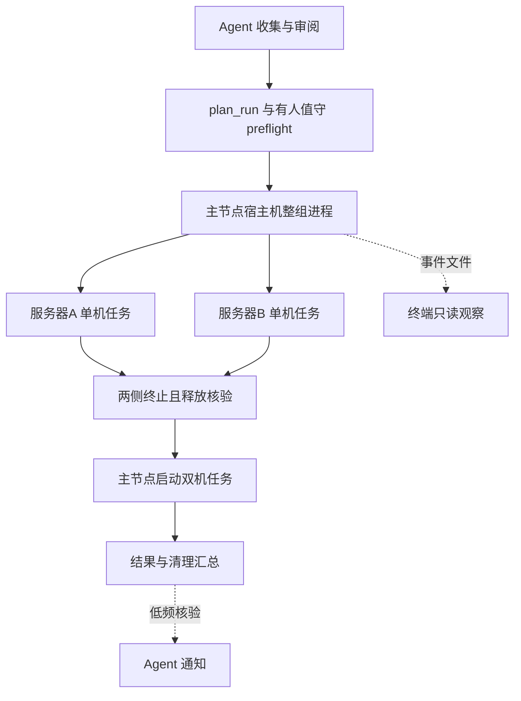

> 历史设计记录：其中旧入口、快照目录和提交流程不适用于新任务。当前规则以 SKILL.md 和 docs/compact-cli.md 为准；旧公开入口已停用。

# Benchmark Agent 当前设计

> 历史设计记录：本文涉及工具副本、自有数据集缓存及代理打包的内容已由[原生 CLI 适配](native-cli.md)取代，不作为当前执行规范。
更新日期：2026-11-01，对齐实现 c502919。当前能力与验收计划见 [工程计划](project-plan.md)；具体命令、Schema 和参数以 [Skill](../SKILL.md) 为准。本文后半部分保留早期方案，仅作历史参考。

## 任务描述与现场绑定

用户描述服务器、模型、镜像、部署脚本和测试目标，Agent 复用已有事实、提取参数并集中确认实际缺项。默认请求数、轮数、预检、清理和监控规则不要求用户反复写入提示词。多模型、多部署、多 case 时再披露矩阵与资源分组。

当前唯一用户格式为 job_spec v3：deployments 定义模型服务拓扑，cases 定义可复用负载，sub_tasks 引用部署与 case，保存串行执行顺序、phase_id、after_case、on_failure。phase_id 仅分组，不代表并行屏障。源脚本的本地/远端路径只是收集入口，不作为任务执行依赖；审阅后的命令、环境和模型参数进入结构化配置。

bindings 保存真实主机、模型位置、挂载和其他现场值；preflight 动态选择网卡与 IP、规划端口、发现镜像内 AISBench，再生成 resolved 与启动脚本。任务计划、绑定和完整代码快照冻结后执行；不原地更新运行中的快照。

## 执行层次



单机任务执行进程放本机宿主，多机任务执行进程放所选主节点宿主，通过固定 SSH 节点脚本管理各服务。模型服务与 AISBench 客户端在任务容器内。整组主进程使用已预检任务的引用清单 group-plan.json，管理依赖与主机互斥，不重复实现五阶段逻辑。

独立主机任务可以并行；同一 job_spec 内仍按 sub_tasks 串行。整组清单引用子任务协调节点、任务目录和计划摘要，不存任意启动命令。子任务通过后台 worker 脱离 SSH 运行，使用 PID 与进程启动标识登记，重复或不确定启动不盲目重放。

## 五阶段职责

| 阶段 | 当前职责 |
|---|---|
| plan_run | 校验和冻结任务，补齐默认值，保存顺序与代码快照，生成 run.sh |
| preflight | 有人值守核验环境、资源与工具，绑定现场参数并生成节点启动脚本 |
| deploy | 核验服务身份；有效READY复用，否则部署、等待健康并执行default curl冒烟 |
| evaluate | 重置缓存、预热、正式性能测试及验证，保留attempt结果和客户端释放证据 |
| finalize | 按case/服务/任务策略释放并核验全部登记节点，保留结果与诊断产物 |

自动执行不再依赖 Agent 在每个阶段之间持续调用。Agent 负责前置审阅和超出计划的决策；远端进程推进已授权的正常路径和有限重试。更改测试目标或部署参数仍须按实际授权处理。

## 容器与资源

容器基础选项默认使用 root、host 网络/PID、500g 共享内存、privileged、八卡和管理设备，runtime.container 显式参数优先。挂载独立配置：节点 mount_profiles 显式选择驱动/通信模板，mounts 按目标路径覆盖模板或追加；不隐式追加旧基线的整盘目录。生成器另合并任务目录（可写）和模型目录（默认只读），规则见 [容器基线](../references/container-baseline.md)。

每台机器首个任务容器以总job_id命名，兼容配置跨部署复用，不兼容时使用子编号。服务身份和容器身份分离；切换部署默认停止服务，保留兼容容器。任务结束默认停止服务并删除本任务容器，保留日志、结果、脚本快照、共享镜像和权重。

单任务仍支持明确的保留策略；整组自动推进要求子任务task_end=stop_container，以核验释放作为后继条件。缺少挂载来源阻塞，不创建空文件替代通信配置。任务只操作已登记且归属核验通过的资源。

## 状态与故障边界

整组任务状态包括PENDING、RUNNING、UNKNOWN、DONE、BLOCKED。DONE表示执行终止且释放证据通过；测量结果另为PASSED或FAILED。测量FAILED但释放通过可继续后继，整组最终仍FAILED。释放缺失/失败或身份不明时阻塞相关后继，独立任务可继续。

case的on_failure默认record_only：记录失败，核验客户端和服务，健康则继续，确认退出并释放后由下一case重部署。默认最多额外重试3次，尝试证据隔离；不把SSH断连直接判为任务失败，不以进程退出代替成功。

没有主机重启后自动恢复、复杂故障调度或任意任务自动接管。协调器意外退出要审阅现有进程和状态，不能删除登记来强行重跑。每台主机使用统一规范地址；当前不支持别名自动归一或同机分卡并发。

## 进度事件与通知

事件以subcase和阶段组织：deploy/deploy_attempt、smoke、testing，测试内细分cache_reset、warmup、benchmark、validate、client_cleanup，并记录reconcile、release、job_release。状态为doing/done/fail/skipped/blocked/retry，附case、部署、phase及attempt等标识。字段和命令详见 [整组执行](../references/group-execution.md)。

原始事件追加到events.jsonl并保存UTC时间；整组按流游标汇集，终端以北京时间显示到秒。Agent提交前提供可复制SSH观察命令；终端只是观察器，关闭后执行继续。事件写入或采集失败不能替代结果证据，也不应阻断资源清理。

远端30秒轮询由Python完成，不调用模型。当前聊天默认每60分钟进行一次Agent兜底检查，整组只建一个监控，正常静默；终态或需要人工处理时通知。启动后立即核验一次，终态通知后停用监控。通知可能延迟一个周期，应用离线会更久；无监控能力时明确告知，不能承诺主动通知。

## 当前验证与未实现能力

Linux 72项检查通过；真实SSH、后台worker、自动后继和终端观察以合成任务验证。真实跨服务器单机并行及新版模型/容器完整链路仍待小负载验收，应用通知投递亦待验证。历史单机DSV4 PD和双机GLM PD功能结果不能证明新长输入矩阵或新整组流程通过。

当前支持混部和一个P/一个D/一个proxy的PD结构。多P/D、精度、配置库、job_spec内并行屏障及复杂恢复未实现。完整Agent与强弱模型复现按工程计划继续。

---

## 原始方案（历史参考，不作为首版执行规范）

## 1. 建设目标与核心决策

### 1.1 建设目标

通过 SKILL + Script + Reference 实现昇腾 NPU 一体机上的模型服务自动部署与 AISBench 自动测评，打通：

**任务规划 → 人工确认 → 环境检查 → 模型服务部署 → 服务验证 → 精度/性能测评 → 结果校验 → 归档与资源清理。**

首期目标是跑通一条基于已验证模型、容器镜像、运行环境和 AISBench 数据集的完整自动化链路，而不是一次性建设通用模型部署平台。

### 1.2 首期固定决策

| 项目                  | 首期决策                                                  |
| --------------------- | --------------------------------------------------------- |
| 硬件平台              | 昇腾 NPU 一体机 A3/A5硬件                                 |
| 模型服务位置          | Docker 容器内                                             |
| Script 执行位置       | 宿主机                                                    |
| 推理引擎              | vLLM-Ascend + vLLM                                        |
| AISBench 执行位置     | Docker容器内                                              |
| AISBench 访问模型服务 | 通过宿主机映射端口访问                                    |
| 数据集                | AISBench 已适配的数据集                                   |
| 测评类型              | LLM类的精度测评、性能测评                                 |
| 首期执行模式          | 一次人工确认，之后自动执行                                |
| 编排方式              | 单一编排进程串行调用五个脚本                              |
| 资源清理              | `finalize.py` 在编排器 `finally` 中无条件执行，且必须幂等 |

不支持 SGLang，不在首期实现跨机部署、Slurm 调度、自动量化或新数据集适配。

### 1.3 核心设计原则

1. 测评规划、配置生成、实际执行和结果验证分离。
2. `job_spec.json` 是已确认执行计划的单一事实来源。
3. 配置确认和运行环境检查分别形成质量门禁。
4. 冒烟测试必须由实际运行结果证明通过，不能由状态推断。
5. 每项精度与性能结果必须绑定实际部署实例。
6. 性能结果必须带有可复核的运行条件快照。
7. 所有执行路径必须有最终清理保障。
8. 未经验证的 Reference 不得直接进入正式自动执行流程。

## 2. 适用范围与边界

### 2.1 首期适用范围

- 昇腾 NPU 一体机。
- 已验证的 vLLM-Ascend + vLLM 组合。
- Docker 容器内运行的文本生成类 LLM。
- 已验证的精度格式和量化配置。
- AISBench 已适配且满足运行条件的数据集。
- 宿主机侧模型服务部署、服务验证和 AISBench 测评。
- 单任务串行执行及任务级资源管理。

### 2.2 首期不支持

- SGLang 或其他未纳入兼容矩阵的推理引擎。
- 未验证的硬件、驱动、CANN、vLLM 版本组合。
- 未验证的模型架构、精度格式和量化方案。
- 多模态模型及非文本生成类模型。
- 新数据集自动开发与评分逻辑生成。
- 自动修改宿主机驱动、系统配置或模型权重。
- 未经授权的容器管理、任意 Shell 命令执行。
- 不能证明测量条件满足要求的正式性能结论。

具体模型格式、量化类型、软件版本及首期验收数据集均需在实施前确认。

## 3. 总体架构与部署拓扑

### 3.1 部署拓扑

```
用户输入任务
     |
     v
Benchmark Agent / Skill
     |
     v
单一编排进程
     |
     +-- plan_run.py
     +-- preflight.py
     +-- deploy.py
     +-- evaluate.py
     +-- finalize.py
     |
     v
宿主机执行环境
     |
     +-- Docker Runtime Adapter
     |       |
     |       v
     |   模型服务容器
     |   vLLM-Ascend + vLLM
     |       |
     |       v
     |    昇腾 NPU
     |
     +-- AISBench CLI
     |       |
     |       v
     |   127.0.0.1:<mapped-port>
     |
     +-- 任务状态、日志与结果归档
```

### 3.2 宿主机与容器职责

**宿主机负责：**

- 执行五个受控脚本。
- 检查硬件、Docker、模型文件、端口和资源。
- 管理模型服务容器生命周期。
- 在宿主机运行 AISBench CLI。
- 采集性能测量条件、任务状态及执行产物。
- 清理本次任务创建的容器和临时资源。

**模型服务容器负责：**

- 承载 vLLM-Ascend + vLLM 运行环境。
- 加载模型及精度/量化配置。
- 通过已验证的设备映射方案访问 NPU。
- 提供推理接口并输出服务日志。

**网络约束：**

首期通过 Docker 端口映射，使宿主机 AISBench 通过 `http://127.0.0.1:<mapped-port>` 访问模型服务。具体 API 路径、模型服务名称和鉴权方式由部署 Reference 指定。

AISBench 运行环境必须使用已验证的依赖版本和入口；不得默认依赖公网下载模型、数据集或软件包。

## 4. Skill 自包含与工程目录

### 4.1 目录结构

Skill 必须能够独立复制、安装和加载，不依赖调用时的当前工作目录。

```
benchmark-agent/
├── skills/
│   └── ascend-llm-deploy-eval/
│       ├── SKILL.md
│       ├── references/
│       │   ├── compatibility/
│       │   ├── deployment-recipes/
│       │   ├── aisbench-datasets/
│       │   └── troubleshooting/
│       ├── scripts/
│       │   ├── plan_run.py
│       │   ├── preflight.py
│       │   ├── deploy.py
│       │   ├── evaluate.py
│       │   └── finalize.py
│       ├── adapters/
│       │   ├── runtime/
│       │   └── aisbench/
│       └── schemas/
│           ├── job_spec.schema.json
│           ├── runtime.schema.json
│           ├── run_state.schema.json
│           └── script_result.schema.json
├── tests/
│   ├── unit/
│   ├── integration/
│   └── end_to_end/
└── .gitignore
```

任务运行产物不得默认写入仓库。建议存放在独立运行目录，例如 `/var/lib/benchmark-agent/runs/<run_id>/`，实际路径由部署环境配置。

### 4.2 路径解析约束

所有脚本、Schema 和 Reference 的路径必须相对于 Skill 安装根目录或显式配置的运行根目录解析，不得依赖 `pwd`。

安装后必须通过独立目录执行测试，验证 Skill 不依赖原仓库路径。

## 5. 首期五脚本设计

### 5.1 脚本职责

| 脚本           | 主要职责                                   | 关键输出                          |
| -------------- | ------------------------------------------ | --------------------------------- |
| `plan_run.py`  | 任务解析、Reference 匹配、Gate 1、配置冻结 | `job_spec.json`、审批记录         |
| `preflight.py` | Gate 2、环境与资源检查、资源预留           | `preflight_report.json`、资源快照 |
| `deploy.py`    | 容器启动、服务就绪检查、完整冒烟测试       | `runtime.json`、服务日志          |
| `evaluate.py`  | 调用 AISBench 执行精度和性能测评           | 原始结果、测评事件                |
| `finalize.py`  | 结果校验、归档、报告、资源清理             | `final_report.md`、清理记录       |

可以在脚本内部拆分可复用模块，但首期只保留五个标准执行入口。

### 5.2 冒烟测试的归属

**冒烟测试必须整体由** `**deploy.py**` **执行并完成。**

`deploy.py` 只有在模型服务实际通过就绪检查和冒烟测试后，才允许在 `runtime.json` 中将对应实例的 `smoke.ok` 设为 `true`。

`evaluate.py` 不负责执行冒烟测试，只消费已经通过验证的 `runtime.json`。如果目标 `instance_id` 不存在、`smoke.ok` 不为 `true`、服务状态不正确或证据缺失，`evaluate.py` 必须拒绝启动 AISBench 测评。

这样可以明确区分：

- 模型服务启动或冒烟失败。
- AISBench 测评执行失败。
- 测评结果校验失败。

三类故障不得合并成一个笼统的“测评失败”。

## 6. 编排、finally 与资源清理保障

### 6.1 强制编排规则

五个脚本必须由同一编排进程串行调用。编排器负责维护 Run ID、任务状态、脚本退出码和最终清理。

正常执行顺序为：

```
plan_run.py → preflight.py → deploy.py → evaluate.py → finalize.py
```

**无论** `**plan_run.py**`**、**`**preflight.py**`**、**`**deploy.py**` **或** `**evaluate.py**` **成功还是失败，编排器都必须在** `**finally**` **中无条件调用** `**finalize.py**`**。**

示意逻辑：

```
run_id = create_run_context()

try:
    run_script("plan_run.py", run_id)
    run_script("preflight.py", run_id)
    run_script("deploy.py", run_id)
    run_script("evaluate.py", run_id)

finally:
    # 无条件调用；即使前面的脚本返回非零退出码或抛出异常
    run_finalize(run_id)
```

以上为流程示意，不是完整生产代码。实际实现必须处理子进程超时、非零退出码、取消信号及清理脚本自身异常。

### 6.2 单实例与多实例执行

默认单实例任务按照上述顺序执行。

如果精度和性能测评需要不同的服务配置，编排器按照 `deployment_instances` 中的实例顺序串行执行：

1. 调用 `deploy.py` 启动并验证当前实例。
2. 检查当前实例的 `smoke.ok`。
3. 调用 `evaluate.py` 执行关联的测评。
4. 根据策略停止当前服务，再部署下一实例。
5. 全部实例处理结束后，在 `finally` 中执行一次最终归档与清理。

实例之间不得因并行启动而互相干扰性能测量。每个实例的部署和测评结果都必须保留独立关联关系。

### 6.3 `finalize.py` 要求

`finalize.py` 必须满足：

- 可以重复执行，不重复破坏已有产物。
- 只操作当前 Run ID 登记的容器和资源。
- 已完成的归档操作可以安全跳过。
- 清理失败不覆盖原始任务失败原因。
- 不因缺少 `job_spec.json` 或 `runtime.json` 而直接退出，必须能够处理部分初始化的任务。
- 无论任务成功、失败或部分完成，都写入最终状态和清理状态。

如果宿主机进程被强制杀死、机器断电或发生无法执行 `finally` 的故障，应在下一次启动时提供残留任务恢复检查。这是 `finally` 无法覆盖的异常边界。

生产执行入口应统一走编排器；开发诊断模式下不得绕过清理策略直接运行部署流程。

## 7. 统一任务描述与审批绑定

### 7.1 `job_spec.json`

`job_spec.json` 记录任务规划阶段确定的参数，包括：

- 模型标识、路径、格式和量化配置。
- 推理引擎及版本要求。
- 已验证部署配方和镜像约束。
- 资源需求及限制。
- 测评数据集、测评类型和参数。
- 部署实例列表。
- 执行策略、超时和清理规则。
- 审批绑定信息。

实际资源分配结果写入 `run_state.json` 或 `runtime.json`，不回写冻结的 `job_spec.json`。

### 7.2 一次人工确认

首期执行模式固定为：**人工确认一次任务计划，确认后在授权范围内自动完成后续步骤。**

`approval` 字段必须包含以下内容：

```
{
  "mode": "manual_confirm",
  "spec_sha256": "<approved-spec-sha256>",
  "confirmed_by": "<authenticated-operator>",
  "confirmed_at": "2026-10-29T10:00:00+08:00",
  "expires_at": "2026-10-29T11:00:00+08:00"
}
```

示例中的身份、时间和哈希仅为格式示例。

`confirmed_by` 必须来自可信的身份信息，不得由模型任意填写。

### 7.3 哈希计算与 Gate 1 校验

为了避免 `approval.spec_sha256` 自身参与哈希计算造成循环，定义如下：

1. 对待确认的 `job_spec.json` 进行规范化序列化。
2. 计算时排除整个 `approval` 对象，其他影响执行的字段均参与计算。
3. 使用 SHA-256 生成 `spec_sha256`。
4. 人工确认后将该值写入 `approval.spec_sha256`。
5. Gate 1 重新计算规范化任务描述的哈希，并与审批值比较。

Gate 1 必须检查：

- `mode` 是否为 `manual_confirm`。
- 哈希是否完全一致。
- 确认人是否有效。
- 确认时间及有效期是否合法。
- 当前时间是否已超过 `expires_at`。

任何关键字段变化都会导致哈希不匹配，必须重新确认，不允许下游静默改参。

`job_spec.json` 冻结后只读；执行状态、实际资源和日志写入独立状态文件。

## 8. Gate 2 与安全约束

### 8.1 环境与资源检查

`preflight.py` 必须检查：

- 昇腾设备状态。
- Docker 服务及权限。
- 模型文件及允许挂载的目录。
- 已批准的镜像及 digest。
- 设备映射配置。
- 服务端口。
- 必要的内存、CPU、磁盘和设备资源。
- AISBench 运行环境及数据集。
- 当前是否存在其他任务占用目标 NPU。

### 8.2 NPU 独占性检查

在模型服务部署前和性能测评开始前，分别采集 NPU 状态快照。

至少保存实际执行的 `npu-smi` 查询命令、原始输出、采集时间和解析结果。结合可获得的进程信息，判断目标 NPU 是否存在其他任务占用。

状态统一为：

- `exclusive`：有证据表明目标设备不存在非本任务的竞争进程。
- `shared`：发现其他任务或进程占用。
- `unknown`：当前环境无法可靠判定。

正式性能测评默认要求 `exclusive`。状态为 `shared` 时应阻止正式可比性测试；状态为 `unknown` 时不得声称测量条件已满足。

如果实际昇腾工具版本无法提供可靠的进程归属信息，应明确记录限制并补充可用的诊断证据，不得仅凭一条 `npu-smi` 输出就推断设备完全独占。

### 8.3 Docker 安全白名单

部署前必须执行语义校验，而不只是 JSON Schema 校验。

至少包括：

- 模型路径必须位于批准的模型根目录内。
- 镜像必须匹配已批准的镜像 digest。
- 服务端口必须位于允许的端口范围。
- 禁止 `--privileged`。
- 设备映射必须匹配当前已验证的 Deployment Reference。
- 模型目录必须只读挂载，并验证实际 mount options。
- 只允许访问必要的宿主机目录。
- 禁止执行任意 Agent 生成的 Shell 命令。
- 禁止未授权公网下载。

昇腾设备节点及驱动目录的具体清单由经过验证的设备映射配方定义，不使用一套未经验证的固定清单覆盖所有硬件和驱动版本。

### 8.4 离线镜像管理

如果镜像已经存在，验证其 digest 后使用。

如果镜像缺失，只允许使用经批准的本地镜像归档执行 `docker load`，加载后再次校验镜像身份。

**首期禁止自动执行** `**docker pull**`**。**

镜像缺失且没有可用的批准归档时，任务应阻止执行并报告缺失条件。

## 9. `deploy.py`：部署、就绪检查与冒烟测试

### 9.1 服务启动

`deploy.py` 根据冻结的任务描述和已验证 Reference：

1. 校验部署配置。
2. 创建当前实例的 Docker 容器。
3. 记录容器 ID、镜像 digest、设备映射、模型挂载及端口。
4. 等待模型服务就绪。
5. 完成冒烟测试。
6. 输出 `runtime.json`。

容器状态为 `RUNNING` 不能直接判定服务就绪。

### 9.2 服务就绪判据

默认通过 OpenAI 兼容接口的 `/v1/models` 检查服务就绪。

需要同时满足：

- HTTP 请求成功。
- 响应能够正常解析。
- 返回模型列表非空。
- 返回的 `served_model_name` 与本次任务要求一致。

默认 `ready_timeout = 1800` 秒，轮询间隔及请求超时由部署配方确定。

超时后应收集容器状态、启动错误和日志尾部至少 60 行。默认保留诊断产物；是否保留运行中的容器由失败清理策略控制。

### 9.3 冒烟测试判据

服务就绪后必须发送真实推理请求。对于 OpenAI 兼容的 Chat Completions 接口，至少检查：

1. HTTP 状态为 200。
2. 响应 JSON 可解析。
3. `choices[0].message.content` 非空。
4. `finish_reason` 符合当前 Reference 的允许值。
5. 返回内容满足预设的最小语义断言。
6. 推理延迟在配置的冒烟测试超时范围内。

建议使用确定性简单问题，例如要求模型回答 `1+1` 的结果，并验证回答包含 `2`。具体 Prompt、最大输出长度和允许的结束状态应由 Reference 固定，避免每次执行随机变化。

如果模型返回 HTTP 200，但内容为空、模型名称不匹配或未满足语义断言，冒烟测试必须失败。

### 9.4 `runtime.json` 输出

每个实例都需要记录实际运行证据：

```
{
  "run_id": "<run-id>",
  "instances": {
    "accuracy-01": {
      "instance_id": "accuracy-01",
      "container_id": "<container-id>",
      "image_digest": "<sha256-digest>",
      "service_url": "http://127.0.0.1:18080",
      "served_model_name": "<expected-model-name>",
      "service_status": "ready",
      "smoke": {
        "ok": true,
        "http_status": 200,
        "content_nonempty": true,
        "semantic_assertion_passed": true,
        "finish_reason_valid": true,
        "latency_ms": 1200,
        "evidence_path": "instances/accuracy-01/smoke.json"
      }
    }
  }
}
```

示例值仅用于说明字段结构。

`smoke.ok` 必须由实际冒烟测试结果计算，禁止手工预置为 `true`。

### 9.5 `evaluate.py` 前置校验

`evaluate.py` 在执行任何正式测评前必须验证：

- 对应 `instance_id` 存在。
- `runtime.json` 与当前 `run_id` 一致。
- 容器和服务状态符合要求。
- `smoke.ok == true`。
- 冒烟测试证据文件存在且校验通过。
- 目标测评与该实例的配置关联正确。

任何一项不满足，都应拒绝启动 AISBench。

## 10. 多部署实例与测评关联

### 10.1 数据结构

任务描述使用 `deployment_instances`，而不是单个 `deployment` 对象。

每个实例至少包含：

- `instance_id`
- 部署配方引用
- 镜像及服务参数
- 模型配置
- 资源需求
- 预期服务名称

精度和性能测评分别引用实际使用的实例：

```
{
  "evaluation": {
    "accuracy": {
      "enabled": true,
      "instance_id": "accuracy-01",
      "dataset_ref": "gsm8k-approved",
      "config_ref": "accuracy-profile-v1"
    },
    "performance": {
      "enabled": true,
      "instance_id": "performance-01",
      "dataset_ref": "performance-approved",
      "config_ref": "performance-profile-v1"
    }
  }
}
```

### 10.2 实例执行规则

当精度和性能测评使用相同服务配置时，可以关联同一实例。

当服务参数不同，例如最大并发数、模型服务启动配置或资源限制不同时，应建立不同的 `instance_id`。

首期采用串行实例执行，默认不同时运行多个模型服务容器进行正式性能比较。

每个测评结果必须保留自己的 `instance_id`，不能仅通过模型名称或 Run ID 推断实际服务实例。

## 11. `evaluate.py`：AISBench 测评与性能测量

### 11.1 既有能力复用

首期优先复用 AISBench CLI 和已存在的测评执行能力，不重新开发独立的测评引擎。

与既有 Skill 的关系如下：

| 既有能力                               | 首期处理方式                                                 |
| -------------------------------------- | ------------------------------------------------------------ |
| AISBench CLI                           | 直接复用现有执行入口                                         |
| `msagent` 的 `run-aisbench-evaluation` | 核查其输入输出约定后复用兼容部分；遵守其不负责启动推理服务的边界 |
| `msmodelslim` 的 `evaluation/evaluate` | 核查 `ServiceOrientedEvaluateService` 的实际接口及 `demand.expectations`、vLLM-Ascend 适用条件，作为可选集成路径 |
| Benchmark Agent 模型部署               | 新建，由 `deploy.py` 负责                                    |
| 任务规划、审批、资源门禁和证据链       | 新建，由 Benchmark Agent 负责                                |

上述 Skill 和接口的具体版本、参数与兼容性必须在代码核查后冻结，不将未经验证的能力写为已支持。

### 11.2 精度测评

精度测评必须：

- 使用 Reference 中已确认的数据集映射。
- 记录模型、Tokenizer、数据集和测评配置。
- 记录实际 `instance_id`。
- 保留原始 AISBench 结果及日志。
- 校验结果文件、样本完成情况及必要评分指标。

数据集 Reference 应包含别名、AISBench 任务名、数据路径、校验和、Tokenizer 来源及必要的最大输出长度等字段。

### 11.3 性能测量条件快照

性能测评必须在正式测量前生成独立的测量条件快照。

至少包含：

**硬件与设备**

- 硬件标识及目标 NPU。
- 测量前的 `npu-smi` 原始输出。
- 设备进程及占用判断。
- `npu_exclusivity` 状态。
- 采集时间及证据路径。

**容器与资源**

- `instance_id`、容器 ID、镜像 digest。
- Docker `HostConfig` 中的 CPU、内存、CPU 集合及其他资源限制。
- 可获取的 cgroup 实际限制与使用情况。
- NPU 设备映射配置。
- 服务启动参数及模型配置。

CPU、内存等未设置限制的字段应明确记录为未限制或未知，不能用空值冒充零限制。

**负载与测评配置**

- 并发数。
- 请求速率及其具体语义。
- `max-num-seqs`。
- 输入与输出长度分布。
- 预热请求数。
- 正式统计范围及丢弃规则。
- AISBench 实际使用的测评参数。

所有快照都需要与测评的 `instance_id` 和结果文件关联。

### 11.4 性能指标与有效性判定

首期固定关注以下四类指标：

| 指标         | 目标口径                                                     | 有效性检查                              |
| ------------ | ------------------------------------------------------------ | --------------------------------------- |
| TTFT P50/P90 | 从客户端发出请求到收到首个输出 Token 的延迟分位数，并明确是否包含客户端排队 | 样本数足够，统计范围明确                |
| TPOT         | 首 Token 之后的平均每 Token 输出耗时，记录实际计算口径       | 存在符合统计条件的成功请求              |
| 输出吞吐     | 正式测量窗口内输出 Token 总数除以有效测量时长                | 排除预热，记录实际窗口和 Token 统计方式 |
| 请求成功率   | 正式统计请求中成功完成的请求比例                             | 成功数、失败数和总请求数可核对          |

实际指标字段和计算口径必须对照当前 AISBench 实现核验后冻结，不得只根据指标名称推断其定义。

建议将请求成功率不低于 99% 作为首期候选有效性门槛，但正式阈值须在测评配置和验收基线确认后确定。未达到门槛时仍需保留原始测量结果，但不能标记为满足正式性能有效性条件。

预热请求数及丢弃规则必须显式记录。具体数值由经过验证的性能配置 Reference 指定，不能由 Agent 临时选择。

### 11.5 性能结果可比性

正式性能结论必须满足：

1. 目标 NPU 的独占性检查通过。
2. 容器镜像和资源限制均已记录。
3. 服务参数及测评参数完整。
4. 预热和正式测量范围明确。
5. 必要性能指标能够计算。
6. 结果绑定唯一的 `instance_id`。
7. 原始结果、条件快照及校验报告均存在。

如果 NPU 存在其他任务占用、独占状态无法确认或关键条件缺失，必须阻止正式可比性结论，或者明确将结果标记为非正式、不可直接比较。

## 12. Reference 生命周期与离线兼容矩阵

### 12.1 Reference 状态

每条部署或测评 Reference 必须具有明确状态：

```
未建设 → 候选 → 验证中 → 已验证 → 失效/降级
```

### 12.2 升级规则

Reference 首次跑通后只能进入候选状态。

只有在相同环境指纹下达到预设的重复验证次数、必要检查全部通过并保留验证证据后，才能升级为已验证状态。

建议首期将三次成功重复运行作为候选默认验证策略，具体次数及性能稳定性门槛在首个环境基线测试后冻结。

每条 Reference 至少记录：

- `reference_id`
- `version`
- `status`
- `verified_on`
- `environment_fingerprint`
- `verified_runs`
- `required_successful_runs`
- `image_digest`
- `known_limitations`

环境指纹至少覆盖硬件、驱动、CANN、vLLM-Ascend、vLLM 和容器镜像 digest。

关键指纹发生变化时，原有验证结果不能自动沿用；Reference 应降级并重新验证。

## 13. 状态管理、异常处理与清理

### 13.1 主状态与子任务状态

主任务使用：

```
overall_status ∈ {all_ok, partial, failed}
```

其中：

- `all_ok`：所有要求执行的测评均执行完成且结果有效。
- `partial`：部分测评完成并有效，另一些失败或被阻止。
- `failed`：任务无法产生符合要求的有效测评结果。

精度和性能子任务分别记录：

- `NOT_REQUESTED`
- `PENDING`
- `RUNNING`
- `EXECUTION_FAILED`
- `RESULT_INVALID`
- `VALID`
- `QUALITY_PASS`
- `QUALITY_FAIL`
- `BLOCKED`

执行成功、结果有效和质量达标必须分开判定。

### 13.2 异常处理

| 场景                   | 处理方式                             |
| ---------------------- | ------------------------------------ |
| Gate 1 未通过          | 阻止执行，仍调用 `finalize.py`       |
| Gate 2 未通过          | 不创建容器，仍调用 `finalize.py`     |
| 镜像或配方不匹配       | 终止部署，保留诊断证据               |
| 容器启动失败           | 采集日志，按已批准策略有限恢复       |
| 服务就绪超时           | 保存状态与日志，默认保留诊断产物     |
| 冒烟失败               | 不启动 AISBench                      |
| AISBench 执行失败      | 保留部分结果和原始错误               |
| 性能独占性不满足       | 阻止正式可比性结论                   |
| 结果不完整             | 标记无效，不生成正式成功结论         |
| `finalize.py` 清理失败 | 保留清理失败记录，不覆盖原始失败原因 |

### 13.3 `run_state.json`

运行状态示例：

```
{
  "run_id": "<run-id>",
  "overall_status": "partial",
  "current_stage": "FINALIZE",
  "stages": {
    "plan": "SUCCESS",
    "preflight": "SUCCESS",
    "deploy": "SUCCESS",
    "evaluate": "PARTIAL",
    "finalize": "SUCCESS"
  },
  "evaluations": {
    "accuracy": {
      "status": "VALID",
      "instance_id": "accuracy-01"
    },
    "performance": {
      "status": "RESULT_INVALID",
      "instance_id": "performance-01",
      "reason": "NPU exclusivity could not be established"
    }
  },
  "cleanup": {
    "status": "SUCCESS",
    "remaining_resources": []
  }
}
```

此示例表示精度结果有效，但性能结果因无法确认 NPU 独占性而无效。主任务因此为 `partial`，不能标记为完整成功。

## 14. 结果产物与证据链

每个 Run ID 使用独立产物目录：

```
<run_root>/<run_id>/
├── job_spec.json
├── run_state.json
├── execution_events.jsonl
├── preflight_report.json
├── snapshots/
│   ├── npu_before_deploy.txt
│   └── npu_before_performance.txt
├── instances/
│   ├── accuracy-01/
│   │   ├── runtime.json
│   │   ├── smoke.json
│   │   ├── container_metadata.json
│   │   ├── cgroup_snapshot.json
│   │   └── service_logs/
│   └── performance-01/
│       ├── runtime.json
│       ├── smoke.json
│       ├── container_metadata.json
│       ├── cgroup_snapshot.json
│       ├── measurement_snapshot.json
│       └── service_logs/
├── aisbench/
│   ├── accuracy/
│   └── performance/
├── validation_report.json
├── cleanup_report.json
└── final_report.md
```

最终证据链为：

```
job_spec → approval → preflight_snapshot → runtime(instance_id) → smoke_evidence → measurement_snapshot → aisbench_raw_results → validation_report → final_report
```

每份正式测评结果都必须能反向追溯到对应实例及其真实执行配置。

## 15. 验收标准

| 编号  | 验收要求           | 判定方式及证据                                               |
| ----- | ------------------ | ------------------------------------------------------------ |
| AC-01 | Skill 自包含       | 复制 Skill 至独立目录后可执行；路径解析不依赖原仓库 `cwd`    |
| AC-02 | 审批绑定有效       | 修改冻结配置任意关键字段后，Gate 1 哈希校验失败              |
| AC-03 | 双层门禁有效       | 分别注入 Gate 1、Gate 2 失败条件，均不得创建模型服务容器     |
| AC-04 | 五脚本编排         | 记录五个脚本的调用顺序、退出码及任务状态                     |
| AC-05 | finally 清理       | 分别注入 plan、preflight、deploy、evaluate 失败，均能证明 `finalize.py` 被调用 |
| AC-06 | 清理幂等           | 对同一 Run ID 重复执行 `finalize.py`，不得误删其他资源或破坏已归档结果 |
| AC-07 | 服务就绪           | `/v1/models` 返回有效模型列表，模型名称匹配；记录就绪时间及日志 |
| AC-08 | 冒烟测试           | HTTP 200 但返回空内容、模型名称不匹配或语义断言失败时，`smoke.ok` 必须为 `false` |
| AC-09 | 测评前置校验       | `runtime.json` 中 `smoke.ok` 为假或证据缺失时，`evaluate.py` 必须拒绝执行 |
| AC-10 | 多实例关联         | 精度、性能结果分别绑定对应 `instance_id`，可追溯到容器和服务参数 |
| AC-11 | NPU 独占性         | 保存部署前及性能测量前的 NPU 快照；共享或未知状态不得形成正式可比性结论 |
| AC-12 | cgroup 快照        | 归档 Docker 资源配置及实际可获取的 cgroup 限制，明确区分无限制和未知 |
| AC-13 | 性能指标           | TTFT P50/P90、TPOT、输出吞吐、成功率及其实际口径均有记录     |
| AC-14 | 结果有效性         | 原始结果缺失或指标无法解析时，不能标记为 `VALID`             |
| AC-15 | Reference 生命周期 | 首次运行形成候选；达到验证策略后才允许升级为已验证；指纹变化触发降级 |
| AC-16 | 离线镜像管理       | 镜像缺失时只尝试批准的本地导入路径，不调用公网 `docker pull` |
| AC-17 | 安全边界           | 越权路径、非白名单镜像、禁止的特权参数和非法设备映射均被阻止 |
| AC-18 | 端到端闭环         | 至少一个经确认的模型、部署配方和 AISBench 数据集完成部署、冒烟、测评、校验及归档 |

所有验收项均须保存测试记录和对应证据文件。对软硬件版本、首期模型、数据集和量化格式等尚未确认的事项，先冻结验收基线，再执行对应验证。

## 16. 实施顺序

### 阶段一：构建首条可执行 Reference

- 冻结一组昇腾软硬件版本。
- 确认已验证容器镜像和设备映射方案。
- 选择一个模型及一个 AISBench 数据集。
- 跑通模型部署、服务验证和精度/性能测评。
- 形成候选 Reference 并建立验证记录。

### 阶段二：实现五脚本与强制编排

- 实现任务规划及审批哈希。
- 实现环境门禁与资源检查。
- 实现包含完整冒烟测试的 `deploy.py`。
- 实现 AISBench 调用和多实例结果关联。
- 实现无条件 finally 调用及幂等 `finalize.py`。

### 阶段三：建立性能可信性验证

- 固化 NPU 独占性检测方式。
- 固化 Docker/cgroup 资源快照。
- 明确性能指标计算口径、预热规则和有效性阈值。
- 验证重复运行的稳定性和结果可追溯性。

### 阶段四：扩展模型和数据集

- 增加经过验证的精度与量化模型配置。
- 扩展 AISBench 已适配数据集的 Reference。
- 增强异常诊断及 RSI 测评反馈能力。

## 17. 待确认事项

以下事项需要在正式验收前冻结：

1. 昇腾硬件型号及驱动、CANN、vLLM-Ascend、vLLM 版本组合。
2. 首期模型、精度格式和量化配置。
3. 首期 AISBench 验收数据集及测评参数。
4. AISBench CLI 的实际入口、依赖环境及现有 Skill 的兼容情况。
5. 当前环境中可靠的 NPU 进程归属与独占性检测方式。
6. Docker/cgroup 实际可采集的资源限制字段。
7. 性能预热次数、请求速率语义及指标口径。
8. 性能结果有效性门槛。
9. Reference 的重复验证次数和性能稳定性标准。
10. 失败时的容器保留、清理和残留任务恢复策略。

## 18. 总结

V1.3 将 Benchmark Agent 第一阶段收敛为一条明确的执行链：

**任务规划与审批绑定 → 环境门禁 → 容器部署及冒烟验证 → AISBench 测评 → 证据校验 → finally 清理。**

五个标准脚本降低了首期实现复杂度；自包含 Skill、冻结的任务描述和审批哈希保证配置可追溯；完整冒烟测试避免将服务异常归因于测评；多实例绑定与 NPU/cgroup 快照提升性能数据的可复核性；无条件、幂等的 `finalize.py` 则保障正常失败路径下的资源清理。

首期以一条经过验证的昇腾部署与 AISBench 测评链路为交付核心，在验证通过后再逐步扩展模型、数据集及更高级的 RSI 分析能力。
