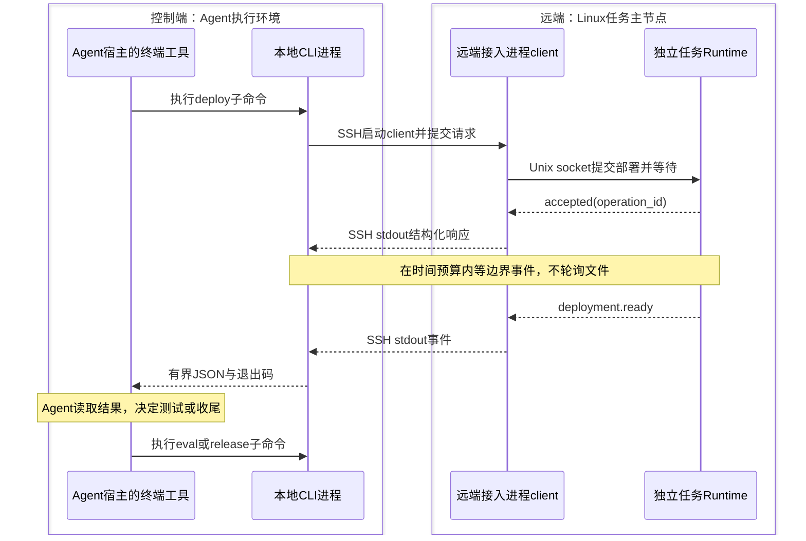

# Deploy and Eval v2 轻量 SSH 事件设计

版本：0.3。日期：2026-11-12。状态：待实现设计，CLI及远端协议尚未联调。

历史基线为 skills/ascend-llm-deploy-eval，提交74a7feffb76c32b23658d37ea681784b3a9b2474。稳定版保持原位置和行为。本文替代0.1的事件平台方案。

## 1 核心方案

Agent通过现有终端/执行工具调用CLI子命令，CLI通过SSH提交工作并等待结构化事件。runtime产生阶段结果后，CLI将有界JSON写到stdout并退出，Agent读取命令结果后选择下一步。SSH持续读输出，不需要反复执行命令查看服务器文件。

首版采用本地CLI与远端每任务一个runtime。技能仍为路由入口加plan、deploy、eval、release四个子技能；代码层以阶段接口为主。



### 1.1 技能源码与安装目录

源码统一放在 `D:\autobenchmark` 仓库。五个技能目录在 `skills/` 下平级，独立包含SKILL.md；“子技能”表示路由职责，不依赖宿主递归发现嵌套技能。统一使用v2名称前缀，避免与稳定版或其他部署技能混淆。早期建议中的deploy-service等短名称在本设计中收敛为下列正式拟用名称。

```text
D:/autobenchmark/
  docs/
    deploy-and-eval-v2-design.md
  skills/
    ascend-llm-deploy-eval/           # 现有稳定版，保持原样
    deploy-and-eval-v2/               # 总入口
      SKILL.md
      references/
        routing.md                  # 意图、阶段结果与下一技能映射
    deploy-and-eval-v2-plan/
      SKILL.md
      references/
        intake-review.md            # 参数保真、默认值、现场取证及审阅
    deploy-and-eval-v2-deploy/
      SKILL.md
      references/
        deployment.md              # 部署前提、服务交付、失败处理
    deploy-and-eval-v2-eval/
      SKILL.md
      references/
        evaluation.md              # 外部服务、负载、数据与结果解释
    deploy-and-eval-v2-release/
      SKILL.md
      references/
        ownership-cleanup.md       # 归属核验、取消和释放证据
  runtime_v2/                       # 独立共享Python包，详见第9节
```

以上为开发交付布局，尚未创建这些子技能。当前已有的 `C:\Users\d00937186\.codex\skills\deploy-and-eval-v2` 是控制端安装目录中的路由草案，不是仓库源码。开发时将其内容按当前设计整理到仓库，后续以仓库版本作为发布源；不要移动或改写历史稳定版。

安装时将五个技能目录平级放入目标Agent的技能目录；当前Codex环境为 `C:\Users\d00937186\.codex\skills`。共享CLI包单独安装到控制端Python环境，提供deploy-eval-v2命令。服务器只发布执行所需的冻结runtime及输入，不要求安装技能说明。每个技能声明所需CLI/协议版本并通过版本检查确认可用性；缺失依赖时明确报告，不隐式切到旧版。

references仅保存该技能专属的规则，CLI协议、Schema和可执行逻辑由共享包维护，避免五份复制。技能按名称发现依赖，安装器校验依赖齐全，不把绝对本机路径写入可分发SKILL.md。各技能可独立调用，但仍执行自身前置检查。

### 1.2 子技能职责与交接

| 正式技能名 | 何时调用 | 输入 | 输出与完成条件 | 边界 |
| --- | --- | --- | --- | --- |
| deploy-and-eval-v2 | 端到端请求或需要选择阶段 | 用户目标、当前task状态 | 选择所需子技能，按边界结果推进，汇总执行/性能/释放 | 不重复子技能细则，不自行执行SSH脚本 |
| deploy-and-eval-v2-plan | 新任务、参数修订；仅测试时只规划测试部分 | 用户需求、参考脚本、只读现场证据、既有服务信息 | plan.json、bindings.json、review.json及摘要；未解决项显式记录 | 不启动容器或测试；审阅通过才进入执行 |
| deploy-and-eval-v2-deploy | 创建已审阅模型服务 | 部署计划、现场绑定、审阅证据 | 调用deploy并等待；交付service_id、服务描述、健康/冒烟证据 | 不自动开始性能测试；失败清理由runtime保障 |
| deploy-and-eval-v2-eval | 测试已部署/外部服务；分析已有结果 | service handle、case配置，或已有结果引用 | 调用eval/read-result；输出请求结果、证据完整性与性能有效性 | 不默认改部署、不释放外部服务；离线分析不启动runtime测试 |
| deploy-and-eval-v2-release | 明确释放、取消后核验或异常收尾 | task/service身份、保留策略、资源归属证据 | 调用release/cancel及查询，输出逐资源状态与未核验项 | 不按名字猜归属，不因取消已接受就报告释放完成 |

路由只加载当前阶段需要的技能。技能调用不是自动创建多个Agent，也不是创建多套协调进程。健康检查、冒烟、预热和缓存检查是相应技能内部步骤；不再细拆成独立技能。wait-event/get-status/read-result属于共享CLI机制，不另建监控技能。

各SKILL.md至少写清触发范围、输入前提、所用CLI命令、关键事件处理、完成证据及失败交接。权限和用户参数跨阶段保留；需要修改语义配置时返回plan生成新修订，不在运行中覆盖冻结参数。

### 1.3 JSON交接原则

保留历史版本以JSON表达需求、绑定、状态及结果的整体思想，但不强制复用旧字段布局。v2可重新组织部署、测试和服务描述，Schema必须包含版本并校验。旧字段迁移映射随代码交付，不能因结构变化丢失用户显式参数、资源归属或证据。

复杂业务配置通过JSON请求文件传递；CLI选项负责文件位置、任务引用、游标及等待控制。子技能交接JSON文件或有摘要的结果引用，不依赖聊天中自然语言摘要恢复准确参数。plan负责需求解释，runtime负责确定性校验；运行中版本冲突返回重新核对。

## 2 短阶段与长阶段

短阶段：deploy/eval/release提交后在调用时间预算内等待关键事件，完成即返回，Agent继续推理。

长阶段：同一接口在wait_ms内未完成就返回RUNNING、operation_id和cursor；Agent调用wait_event继续等待。不另设一套start_deploy协议。

```text
deploy(plan_ref, request_id, expected_version=0, wait_ms=30000)
  → RUNNING, task_id, operation_id, next_cursor
wait_event(task_ref, after_seq=12, wait_ms=30000)
  → EVENTS, deployment.ready, next_cursor=13
eval(service_id, case_id, request_id, expected_version=4, wait_ms=30000)
```

wait_event在远端等待器上阻塞；已有事件立即返回；无事件到期返回WAIT_TIMEOUT，不表示任务失败或取消。默认30秒，范围0—30秒，可按宿主限制缩短。若宿主支持原生异步工具句柄，可再优化，首版不依赖它。

有界等待仍可能产生多次工具调用和模型开销，不承诺完全没有等待成本。改变的是服务端等事件，而非Agent定时SSH扫描文件。工具正在等待期间模型无需反复推理；工具返回超时后，是否继续调用取决于宿主的执行循环。

## 3 进程与通信结构

Agent现有终端/执行工具 → 本地CLI → SSH → 远端client → Unix socket → 每任务runtime。

这里的“本地”是Agent终端工具实际执行命令的控制端，不是模型推理所在机器，也不必是用户笔记本。桌面Agent直接使用本机终端时，CLI可运行在用户Windows电脑；若执行工具位于控制服务器或容器，CLI就安装在那里。控制端必须能访问输入文件并通过SSH连接任务主节点。

| 进程 | 运行位置 | 职责与寿命 |
| --- | --- | --- |
| 本地CLI | Agent的命令执行环境 | 解析参数/请求文件、管理SSH、限制输出；每次调用启动，返回JSON后退出 |
| 远端client | Linux任务主节点 | 由SSH命令启动，转发请求和事件；可随SSH连接结束，不执行部署生命周期 |
| 任务runtime | 同一Linux任务主节点 | 独立运行，管理部署、测试、状态、等待及收尾；跨SSH调用存活 |

时序图中的CLI参与者表示同一CLI程序在多次调用中的逻辑角色，不表示每次命令共用一个常驻本地进程。长阶段wait-event可建立新SSH连接和client，连接原有runtime。client是随runtime包发布的轻量接入程序，不是第二个协调器；多机部署由任务主节点runtime管理其他节点。

runtime负责真实执行；client转发submit/watch/status/cancel，将JSON Lines写到SSH stdout。runtime由受控启动器作为独立进程启动，不绑定SSH会话寿命。SSH断线、client退出或等待超时均不终止部署。

首版优先使用现场已核验的systemd任务单元。启动器必须验证可用性及独立生命周期；不把普通ssh command后台加一个&视为可靠后台服务。环境不支持既定启动方式时明确报错，不静默退回会随连接退出的实现。

一个任务仅一个runtime；多个只读client可连接。副作用命令串行接纳，跨节点仍由主进程SSH协调。不同任务通过主机级资源声明和远端守卫互斥，不能仅靠任务目录锁。

stdout只传协议JSON，stderr传通信诊断，服务与测试日志写文件。禁用PTY；登录banner、坏JSON和超长行作为协议错误，不当成事件。

## 4 最小持久化

```text
TASK/
  plan.json
  bindings.json
  review.json
  state.json
  service.json
  events.jsonl
  commands/REQUEST_ID.json
  operations/OPERATION_ID.json
  scripts/
  logs/
  results/
  .runtime/task.lock
  .runtime/control.sock
  .runtime/identity.json
```

events.jsonl是单写入者维护的状态变更日志，包含恢复所需的状态增量；state.json是可重建快照。先追加完整事件并flush/fsync，再原子替换快照，最后通知等待器。重启先重放日志，不因快照落后丢失状态。

末尾半条JSON由恢复程序持有独占锁后修复并保存诊断；中间损坏进入RECOVERY_REQUIRED。commands是可从command.accepted重建的幂等索引；索引缺失不代表命令没执行。产物先完成写入及摘要，再发布结果引用。

仅保存关键事件，不保存逐token更新或每次健康探测。首版暂不做历史压缩；完整日志单独保存，等待连接不承担日志归档。

## 5 CLI接口

以下是CLI子命令及其内部参数，不是需要宿主注册的新工具。统一入口为deploy-eval-v2；未安装入口时可用python -m deploy_eval_v2。命令名使用连字符，JSON字段保留下划线。task_ref通过配置解析主机别名及允许根目录，不直接拼接模型提供的shell命令。

| 接口 | 参数 | 行为 |
| --- | --- | --- |
| deploy | task_ref、plan_ref、request_id、expected_version、wait_ms | 核验冻结计划和审阅摘要，提交部署并有界等待 |
| eval | task_ref、service_id、case_id、request_id、expected_version、wait_ms | 核验服务与负载，提交测试 |
| release | task_ref、service_id、request_id、expected_version、wait_ms | 释放本任务拥有的资源 |
| wait_event | task_ref、after_seq、wait_ms、limit | 补读持久事件并等待新边界；limit默认及上限均为10，同时受返回字节上限约束 |
| get_status | task_ref | 当前状态、版本、操作、服务和结果索引 |
| cancel | task_ref、scope、operation_id、request_id、expected_version | scope为task或operation，接受后执行收尾 |
| read_result | task_ref、artifact_ref、offset、max_bytes | 有界读取结果/日志，默认返回预算8KiB，显式扩大时上限32KiB，均包含JSON封装 |

plan_ref引用冻结输入包及摘要；首次创建expected_version=0。已有任务目录只允许匹配身份的连接和恢复，不能覆盖产物。支持外部服务直接eval：在计划中登记endpoint、model、测试绑定和授权，不要求先deploy，也不因此获得reset或release权限。

### 5.0 命令行调用契约

```sh
deploy-eval-v2 deploy --request deploy-request.json
deploy-eval-v2 wait-event --task-ref task-1 --after-seq 12 --wait-ms 30000
deploy-eval-v2 get-status --task-ref task-1
deploy-eval-v2 eval --request eval-request.json
deploy-eval-v2 release --request release-request.json
deploy-eval-v2 cancel --request cancel-request.json
deploy-eval-v2 read-result --task-ref task-1 --artifact-ref results/eval.json --max-bytes 8192
```

副作用命令使用UTF-8请求文件传递表内字段，避免跨PowerShell/Bash的JSON转义问题；请求文件不嵌入SSH密码等秘密。查询命令用命名参数。远端client与runtime之间可流式JSONL；本地CLI对Agent默认只输出一份最终JSON，不转发中途进度流。不默认打印banner、彩色日志或重复提示。

退出码：0表示命令成功提交/查询/等待，RUNNING和WAIT_TIMEOUT均可返回0；2表示输入或状态冲突；3表示通信失败或结果不明；4表示返回了已确认的操作失败。详细原因以JSON为准。Agent不能仅凭退出码0判断部署或测试成功，必须读取status、event和业务结果字段。解析错误也尽量返回ERROR JSON；进程被强杀无JSON时按结果未知处理。

CLI等待预算应短于宿主命令超时并为SSH建立/退出预留余量。宿主如返回本地进程句柄，应先等待同一个CLI完成，不能误以为未提交而再次deploy。关闭等待CLI只关闭观察，业务取消必须显式调用cancel子命令。

统一响应示例：

```json
{
  "protocol_version": "1.0",
  "status": "RUNNING",
  "task_id": "task-1",
  "operation_id": "op-deploy-1",
  "task_version": 2,
  "next_cursor": 3,
  "has_more": false,
  "events": [],
  "result_ref": null
}
```

status为EVENTS/RUNNING/WAIT_TIMEOUT/ERROR。错误结构为code、message、retryable；错误码包括INVALID_INPUT、STALE_VERSION、REQUEST_CONFLICT、RESOURCE_BUSY、UNKNOWN_OUTCOME、RECOVERY_REQUIRED、SSH_UNAVAILABLE、TRANSPORT_PROTOCOL_ERROR、CURSOR_INVALID。通信失败不推断为业务失败。

request_id是持久命令幂等键。同键同内容返回原operation，同键不同内容拒绝。先查幂等记录再检查expected_version，避免响应丢失后的重试被旧版本误拒绝。新命令以版本比较更新状态；冲突时Agent重读事实再决策，不能盲目替换版本重发。

### 5.1 输出与上下文预算

执行和等待工具默认只向Agent返回简短结构化摘要：任务/操作身份、UTC时间、事件类型、状态、游标、简短结论及证据位置。失败增加error_code和有界原因；完整traceback保留在日志。证据位置使用可解析的artifact_ref，或同时提供host和path，不能仅给多节点含义不清的路径。

普通工具响应按最终UTF-8 JSON序列化大小限制为8KiB；summary及错误摘要合计不超过1KiB，每批最多10个关键事件，先达到字节或数量限制即分页。日志读取默认同为8KiB；显式扩大可至32KiB，仍包含JSON元数据及转义开销。read_result可按尾部、行号区间或关键词定位，定位模式互斥，返回实际范围和续读位置。

实现必须满足以下三点：

1. 源头分流。模型、代理及AISBench的stdout/stderr直接写日志文件，SSH stdout只走协议。工具以有界缓冲解析，stderr诊断也只保留有界尾部，不先无限capture_output再截断。超长行中止该通信读取并返回协议错误，任务继续状态需另行核验。
2. 显式分页或截断。事件列表用has_more和next_cursor分页，日志片段用truncated、next_offset及实际范围标识；不能截断原始JSON文本。单个事件超过Agent返回预算时保留身份、类型、时间、状态及必要决策字段，将详细data外置为artifact_ref，并标记details_externalized。必要字段本身无法容纳时报告协议错误，不能漏掉终态或静默推进游标。日志offset为原文件字节位置，正确处理UTF-8边界。
3. 控制累计上下文。WAIT_TIMEOUT仅带task/operation身份、时间、状态和安全游标，不重复配置、服务描述或历史事件。进度在工具内部合并，不逐条进入模型；后续按游标只返回增量。Agent按错误码和阶段读取一次必要证据，避免循环重复粘贴相同日志；相同请求重试可能重放同一事件，依靠身份及幂等处理，不能为压缩上下文丢弃未处理边界。

预算在实际工具结果封装后核验；若框架额外附加包装，适配器预留相应空间。持久事件的内部上限与Agent可见摘要上限分开，不能直接把16KiB内部事件原样返回到8KiB工具响应。

## 6 事件定义

```json
{
  "protocol_version": "1.0",
  "task_id": "task-1",
  "seq": 12,
  "task_version": 4,
  "operation_id": "op-deploy-1",
  "type": "deployment.ready",
  "time": "2026-11-12T03:00:00Z",
  "data": {
    "service_id": "svc-1",
    "endpoint": "http://node-a:18000",
    "model": "model-a",
    "evidence_ref": "results/deploy-1.json"
  }
}
```

以上字段必填；任务级operation_id可为null。唯一标识为task_id+seq，重传不改序号。seq每事件递增；task_version只在影响决策的状态变更时增加。时间UTC；未知主版本拒绝，未知事件类型保留但不自动执行。单事件上限16KiB，完整证据放产物。

| type | data关键字段 | Agent处理 |
| --- | --- | --- |
| command.accepted | request_id、request_hash、operation_id、kind | 记录句柄继续等 |
| phase.changed | phase、简短进度 | 工具内处理，不默认结束等待 |
| deployment.ready | service_id、endpoint、model、evidence_ref | 查当前状态，选测试、保留或释放 |
| evaluation.completed | case_id、result_ref、execution_status、performance_validity | 选下一case、分析或收尾 |
| operation.failed | phase、error_code、evidence_ref、cleanup_status | 看证据后按计划决定 |
| release.completed | service_id、resource_results_ref | 核验释放并汇总 |
| release.unverified | service_id、resource_results_ref、reason | 停止资源复用 |
| operation.cancelled | cleanup_status、evidence_ref | 取消不等于释放成功 |
| task.expired | reason、cleanup_status | 记录保留期限到期处理 |
| runtime.recovery_required | reason、resource_refs | 核验现场，不重放任务 |

ready只在健康、冒烟和部署证据保存后产生。evaluation.completed表示阶段结束，不等于性能有效；结果独立记录execution_status、evidence_status、performance_validity。请求成功却没有有效稳态窗口可为SUCCEEDED+UNVERIFIED。

watch默认在阶段边界结束等待。进度可以内部消费并推进游标，但next_cursor不能越过尚未返回的边界。工具结果丢失后用原after_seq补读。序号超出历史或属于其他任务返回CURSOR_INVALID，不默默跳到最新位置。

## 7 Agent策略联动

```text
边界事件作为工具结果返回
  → get_status核对当前事实
  → 必要时read_result
  → 按用户目标与冻结计划选择下一阶段
  → eval/release等命令，携带request_id和expected_version
```

首版不设置额外decide API；下一个阶段命令就是决策。runtime校验状态、版本、参数、归属及阶段约束。对同一前序状态只允许一次有效后继转移，避免重复事件导致不同request_id启动两轮测试。

一次eval默认一个case，Agent可在case间选择。已授权固定case批次可一次执行，批次内部不等Agent随意改参数。禁止为缩短验证静默减少请求数、降载或改端口。

仅部署可成功结束并保留服务。端到端任务在阶段间等待下一命令，计划中明确idle_timeout_seconds及到期动作；建议展示默认等待900秒后释放自有服务，用户明确保留时尊重该选择。runtime持有资源时继续存活，执行期限及收尾，不依赖Agent在线。

## 8 等待实现及恢复

远端watch用condition/event结合持久事件序号实现。历史读取与等待注册处于同一锁下；condition等待释放锁。真正网络输出在锁外执行，慢SSH客户端不阻塞状态变更。已完成事件先返回，不先睡眠。

```python
async def watch(after_seq, timeout, limit):
    async with condition:
        if not journal.has_boundary_after(after_seq):
            try:
                await wait_for(
                    condition.wait_for(
                        lambda: journal.has_boundary_after(after_seq)),
                    timeout=timeout)
            except TimeoutError:
                return timeout_response(journal.safe_cursor(after_seq))
        return event_response(journal.read_boundaries_after(after_seq, limit))
```

这是接口级伪代码；safe_cursor只能跨越已内部处理的非决策进度。watch不删除历史、不取得唯一消费权。runtime重启从journal恢复计数，client用原游标补读。

本地工具异步读取SSH stdout，校验最大行长、返回总量、protocol_version和task_id。SSH失败保留task/operation/cursor，重连补读；不重新生成任务或猜测命令未执行。

通信空闲可配置SSH keepalive，它不触发模型推理，也不是业务健康检查。每次wait可以新建SSH，之后再按需增加连接复用；独立runtime不依赖某条连接永久存活。

## 9 代码模块与旧版迁移

```text
runtime_v2/
  pyproject.toml       # 定义deploy-eval-v2命令及包依赖
  src/deploy_eval_v2/  # Python包，支持python -m deploy_eval_v2
    __init__.py
    cli.py              # argparse入口、子命令、JSON输出和退出码
    __main__.py         # python -m deploy_eval_v2入口
    ssh_transport.py    # SSH生命周期和JSONL解析
    remote_client.py    # SSH内执行，转发Unix socket
    launcher.py         # 独立runtime启动、定位、禁止重复
    task_runtime.py     # 状态机、命令接纳、调度、等待期限
    event_journal.py    # 事件持久化、恢复、条件通知
    compiler.py         # 冻结配置、脚本、摘要和审阅核验
    deploy.py          # 部署、依赖、健康、冒烟
    evaluate.py        # 测试及证据
    release.py         # 资源归属和释放
    remote_guard.py    # 远端命令、进程组、取消
    schemas/           # request/response/event/service/result
  tests/             # 协议、恢复、阶段验收
```

以上均为拟建模块。旧run.py的生成逻辑迁入compiler，生命周期迁入task_runtime和阶段模块；topology、container_baseline、mount_profiles等冻结版本迁移，不导入稳定版可变内部代码。review_job保留只读取证，bundle_distribution/remote_node/shared_storage保留分发和共享核验。

aisbench_cli、test_evidence、validate_case、cache_reset、metric_evidence用于evaluate，输入改为service handle+case，不依赖deploy私有dispatch.json。退役run_task/case_runner不作为新协议基础。旧watch_events留给稳定版；新事件直接从状态变更处产生。

service handle至少包含service_id、endpoint、model、ownership、部署摘要、健康证据时间及保留策略。测试前重新核验健康。外部服务未知配置记未知，不伪造部署证据。

## 10 必要执行保障

部署顺序：输入核验→资源声明→分发→占用检查→全部容器创建→全部依赖检查→模型/代理启动→健康→冒烟。保持代理门控、挂载可见性、完整KV与参考参数保真。

测试顺序：服务健康→工具/数据核验→显式缓存操作→预热→正式测试→客户端清理→结果核验。普通请求数默认并发×4、稳态×10，显式值优先。合成长度偏差记录，不擅自判失败。

资源归属含任务身份、容器标记和远端命令记录，不按PID或名称猜测。同服务测试与释放互斥；跨任务资源锁有效。部署部分失败自行释放已归属资源；eval失败先停止客户端，服务按任务策略处理。

取消控制真实远端进程组或已归属容器。task取消禁止后续阶段，operation取消只针对指定操作；接受取消不代表完成。各SSH/HTTP调用使用阶段剩余时间，避免单次超时累加突破总deadline。

命令持久化后、外部副作用完成前崩溃可能导致结果不明。远端守卫保存command_id和执行证据，恢复先核验资源，未知则RECOVERY_REQUIRED，不能重跑部署。独立进程不保证主机断电后的自动恢复或跨节点即时释放。

## 11 宿主边界和可选扩展

首版要求宿主能够执行本地CLI并读取退出码和stdout。需要实测现有终端/执行工具的单次超时、返回大小、连续等待和取消行为。CLI正常输出不能保证宿主在回合结束后自动继续。

| 场景 | 行为 |
| --- | --- |
| Agent正在等工具 | 边界事件作为结果返回，Agent继续决策 |
| 等待超时且Agent仍执行 | 用原task/cursor再次wait |
| SSH断线 | runtime继续，重连补读 |
| Agent已结束回合或关闭客户端 | 保留结果，重新进入后恢复；不保证自动唤醒 |
| 需要离线自动选择下一阶段 | 另接宿主事件/会话能力 |

将来如需关闭聊天后的自动续跑，再单独设计宿主接入；不作为本次开发工作。

## 12 验收和实施顺序

先用fake runtime验证SSH事件与工具返回，再接真实阶段。必须看到Agent实际调用后续工具，不能以终端打印JSON判闭环成功。

| 用例 | 通过条件 |
| --- | --- |
| 短阶段 | deploy收到ready后Agent按计划调用eval |
| 长阶段 | RUNNING后wait收到边界续跑，无服务器文件轮询 |
| 等待超时 | WAIT_TIMEOUT不改变远端执行状态 |
| SSH断线 | 任务存活并按seq补读 |
| 重复事件/命令 | 同request同operation；同前序状态无重复后继 |
| 乱序旧事件 | 不对已释放服务启动测试 |
| 提交响应丢失 | 原request查到既有操作，无重复容器 |
| runtime崩溃 | journal恢复或明确要求核验，不盲目重跑 |
| 取消/部分失败 | 自有客户端和资源按策略收尾 |
| Agent离线 | 当前阶段继续，等待期限及保留策略正确执行 |
| 外部服务 | 不自动清缓存、停止或重启 |
| 协议异常 | banner、坏JSON和超长行不被当成成功事件 |
| 大量输出 | 大日志直接落盘，工具内存有界；stderr洪泛同样受控 |
| 输出预算 | 对中文、JSON转义和超长错误按序列化UTF-8字节计量，普通响应≤8KiB，显式日志扩读≤32KiB |
| 分页与截断 | 多边界事件和大详情无静默丢失；续读不跳过未交付边界；JSON始终完整 |
| 累计上下文 | 连续等待超时不重复历史和配置；异常按范围读取，不重复输出整份日志 |

实施顺序：协议及fake闭环→外部端点独立eval→deploy/release与资源保障→真实小负载端到端→有确切需求再接宿主唤醒。

本版不建设数据库、订阅网关、bridge/inbox/outbox或专门decide API；保留事件落盘、幂等、版本校验、断线恢复和独立收尾。该方案减少Agent查询服务器的需求，但不会消除runtime自身必要的健康检查。
