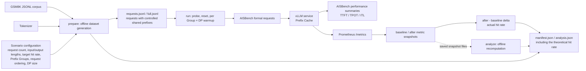

# Variable-Length and Specified Prefix Cache Hit-Rate Dataset Generation/Benchmarking and Multimodal Dataset Generation

## Overview

The AISBench Prefix Cache plugin generates variable-Length and specified prefix pache hit-rate datasets and runs the benchmarks. It can generate two kinds of datasets:

- **Pure-text datasets**: support controllable variable-length input/output distributions, shared-prefix ratios, Prefix Group assignment, and request ordering, with a specifiable global theoretical Prefix Cache hit rate (for example, 60%); the generated requests carry controllable shared prefixes.
- **Multimodal datasets**: generate multimodal requests with fixed image scenarios based on MMMU images (one 1080P image, or five 720P images); see [Multimodal Dataset Generation and Benchmarking](#multimodal-dataset-generation-and-benchmarking).

Both kinds first compute the theoretical Prefix Cache hit rate offline; `run` then collects the actual hit rate through AISBench and vLLM for comparison. It evaluates how input lengths, shared-prefix ratios, Prefix Groups, request ordering, and multiple DP ranks behind one endpoint affect cache hits.

The overall workflow: samples are selected from the GSM8K corpus according to the Scenario configuration and, together with the tokenizer, are turned offline into requests with controllable shared prefixes along with a theoretical hit rate; `run` sends the requests to vLLM for the benchmark; finally, the difference between the Prometheus metrics captured before and after the benchmark yields the actual hit rate, which is compared against the theoretical value:



The plugin provides five subcommands:

| Command | Purpose |
|---|---|
| `inspect` | Preview the scenario configuration, reachable hit-rate range, and length distributions. |
| `prepare` | Generate formal requests, a Manifest, and theoretical analysis. |
| `validate` | Detect modified, truncated, reordered, or inconsistent artifacts. |
| `run` | Probe and reset the service, warm every group on every DP rank, and run the formal AISBench benchmark. |
| `analyze` | Recompute actual hit rates offline from two Prometheus snapshots. |

***

## Prerequisites

1. **Python 3.10 or later**.
2. **An AISBench checkout whose dependencies can be imported**.
3. **The same tokenizer as the target vLLM server**. A mismatch changes token counts, Block boundaries, and the theoretical hit rate.
4. **A JSONL corpus**. Every non-empty line must be a JSON object containing the text field selected by `corpus.field`; the default is the `question` field of the GSM8K dataset. To use a GSM8K-like corpus, follow the GSM8K format.
5. **The correct Prefix Cache Block size**. `tokenizer.block_size` must match the target server.
6. **Service capabilities for online** **`run`**: `/v1/completions`, `/metrics`, optionally `/reset_prefix_cache`; multi-DP additionally requires `X-data-parallel-rank` routing and per-DP metrics with an `engine` label.

***

## Installation

The following commands assume that the current directory is the AISBench repository root.

**Dataset generation only**: when using only the offline commands `inspect`, `prepare`, `validate`, and `analyze`, installing the plugin itself is sufficient:

```shell
conda create --name ais_bench python=3.10 -y
conda activate ais_bench
pip3 install -e ./plugins/prefix_cache
```

**Online benchmarking**: `run` starts AISBench in `perf` mode, so first install AISBench and its service-benchmark dependencies following the [AISBench installation guide](../get_started/install.md) (a Conda environment is recommended):

```shell
pip3 install -e ./ --use-pep517
pip3 install -r requirements/api.txt
pip3 install -r requirements/extra.txt
ais-bench-prefix-cache --help
```

The editable (`-e`) installs normally make source changes available without reinstalling the packages.

***

## Quick Start

Copy the example Scenario:

```shell
cp ./plugins/prefix_cache/config_examples/scenario.example.json ./scenario.json
```

At minimum, review `tokenizer.path`, `tokenizer.block_size`, and `corpus.path`. When modeling cold multi-DP routing or producing a warmup plan, also set `service.dp_size` to the number of DP ranks on the target server. Before an online benchmark, also review the service URLs, `service.model`, and `aisbench.config`.

A minimal example. This example generates a pure-text Prefix Cache dataset:

- 100 formal requests, each with a fixed input of 1024 tokens and at most 32 output tokens; natural suffixes are randomly selected from the GSM8K corpus by seed;
- All requests belong to one Prefix Group and are sent in interleaved order;
- The target global theoretical Prefix Cache hit rate is 60% in `warmup` mode; `run` first warms the cache per `Prefix Group × DP rank` before the formal benchmark;
- The target service is a single HTTP endpoint with 2 internal DP ranks.

```json
{
  "schema_version": "1.0",
  "run": {
    "run_id": "gsm8k-prefix-cache-60",
    "random_seed": 42,
    "output_dir": "./outputs/gsm8k-prefix-cache-60"
  },
  "tokenizer": {
    "path": "/path/to/tokenizer",
    "block_size": 16
  },
  "corpus": {
    "path": "./GSM8K.jsonl",
    "field": "question",
    "selection": {"mode": "random"}
  },
  "requests": {
    "count": 100,
    "input_length": {"mode": "fixed", "value": 1024},
    "output_length": {"mode": "fixed", "value": 32}
  },
  "prefix_cache": {
    "mode": "warmup",
    "target_hit_rate": 0.6,
    "seed_blocks": 1,
    "groups": {"count": 1, "assignment": {"mode": "uniform"}},
    "order": {"strategy": "interleave"}
  },
  "service": {"dp_size": 2}
}
```

The meaning of each field in this example:

| Field | Description |
|---|---|
| `run.run_id` | Task name; a timestamp is appended automatically at execution. |
| `run.random_seed` | Global seed for generation and random selection; identical configurations are reproducible. |
| `run.output_dir` | Base directory for Prefix Cache artifacts. |
| `tokenizer.path` | Tokenizer path; must match the target vLLM server. |
| `tokenizer.block_size` | Prefix Cache Block size; must match the actual server value. |
| `corpus.path` / `corpus.field` | Path to the GSM8K JSONL corpus and the question text field. |
| `corpus.selection.mode` | Corpus selection mode; `random` shuffles deterministically by seed. |
| `requests.count` | Total number of formal requests. |
| `requests.input_length` | Input-token length rule; fixed at 1024 tokens in this example. |
| `requests.output_length` | Maximum output-token length rule; fixed at 32 tokens in this example. |
| `prefix_cache.mode` | Cache mode: `cold` or `warmup`; `warmup` in this example. |
| `prefix_cache.target_hit_rate` | Requested global Prefix Cache hit rate. |
| `prefix_cache.seed_blocks` | Number of Blocks used by each unique seed. |
| `prefix_cache.groups` | Prefix Group count and assignment rule; one group, uniformly assigned, in this example. |
| `prefix_cache.order.strategy` | Formal request ordering strategy; interleaved in this example. |
| `service.dp_size` | Number of DP ranks inside one instance. |

See [Scenario Configuration](#scenario-configuration) below for the complete parameter reference. Multimodal benchmarking additionally requires a `multimodal` section; see [Multimodal Dataset Generation and Benchmarking](#multimodal-dataset-generation-and-benchmarking).

Run the recommended workflow in order:

```shell
ais-bench-prefix-cache inspect --scenario ./scenario.json
ais-bench-prefix-cache prepare --mode text --scenario ./scenario.json
ais-bench-prefix-cache validate --manifest \
  ./outputs/gsm8k-prefix-cache-60_<timestamp>/result/gsm8k-prefix-cache-60_<timestamp>.manifest.json
ais-bench-prefix-cache run --scenario ./scenario.json
```

What each command does:

- `inspect`: offline preview of the scenario configuration, the reachable range of the theoretical hit rate, and length distributions; generates no formal artifacts and contacts no service.
- `prepare --mode text`: offline generation of the formal request data with controllable shared prefixes, plus the Manifest and theoretical analysis artifacts.
- `validate`: checks whether existing artifacts were manually edited, truncated, reordered, or built with the wrong version; the timestamped directory in the manifest path is available from the `manifest` field of the `prepare` output JSON.
- `run`: connects to vLLM and executes the online benchmark — probe, reset, per-group per-DP warmup, then the formal AISBench requests — collecting the actual hit rate and performance metrics such as TTFT/TPOT/ITL.

See [Command Reference](#command-reference) for detailed usage.

***

## Command Reference

### `inspect`: Check configuration and theoretical range

```shell
ais-bench-prefix-cache inspect --scenario ./scenario.json
```

This command:

- parses the Scenario and builds only the length, Group, order, cold-DP route, and theoretical shared-prefix plan; it does not load the tokenizer/GSM8K or construct prompts;
- displays the requested / effective / theoretical hit rates, group distribution, input/output length summaries, and cold DP routing;
- never contacts vLLM and sends no requests.

Here, `requested` is the hit-rate target requested by the Scenario, `effective` is the nearest reachable target selected by the solver, and `theoretical` is the value simulated in final send order.

Every `inspect` creates a new `_YYYYMMDD_HHMMSS` timestamp directory. Its artifacts are:

- `output_dir_<timestamp>/log/<run_id>_<timestamp>.inspect.log`: detailed log;
- `output_dir_<timestamp>/result/<run_id>_<timestamp>.manifest.json`: lightweight Manifest with `status="inspected"` and the summary under `inspect.summary`;
- a JSON summary on stdout with the main fields listed below.

| Field | Description |
|---|---|
| `run_id` | Scenario task name before timestamping. |
| `mode` | `cold` or `warmup` mode. |
| `requested_target_hit_rate` | Hit rate requested by the user. |
| `effective_target_hit_rate` | Nearest reachable target hit rate. |
| `theoretical_hit_rate` | Predicted theoretical hit rate. |
| `reachable_min` / `reachable_max` | Minimum/maximum globally reachable hit rate. |
| `target_reachable` | Whether the target is inside the reachable range. |
| `trajectory` | Solver strategy, trajectory status (`PASS`/`BEST_EFFORT`), and issue list. |
| `group_reachability` | Reachable range of every Group. |
| `groups` | Request count for every Group. |
| `input_tokens` / `output_tokens` | Length statistics and total token count. |
| `dp_route_counts` | Formal request count for every DP rank. |
| `sends_requests` | Whether online requests are sent; always `false` for inspect. |
| `planning_only` | Always `true`; inspect performs configuration-level theoretical planning only. |
| `content_validation_deferred_to_prepare` | Always `true`; corpus, canonical-prefix, and tokenizer round-trip validation is deferred to prepare. |
| `log` / `manifest` | Paths to the log file and the inspect Manifest. |

Subsequent `prepare` / `run` invocations can reuse the same timestamp directory through the matching Manifest.

Large cold scenarios use a near-linear lane construction per `(Prefix Group, DP rank)`, making cumulative hit rate rise smoothly to the exact effective target. Small irregular cases retain bounded beam search. If exact target and monotonic trajectory are mathematically incompatible, the result is marked `BEST_EFFORT` and only warns.

### `prepare`: Generate formal artifacts

```shell
ais-bench-prefix-cache prepare --mode text --scenario ./scenario.json
```

- `--mode`: required. `text` generates text-benchmark data; `mm` generates multimodal data (see [Multimodal Dataset Generation and Benchmarking](#multimodal-dataset-generation-and-benchmarking) and [MULTIMODAL.md](../../../plugins/prefix_cache/MULTIMODAL.md)).
- `--scenario`: path to the Scenario file.
- `--overwrite`: optional. Replaces only the artifact files of this run inside the current timestamp directory; it does not clear the entire output directory.

`prepare` deterministically generates and validates four files:

- `result/<run_id>_<timestamp>.full.jsonl`
- `result/<run_id>_<timestamp>.requests.jsonl`
- `result/<run_id>_<timestamp>.manifest.json` (`status="prepared"`)
- `result/<run_id>_<timestamp>.analysis.json` (`status="prepared"`)

Prompt-generation progress is shown on stderr, and the final result JSON is printed on stdout:

```text
Generate prompts [###############---------------] 50/100  50%
Generate prompts [##############################] 100/100 100%
{"full":"...","requests":"...","manifest":"...","analysis":"...","log":"..."}
```

For example, with `run_id: gsm8k-prefix-cache-60` and `output_dir: ./outputs/gsm8k-prefix-cache-60`, the actual directory is:

```text
./outputs/gsm8k-prefix-cache-60_20260825_123456/
├── log/
│   └── gsm8k-prefix-cache-60_20260825_123456.prepare.log
└── result/
    ├── gsm8k-prefix-cache-60_20260825_123456.full.jsonl
    ├── gsm8k-prefix-cache-60_20260825_123456.requests.jsonl
    ├── gsm8k-prefix-cache-60_20260825_123456.manifest.json
    └── gsm8k-prefix-cache-60_20260825_123456.analysis.json
```

`prepare` discovers the most recent `inspected` Manifest matching the current Scenario SHA-256 and upgrades it in place to a formal `prepared` Manifest; otherwise it creates a new timestamp. Changing the Scenario automatically invalidates old Manifests and creates a new timestamp, so normal workflows never require manually renaming `run_id` or `output_dir`.

### `validate`: Validate existing artifacts

```shell
ais-bench-prefix-cache validate --manifest \
  ./outputs/gsm8k-prefix-cache-60_<timestamp>/result/gsm8k-prefix-cache-60_<timestamp>.manifest.json
```

- `--manifest`: path of the Manifest to validate; the validation logic selects text/mm automatically from the Manifest's `benchmark_mode`.

Without generating data or contacting vLLM, this checks that:

- Manifest, full, and requests row counts agree;
- `sequence_index` is contiguous;
- requests contain exactly `question`, `answer`, and the optional field selected by `output.output_key`;
- requests and full rows correspond one-to-one;
- full and requests SHA-256 values match the Manifest.

It detects manual edits, truncation, reordering, or the wrong artifact version. Stdout prints `ok`, `rows`, and `run_id`; the detailed log is written to `log/<run_id>_<timestamp>.validate.log` inside the Manifest's timestamp directory.

### `run`: Execute a vLLM Prefix Cache benchmark

```shell
ais-bench-prefix-cache run --scenario ./scenario.json
ais-bench-prefix-cache run --scenario ./scenario.json --config ./my_prefix_cache_perf.py
```

- `--scenario`: supplies dataset construction, service, validation, and AISBench settings.
- `--config`: optional, text mode only; temporarily overrides the AISBench Python config template for this invocation without modifying the Scenario.

`run` requires an existing matching `prepared` Manifest (that is, run `prepare` first); it detects the text/mm mode automatically and reuses the artifacts of the same timestamp. The complete flow is:

1. validate the artifacts of this timestamp;
2. probe every DP rank; multi-DP requests use `X-data-parallel-rank` for deterministic routing;
3. reset the Prefix Cache; if `reset_url` is missing or reset fails, execution continues with a warning only when `service.assume_empty_cache=true`;
4. in warmup mode, warm every `Prefix Group × DP rank` according to `warmup.plan` in the Manifest;
5. capture the baseline, render the Scenario's AISBench settings into a temporary Python configuration, and start AISBench in `perf` mode; during the run, KV Cache usage is sampled every `service.poll_interval_seconds` (set to `0` to disable);
6. capture the after snapshot, compute per-DP and global actual hit rates from `after - baseline`, and write `runtime`, `actual`, theory/actual differences, and warnings back to the analysis.

Artifacts include:

- `log/<run_id>_<timestamp>.run.log`: plugin phase logs, not echoed to the terminal;
- `result/<run_id>_<timestamp>.analysis.json`: gains `runtime`, `actual`, and difference fields, with `status="complete"`;
- AISBench child results: written to `aisbench.work_dir` (`./outputs/default` by default), with TTFT/TPOT/ITL performance summaries under `performances/<model-abbr>/`; view them with `ais-bench-prefix-cache report --manifest <manifest-path>`;
- stdout: an AISBench-style result heading, followed by a two-column `Prefix Cache Metric | Value` table showing the overall target, theoretical, and actual hit rates plus the theory/actual and theory/target differences, and finally the path of the complete analysis.

Additional notes:

- Formal requests use vLLM SSE streaming by default (`aisbench.model.stream=true`), producing TTFT, TPOT, ITL, E2EL, and throughput metrics. With `false`, the Prefix Cache hit rate still works, but complete TTFT, TPOT, and ITL metrics are unavailable.
- Plugin warmup and AISBench's own `--num-warmups` are independent mechanisms. To ensure only formal requests occur after the baseline, set `"extra_args": {"--num-warmups": 0}` in the Scenario (the example Scenario already defaults to this).
- Multi-DP uses one HTTP endpoint and requires `X-data-parallel-rank` routing plus per-DP Prometheus metrics with an `engine` label.

### `analyze`: Recompute from Prometheus snapshots offline

```shell
ais-bench-prefix-cache analyze \
  --manifest <manifest-path> \
  --baseline ./baseline.prom \
  --after ./after.prom
```

- `--manifest`: a prepared Manifest; the command first validates artifact integrity, then reads `dp_size`, `engine_label_map`, and warning thresholds from `effective_config.service`.
- `--baseline`: complete Prometheus text captured before the formal measurement window.
- `--after`: complete Prometheus text captured after the window. Queries/hits are cumulative counters, so after values must not be lower than baseline.

This command does not connect to vLLM or launch AISBench. It parses the two snapshots, computes per-DP deltas, aggregates the actual hit rate, compares it with the theoretical value, and writes `status="analyzed"` back to the analysis artifact indexed by the Manifest; stdout prints the complete analysis JSON. Plugin logs are written to `log/<run_id>_<timestamp>.validate.log`.

`baseline.prom` and `after.prom` are not dataset files created by `prepare`; they are complete text snapshots of the same vLLM service's `/metrics` endpoint taken around the formal measurement window. For manual collection, finish reset first and, in warmup mode, finish plugin warmup. Capture the baseline before the first formal request and the after snapshot immediately after the last one:

```shell
METRICS_URL="http://127.0.0.1:8000/metrics"
curl -fsS "$METRICS_URL" -o baseline.prom
# Run the formal workload here; do not restart vLLM or reset metrics.
curl -fsS "$METRICS_URL" -o after.prom
```

Both snapshots must come from one service process and cover every DP rank; multi-DP metrics must retain their `engine` labels. A normal `run` already captures both time points and embeds the raw text in the analysis at `runtime.metrics_baseline.raw_prometheus` and `runtime.metrics_after.raw_prometheus`. Export them when an offline pass is needed:

```shell
ANALYSIS="./outputs/<timestamped_run_id>/result/<timestamped_run_id>.analysis.json"
jq -r '.runtime.metrics_baseline.raw_prometheus' "$ANALYSIS" > baseline.prom
jq -r '.runtime.metrics_after.raw_prometheus' "$ANALYSIS" > after.prom
```

`analyze` is intended for historical verification, reprocessing after parser changes, externally driven workloads, and CI checks; a successful `run` has already performed the same online delta analysis.

***

## Scenario Configuration

See the [complete Scenario field reference](../../../plugins/prefix_cache/config_examples/scenario.example_en.md). The Scenario uses a strict whitelist: unknown fields are rejected, and omitted fields fall back to the example defaults.

| Configuration path | Brief description |
|---|---|
| `schema_version` | Scenario configuration format version; defaults to `"1.0"`, currently the only allowed value. |
| `run` | Task identity, randomness, and output controls. |
| `run.run_id` | Task name, e.g. `"gsm8k-prefix-cache-60"`; a timestamp is appended at execution and used as the filename prefix of the four artifacts. |
| `run.random_seed` | Global seed for generation and random selection, e.g. `42`; controls corpus selection, length sampling, group assignment, ordering, and unique seeds; identical configurations are reproducible. |
| `run.output_dir` | Base directory for Prefix Cache artifacts, e.g. `"./outputs/gsm8k-prefix-cache-60"`; a timestamp is appended to the last directory name at execution. |
| `run.overwrite` | Whether existing formal artifacts may be overwritten; defaults to `false`; rebuild with `prepare --overwrite`. |
| `tokenizer` | Tokenizer loading and Block configuration. |
| `tokenizer.path` | Tokenizer model or directory path, e.g. `"/home/weights/Qwen3.6-27B"`; passed to `AutoTokenizer.from_pretrained` and must match the vLLM server. |
| `tokenizer.block_size` | Prefix Cache Block size in tokens, e.g. `16`; shared prefixes and seeds are aligned to it and it must match the actual server value. |
| `tokenizer.revision` | Tokenizer branch, tag, or commit used to pin a version; defaults to `null`. |
| `tokenizer.trust_remote_code` | Whether to run custom tokenizer code from the model repository; defaults to `false`; enable only for trusted repositories. |
| `corpus` | Natural-suffix corpus configuration. |
| `corpus.path` | Path to the JSONL corpus, e.g. `"./GSM8K.jsonl"`; the format must match GSM8K. |
| `corpus.field` | JSONL field containing question text, defaults to `"question"`; only this field is used and the standard answer is not concatenated. |
| `corpus.selection` | Corpus sample-selection rule, defaults to `{"mode": "random"}`. |
| `corpus.selection.mode` | Selection mode: `random` (deterministic shuffle by `run.random_seed`, e.g. `{"mode": "random"}`), `indices` (zero-based line numbers, e.g. `{"mode": "indices", "values": [0, 15, 72]}`), `question_sha256` (SHA-256 of the normalized question, e.g. `{"mode": "question_sha256", "values": ["<64-hex SHA-256>"]}`), `mixed` (`indices` first, then `question_sha256`, e.g. `{"mode": "mixed", "indices": [0, 15], "question_sha256": ["<SHA-256>"]}`). |
| `corpus.selection.values` | Index or hash list for a non-mixed mode, e.g. `[0, 15, 72]`; when fewer records are specified than required, the selected sequence is reused cyclically. |
| `corpus.selection.indices` | Zero-based index list for mixed mode, e.g. `[0, 15]`. |
| `corpus.selection.question_sha256` | Question SHA-256 list for mixed mode, e.g. `["<SHA-256 of a normalized question>"]`; cannot be empty together with `indices`. |
| `requests` | Formal request count and length distributions. |
| `requests.count` | Total number of formal requests, e.g. `100`; must be a positive integer; warmup requests are not counted. |
| `requests.input_length` | Input-token length generation rule, defaults to `{"mode": "fixed", "value": 1024}`; all lengths must be positive integers and their count must equal the corresponding request count. |
| `requests.input_length.mode` | Input-length mode: `fixed` (one fixed length, e.g. `{"mode": "fixed", "value": 1024}`), `explicit` (an explicit list of lengths, e.g. `{"mode": "explicit", "values": [512, 768, 1024, 2048]}`), `range` (inclusive-range sampling, e.g. `{"mode": "range", "ranges": [{"min": 512, "max": 1024, "count": 80}, {"min": 2048, "max": 4096, "count": 20}]}`), `truncated_normal` (a bounded normal distribution accepting only integer samples within `[min,max]`, e.g. `{"mode": "truncated_normal", "min": 512, "max": 2048, "mean": 1024, "std": 256}`), `csv` (read from a CSV file, e.g. `{"mode": "csv", "path": "./input_lengths.csv"}`). |
| `requests.input_length.value` | Fixed length used by `fixed` mode, e.g. `1024`; defaults to 1024 when omitted. |
| `requests.input_length.values` | Length list used by `explicit` mode, e.g. `[512, 768, 1024, 2048]`; the number of elements must equal the corresponding request count. |
| `requests.input_length.ranges` | Range list used by `range` mode; each range contains `min` and `max` (both inclusive) and `count`, e.g. `{"min": 512, "max": 1024, "count": 80}`; the sum of all `count` values must equal the corresponding request count and sampling is controlled by `random_seed`. |
| `requests.input_length.ranges[].min` | Lower bound of one sampling range (inclusive), e.g. `512`. |
| `requests.input_length.ranges[].max` | Upper bound of one sampling range (inclusive), e.g. `1024`. |
| `requests.input_length.ranges[].count` | Number of requests generated from one range, e.g. `80`. |
| `requests.input_length.min` | Lower bound of the truncated normal distribution, e.g. `512`; `min=max` is equivalent to a fixed length. |
| `requests.input_length.max` | Upper bound of the truncated normal distribution, e.g. `2048`. |
| `requests.input_length.mean` | Mean of the truncated normal distribution, e.g. `1024`; defaults to the midpoint of the range. |
| `requests.input_length.std` | Standard deviation of the truncated normal distribution, e.g. `256`; derived from the range width by default and must be greater than 0 when set explicitly. |
| `requests.input_length.path` | Length-file path used by `csv` mode, e.g. `"./input_lengths.csv"`; must contain one of the `input_prompt_tokens`, `content_tokens`, or `input_tokens` columns, with a row count equal to the corresponding request count. |
| `requests.output_length` | Maximum output-token length generation rule, defaults to `{"mode": "fixed", "value": 32}`; written into the request `max_tokens`; all lengths must be positive integers and their count must equal the corresponding request count. |
| `requests.output_length.mode` | Output-length mode: `fixed` (e.g. `{"mode": "fixed", "value": 32}`), `uniform` (uniform sampling within a range, e.g. `{"mode": "uniform", "min": 16, "max": 64}`), `truncated_normal` (e.g. `{"mode": "truncated_normal", "min": 16, "max": 128, "mean": 64, "std": 16}`), `csv` (e.g. `{"mode": "csv", "path": "./output_lengths.csv"}`). |
| `requests.output_length.value` | Fixed length used by `fixed` mode, e.g. `32`; defaults to 32 when omitted. |
| `requests.output_length.min` | Lower bound for `uniform` / `truncated_normal` mode, e.g. `16`. |
| `requests.output_length.max` | Upper bound for `uniform` / `truncated_normal` mode, e.g. `64`; requires `max >= min`, and `min=max` returns a fixed value. |
| `requests.output_length.mean` | Mean of the truncated normal distribution, e.g. `64`; defaults to the midpoint of the range. |
| `requests.output_length.std` | Standard deviation of the truncated normal distribution, e.g. `16`. |
| `requests.output_length.path` | Length-file path used by `csv` mode, e.g. `"./output_lengths.csv"`; the column must be named `output_tokens`, with a row count equal to the corresponding request count. |
| `output` | Field controls for the compact request file. |
| `output.output_key` | Optional output-length key: `null` (default; each row contains only `question` and `answer`), `"max_tokens"`, or `"output_tokens"` (appends the third field carrying the request's maximum output tokens, e.g. `{"output_key": "max_tokens"}`); `full.jsonl` always retains `max_tokens`, so omitting it does not affect execution. |
| `prefix_cache` | Prefix Cache data and runtime strategy. |
| `prefix_cache.mode` | Cache mode, defaults to `warmup`: `cold` (every `(group_id, dp_rank)` lane starts from an empty cache watermark, and requests in a group are routed round-robin to DP ranks in group occurrence order) or `warmup` (one warmup item is generated for every `Prefix Group × DP rank` and written to `warmup.plan` in the Manifest; `run` sends each item to its designated target before the formal baseline; warmup requests are not written to `requests.jsonl` and are excluded from formal statistics). |
| `prefix_cache.target_hit_rate` | Requested global token-weighted hit rate, e.g. `0.6` for 60%; range `[0,1]`. |
| `prefix_cache.seed_blocks` | Number of Blocks used by each unique seed, defaults to `1`; the seed length is `seed_blocks × block_size` (e.g. `1 × 16 = 16` tokens), and the seed token sequence is globally unique, preventing accidental sharing beyond the intended prefix. |
| `prefix_cache.minimum_non_shared_length` | Minimum non-shared tokens retained per request, e.g. `16`; defaults to the seed length and cannot be smaller; the maximum shared-prefix length is `floor((input_length - minimum_non_shared_length) / block_size) × block_size`. |
| `prefix_cache.groups` | Prefix Group count, assignment, and overrides; each Group has its own canonical prefix and theoretical statistics. |
| `prefix_cache.groups.count` | Total number of Prefix Groups, e.g. `1`; the plugin generates IDs such as `group-0` and `group-1`. |
| `prefix_cache.groups.assignment` | Rule assigning requests to Groups, defaults to `{"mode": "uniform"}`. |
| `prefix_cache.groups.assignment.mode` | Group-assignment mode: `uniform` (distribute requests as evenly as possible, e.g. `{"mode": "uniform"}`), `zipf` (use `exponent` to control hotspot concentration, e.g. `{"mode": "zipf", "exponent": 1.0}`), `weights` (provide relative group weights in `weights`, e.g. `{"mode": "weights", "weights": [0.5, 0.3, 0.15, 0.05]}`). |
| `prefix_cache.groups.assignment.exponent` | Hotspot exponent for Zipf assignment, e.g. `1.0`; must be greater than 0; larger values concentrate more traffic on hotspot groups (popularity is proportional to `1/rank^exponent`). |
| `prefix_cache.groups.assignment.weights` | Relative group weights for `weights` mode, e.g. `[0.5, 0.3, 0.15, 0.05]`; the count must equal `groups.count`, values cannot be negative, the sum must be greater than 0, and no normalization is required. |
| `prefix_cache.groups.overrides` | Optional per-Group overrides, defaults to `{}`; IDs must range from `group-0` to `group-(count-1)`. |
| `prefix_cache.groups.overrides.group-N.input_length` | Input-length rule for one Group, e.g. `{"mode": "fixed", "value": 2048}`; supports all global modes, and the count must equal the number of requests assigned to that group. |
| `prefix_cache.groups.overrides.group-N.output_length` | Output-length rule for one Group, e.g. `{"mode": "fixed", "value": 64}`; the count must equal the number of requests assigned to that group. |
| `prefix_cache.groups.overrides.group-N.corpus_selection` | Corpus-selection rule for one Group, e.g. `{"mode": "indices", "values": [0, 1, 2]}`. |
| `prefix_cache.order` | Formal request ordering rule, defaults to `{"strategy": "interleave"}`; the theoretical hit rate is always recomputed using the final reordered request sequence. |
| `prefix_cache.order.strategy` | Ordering strategy: `sequential` (keep the stable generation order), `within_group_shuffle` (deterministic shuffle inside every Group), `interleave` (round-robin across different Groups), `global_shuffle` (deterministic global shuffle), `input_len_asc` (ascending input length within every Group, then round-robin across groups, e.g. `{"strategy": "input_len_asc"}`). To model an unwarmed cache growing from short to long requests, use `cold` + `input_len_asc`. |
| `service` | Online inference service and metric collection. |
| `service.inference_url` | vLLM inference endpoint, e.g. `"http://127.0.0.1:8000/v1/completions"`; `--mode text` uses the Completions endpoint, while `--mode mm` must use Chat Completions (e.g. `http://127.0.0.1:8000/v1/chat/completions`). |
| `service.metrics_url` | Prometheus metrics endpoint, e.g. `"http://127.0.0.1:8000/metrics"`. |
| `service.reset_url` | Prefix Cache reset endpoint, e.g. `"http://127.0.0.1:8000/reset_prefix_cache"`; execution continues only with `assume_empty_cache=true` when it is missing or fails. |
| `service.model` | Service model name sent in the request body, e.g. `"model-name"`. |
| `service.dp_size` | Number of DP ranks inside one instance, defaults to `2`; used offline for cold routing / warmup planning and online for per-DP probing and metric validation. |
| `service.assume_empty_cache` | Assume an empty cache when reset is unavailable, defaults to `false`; enabling it records `ASSUME_EMPTY_CACHE`. |
| `service.engine_label_map` | Explicit mapping from the Prometheus `engine` label to DP ranks, defaults to `{}`; when unset, the trailing digits of the label are parsed. |
| `service.timeout_seconds` | Timeout in seconds for probes, warmup, and metrics requests, defaults to `30`. |
| `service.api_key` | Bearer token for the inference API, defaults to `""`; never persisted in plaintext. |
| `service.poll_interval_seconds` | KV metric sampling interval during the formal run, defaults to `5.0`; set to `0` to disable periodic sampling (baseline/after are still captured). |
| `validation` | Result-deviation warning thresholds, in percentage points (pp). |
| `validation.target_warning_pp` | Warning threshold for theory-versus-target deviation, defaults to `1.0`; e.g. 60% versus 58.5% differs by 1.5 pp. |
| `validation.actual_warning_pp` | Warning threshold for actual-versus-theory deviation, defaults to `5.0`. |
| `aisbench` | AISBench formal benchmark launch configuration. |
| `aisbench.config` | Path to the AISBench Python configuration template, e.g. `"./plugins/prefix_cache/config_examples/prefix_cache_perf.py"`; can be overridden per run with the CLI `--config`. |
| `aisbench.work_dir` | Base directory for AISBench results, e.g. `"./outputs/default"`; resolved relative to the Scenario directory, and AISBench appends an execution timestamp below it. |
| `aisbench.extra_args` | Key/value object for extra CLI options, e.g. `{"--num-warmups": 0}` (expanded to `--num-warmups 0`); scalars expand to one value, arrays to multiple values of the same option, booleans emit only the flag for `true` and nothing for `false`. |
| `aisbench.dataset` | Dataset reader and Prompt mapping configuration; to keep theoretical and actual prompts token-identical, retain the example values for `input_columns`, `output_column`, and `prompt_template`; `abbr` and `pred_role` may be changed. |
| `aisbench.dataset.abbr` | Dataset display name, defaults to `null` (uses the timestamped `run_id`). |
| `aisbench.dataset.input_columns` | Input columns used by the Dataset reader, defaults to `["question", "max_out_len"]`; currently this value must be kept. |
| `aisbench.dataset.output_column` | Reference-answer column used by the reader, defaults to `"answer"`. |
| `aisbench.dataset.prompt_template` | Prompt template for formal requests, defaults to `"{question}"`. |
| `aisbench.dataset.pred_role` | Role name assigned to predictions, defaults to `"BOT"`. |
| `aisbench.model` | AISBench API Model configuration; older Scenarios receive the example defaults automatically. |
| `aisbench.model.abbr` | Model display name, defaults to `null` (uses `<run_id>-vllm`). |
| `aisbench.model.attr` | Model attribute; currently must be `"service"` to enable AISBench service performance collection, including TTFT. |
| `aisbench.model.stream` | Whether to use SSE streaming responses, defaults to `true`. |
| `aisbench.model.max_out_len` | Model-level fallback maximum output length, defaults to `1`; formal requests prefer the per-row `max_tokens` from full.jsonl. |
| `aisbench.model.retry` | Number of retries after API failures, defaults to `2`. |
| `aisbench.model.batch_size` | Base AISBench API concurrency, defaults to `1`. |
| `aisbench.model.generation_kwargs` | Generation arguments forwarded to vLLM, e.g. `{"temperature": 0, "ignore_eos": true}`. |

***

## Artifacts

All formal artifacts are stored under `result/` of the timestamped output directory, with detailed logs under the sibling `log/` directory:

```text
outputs/gsm8k-prefix-cache-60_20260825_123456/
├── log/
│   ├── gsm8k-prefix-cache-60_20260825_123456.inspect.log
│   ├── gsm8k-prefix-cache-60_20260825_123456.prepare.log
│   ├── gsm8k-prefix-cache-60_20260825_123456.validate.log
│   └── gsm8k-prefix-cache-60_20260825_123456.run.log
└── result/
    ├── gsm8k-prefix-cache-60_20260825_123456.full.jsonl
    ├── gsm8k-prefix-cache-60_20260825_123456.requests.jsonl
    ├── gsm8k-prefix-cache-60_20260825_123456.manifest.json
    └── gsm8k-prefix-cache-60_20260825_123456.analysis.json
```

| Artifact | Purpose |
|---|---|
| `full.jsonl` | Complete audit rows: group, DP lane, input lengths, shared prefix, unique seed, GSM8K sources, theoretical watermark, and collision state. |
| `requests.jsonl` | Minimal AISBench requests. Rows contain `question` and `answer` by default; `output.output_key` may append `max_tokens` or `output_tokens`. |
| `manifest.json` | Reproduction and validation entry: effective configuration, input hashes, tokenizer fingerprint, length distributions, reachable ranges, groups, DP, warmup plan, and artifact hashes. |
| `analysis.json` | Requested/effective/theoretical/actual rates, baseline/after snapshots, group and per-DP statistics, differences, and warnings. |

The plaintext `service.api_key` is not stored in the Manifest; only `api_key_configured` is recorded.

### `requests.jsonl` Fields

| Field | Description |
|---|---|
| `question` | Complete Prompt sent to the model. |
| `answer` | Reference answer used by AISBench; currently fixed to `"none"`. |
| `max_tokens` | Optional maximum output-token count. |
| `output_tokens` | Optional alias for `max_tokens`. |

`output.output_key` may append either `max_tokens` or `output_tokens`; neither is present with the default `null`. `full.jsonl.max_tokens` is always retained, and AISBench reads the generation length from full, so omitting the public field does not affect execution.

### `full.jsonl` Fields

| Field | Description |
|---|---|
| `request_id` | Globally unique request identifier. |
| `sequence_index` | Global index in final send order. |
| `group_id` | Prefix Group containing the request. |
| `occurrence_index_within_group` | Occurrence index inside the Group. |
| `dp_rank` | Target DP rank in cold mode; `null` for formal warmup-mode requests. |
| `lane_sequence` | Sequence number within a `(group_id, dp_rank)` lane; `null` in warmup mode. |
| `target_input_tokens` | Configured target input-token count. |
| `actual_input_tokens` | Actual input tokens verified by the Tokenizer. |
| `max_tokens` | Maximum tokens allowed for this response. |
| `shared_prefix_tokens` | Number of reusable shared-prefix tokens. |
| `seed_tokens` | Number of globally unique seed tokens. |
| `natural_suffix_tokens` | Number of natural-suffix tokens. |
| `question` | Complete Prompt composed of prefix, seed, and suffix. |
| `answer` | AISBench reference answer. |
| `gsm_indices` | Zero-based GSM8K rows used by the natural suffix. |
| `gsm_hashes` | SHA-256 values of the suffix source questions. |
| `canonical_prefix_sha256` | Digest of the Group canonical prefix. |
| `seed_sha256` | Digest of this request's unique seed. |
| `request_random_seed` | Random seed derived for this request. |
| `watermark_before` | Simulated cache-lane watermark before the request. |
| `theoretical_hit_tokens` | Tokens theoretically hit by this request. |
| `watermark_after` | Simulated cache-lane watermark after the request. |
| `theoretical_hit_rate` | Theoretical hit rate of this request. |
| `divergence_block_sha256` | Digest used to validate the divergence Block. |
| `divergence_unique` | Whether the divergence Block is globally unique. |
| `collision_status` | Prefix or seed collision-check result; `"pass"` for successful artifacts. |

### `manifest.json` Top-Level Fields

| Field | Description |
|---|---|
| `schema_version` | Manifest data-structure version. |
| `plugin_version` | Plugin version that produced the artifacts. |
| `status` | `inspected` or `prepared` state. |
| `run_id` | Timestamped task identifier. |
| `scenario_path` / `scenario_sha256` | Path and digest of the original Scenario file. |
| `effective_config` / `effective_config_sha256` | Effective configuration after defaults and its digest. |
| `corpus_sha256` | Digest of the GSM8K corpus file. |
| `tokenizer` | Tokenizer identity and Block information. |
| `requests` | Request count, token total, and length summaries. |
| `prefix_cache` | Mode, hit rates, and reachability results. |
| `groups` | Independent statistics for each Prefix Group. |
| `dp` | DP count and cold-routing strategy. |
| `warmup` | Whether enabled and the Group × DP warmup plan. |
| `divergence` | Seed/divergence-block uniqueness summary. |
| `artifacts` | Paths, sizes, and digests of generated artifacts. |
| `inspect` | Preview information in an inspect-only Manifest. |

A prepared Manifest uses all fields above except `inspect`. An inspect-only Manifest has `status="inspected"` and stores its preview under `inspect.summary`.

### `analysis.json` Top-Level Fields

| Field | Description |
|---|---|
| `schema_version` | Analysis data-structure version. |
| `run_id` | Corresponding timestamped task identifier. |
| `status` | `prepared`, `complete` (after run), or `analyzed` (after analyze). |
| `requested_target_hit_rate` | Hit-rate target requested by the Scenario. |
| `effective_target_hit_rate` | Nearest reachable target chosen by the solver. |
| `theoretical_hit_rate` | Rate simulated in final request order. |
| `target_difference_pp` | Absolute percentage-point gap between theory and target. |
| `target_signed_difference_pp` | Signed theory-minus-target gap in percentage points. |
| `target_absolute_difference_pp` | Absolute theory-versus-target gap in percentage points. |
| `validation` | Reachability, status, and warning policy. |
| `theory` | Theoretical token, Group, and DP statistics. |
| `warnings` | Warnings produced by this run. |
| `runtime` | Baseline/after snapshots, KV sampling, and other runtime data; appended by run/analyze. |
| `actual` | Actual hit statistics computed from metric deltas; appended by run/analyze. |
| `theory_actual_difference_pp` | Absolute actual-versus-theory gap in percentage points. |
| `theory_actual_signed_difference_pp` | Signed actual-minus-theory gap in percentage points. |
| `theory_actual_absolute_difference_pp` | Absolute actual-versus-theory gap in percentage points. |

***

## Multimodal Dataset Generation and Benchmarking

The multimodal mode generates multimodal datasets with fixed image scenarios (single-image 1080P or five-image 720P — choose one of the two, for example 1319 single-image 1080P requests) and shares the same Scenario JSON and command entry point as the text mode:

```shell
ais-bench-prefix-cache prepare --mode mm --scenario ./scenario.json
ais-bench-prefix-cache run --scenario ./scenario.json
```

Simply append a `multimodal` section on top of the text configuration:

```json
{
  "multimodal": {
    "mmmu_parquet_dir": "../../../../MMMU",
    "scenarios": ["single_1080p"]
  }
}
```

| Configuration path | Brief description |
|---|---|
| `multimodal` | Image-scenario configuration for multimodal benchmarking (`--mode mm`). |
| `multimodal.mmmu_parquet_dir` | MMMU Parquet directory; required for `--mode mm`; relative paths resolve against the Scenario file directory. |
| `multimodal.scenarios` | Image scenario; only one of `single_1080p` and `multi_720p_5` may be selected: `single_1080p` uses one identical native 1920×1080 MMMU image per request, and `multi_720p_5` repeats the same native 1280×720 MMMU image five times per request; optional, defaults to `["single_1080p"]`. |

The multimodal mode reuses the `tokenizer.path`, `corpus`, `requests`, `run.output_dir`, `service`, and `aisbench` sections of the text configuration. However, `requests.input_length` / `requests.output_length` must be `fixed`, and `tokenizer.block_size` and the `prefix_cache` section are not used (they may be omitted, and keeping them does not impose Block, shared-prefix, or non-shared-region constraints on multimodal text lengths). `run`, `validate`, and `report` read `benchmark_mode` from the Manifest produced by `prepare` and no longer accept `--mode`.

Images are selected strictly at native size from the `image_1`–`image_7` bytes fields of the MMMU Parquet without scaling; they are sent as Base64 data URLs, so the server does not need access to the local MMMU path. `stream=true` is required for valid TTFT, TPOT, and ITL metrics. See [MULTIMODAL.md](../../../plugins/prefix_cache/MULTIMODAL.md) for the complete guide.

***

## Warnings and Exit Codes

| Warning | Condition |
|---|---|
| `TARGET_UNREACHABLE` | The requested target is outside `[reachable_min, reachable_max]`. |
| `TARGET_DEVIATION` | The absolute difference between theory and target exceeds `validation.target_warning_pp`. |
| `ACTUAL_DEVIATION` | The absolute difference between actual and theory exceeds `validation.actual_warning_pp`. |

These warnings only change the displayed validation state in `analysis.json` to `PASS_WITH_WARNING`; they do not change an otherwise successful exit code. Scenario, artifact, service-capability, or AISBench execution errors return a non-zero exit code.

***

## Further Reading

- [Prefix Cache plugin README](../../../plugins/prefix_cache/README_en.md)
- [Complete Scenario field reference](../../../plugins/prefix_cache/config_examples/scenario.example_en.md)
- [Multimodal benchmark MULTIMODAL.md](../../../plugins/prefix_cache/MULTIMODAL.md)
