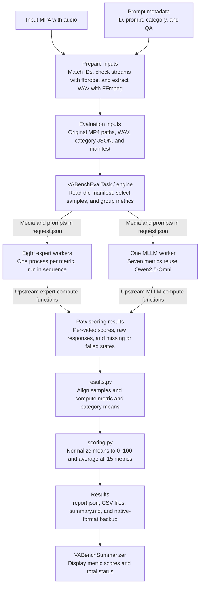
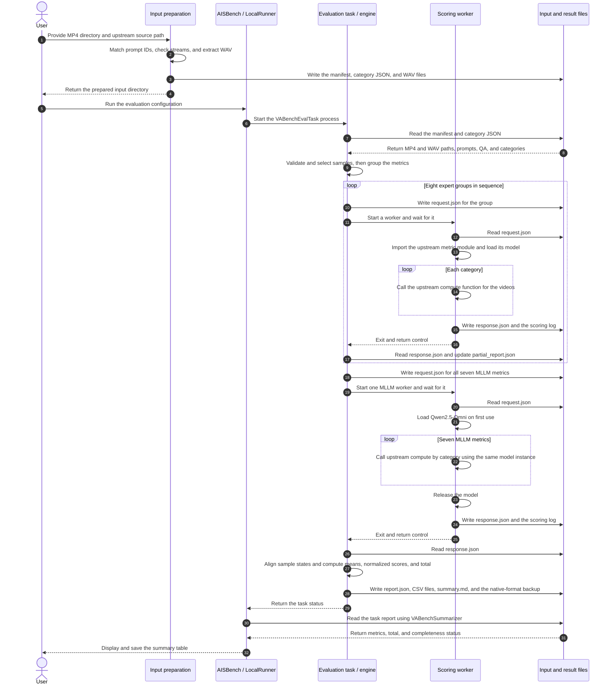

# VABench Audio-Video Evaluation Quick Start

**VABench** is a benchmark for text-to-audio-video (T2AV) generation, covering audio quality, audio-video consistency, synchronization, and content quality.

AISBench integrates all **15 VABench metrics** and evaluates existing MP4 files with audio tracks on GPU through the external upstream scoring implementation, reporting raw means, normalized scores, and a total score. This guide covers evaluating the 778-prompt standard set and comparing against native VABench; video generation is completed before the evaluation. The run template is `ais_bench/configs/vabench_examples/eval_vabench_custom.py`.

This document describes the manual preparation and evaluation route on a Linux GPU machine. It assumes an AISBench source checkout and Conda are already available; the VABench source is downloaded in Section 1. When you want AISBench to prepare the scoring dependencies automatically, Section 2.5 still uses the installer tool, which is not equivalent to installing packages one by one by hand.

The entry point is unified under `ais_bench.tools.vabench`. Task, Dataset, and the summarizer are each packaged separately; the native official preparation/comparison scripts also live under tools, and the paths below match the current implementation. Comparison results use per-metric raw means, with per-sample numeric differences listed separately; GPU accuracy alignment still requires verifying identical inputs, weights, parameters, and failure states.

Run the integration from an AISBench source checkout that contains VABench support. Install AISBench in editable mode as shown in Section 4.1. The evaluator reads the protocol and dependency files from the source checkout.

The following paths are fixed examples. Replace them as a whole when switching machines:

```bash
export AISBENCH_ROOT=/workspace/code/benchmark
export VABENCH_ROOT=/workspace/code/VABench-main
export VABENCH_CACHE_DIR=/workspace/vabench-cache
export CONDA_ENV=vabench311_new1
export PY=/root/miniconda3/envs/${CONDA_ENV}/bin/python3
export CUDA_VISIBLE_DEVICES=0,1
```

```bash
source /root/miniconda3/etc/profile.d/conda.sh
# Activate an existing environment first; for a fresh environment, create it in Section 2.2 and activate it then.
if [ -x "${PY}" ]; then
  conda activate "${CONDA_ENV}"
fi
cd "${AISBENCH_ROOT}"
```

> If you already have a working environment and the model weights are complete, skip the downloads and installation in Sections 2.2–2.5. However, you must first confirm that the third-party external sources in Section 1.1 exist, and at minimum run the `environment check` in Section 2.5, the resource checks in Section 2.6, and `doctor` in Section 4.2.

The AISBench source must contain the VABench integration. Confirm that the following two files exist first:

```bash
test -f ${AISBENCH_ROOT}/ais_bench/tools/vabench/cli.py
test -f ${AISBENCH_ROOT}/ais_bench/benchmark/tasks/vabench/eval.py
```

---

## 1. Download the VABench source

Use the following pinned revision:

The clone below requires Git, and the manual source setup in Section 1.1 requires curl. If the container lacks these tools, install them first (Ubuntu/Debian root container):

```bash
apt-get update
apt-get install -y git curl ca-certificates
```

```bash
git clone https://github.com/tanABCC/VABench.git ${VABENCH_ROOT}
git -C ${VABENCH_ROOT} checkout 12b9617a900a9eca1691da6b7115ce3d58f53a16
```

Check:

```bash
ls ${VABENCH_ROOT}/evaluate.py
ls ${VABENCH_ROOT}/vabench/config.yaml

# The revision can only be verified in a Git checkout; skip this for source extracted from an archive without .git
if [ -d ${VABENCH_ROOT}/.git ]; then
  git -C ${VABENCH_ROOT} rev-parse HEAD
fi
```

Expected revision (Git checkout):

```text
12b9617a900a9eca1691da6b7115ce3d58f53a16
```

Do not clone again if the source already exists. Source extracted from an archive runs without `.git`, but you must record its origin and version.

### 1.1 Complete the third-party external sources

In the pinned upstream repository, `third_party/` contains only `ViCLIP/`, `syncnet_eval/`, and similar directories — it does **not** include `Synchformer` or `DNS-Challenge`. `first_dnsmos` and `second_desync` load them directly from the source directory, and these two metrics fail when the files are missing. The following must exist:

```text
${VABENCH_ROOT}/third_party/Synchformer/scripts/train_utils.py
${VABENCH_ROOT}/third_party/Synchformer/dataset/transforms.py
${VABENCH_ROOT}/third_party/DNS-Challenge/DNSMOS/dnsmos_local.py
```

On a fresh installation, `environment install` in Section 2.5 fills in these paths automatically when they are missing, so there is no need to handle them manually first. The commands below are for reusing an existing environment, skipping install, or preparing in advance; they depend on the cache downloaded in Section 2.3, so on a new machine complete Section 2.3 first and then come back here.

The `synchformer/Synchformer/` directory in the model cache is the complete source. A symlink is enough — there is no need to copy about 422 MB:

```bash
mkdir -p "${VABENCH_ROOT}/third_party"
if [ ! -e "${VABENCH_ROOT}/third_party/Synchformer" ] && \
   [ ! -L "${VABENCH_ROOT}/third_party/Synchformer" ]; then
  ln -s "${VABENCH_CACHE_DIR}/synchformer/Synchformer" \
        "${VABENCH_ROOT}/third_party/Synchformer"
fi
```

DNSMOS is only missing a single Python source file. Download it at the pinned revision used by AISBench:

```bash
mkdir -p "${VABENCH_ROOT}/third_party/DNS-Challenge/DNSMOS"
if [ ! -e "${VABENCH_ROOT}/third_party/DNS-Challenge/DNSMOS/dnsmos_local.py" ]; then
  curl -fL --retry 3 \
    -o "${VABENCH_ROOT}/third_party/DNS-Challenge/DNSMOS/dnsmos_local.py" \
    https://raw.githubusercontent.com/microsoft/DNS-Challenge/591184a9fcb2cbdec02520fed81a32bbbf9d73ff/DNSMOS/dnsmos_local.py
fi
```

The `dns_mos/` directory in the cache contains only the two weights `sig_bak_ovr.onnx` and `model_v8.onnx` — it is not the DNS-Challenge source, so do not copy it into `third_party` as source code. There is also no need to clone the entire DNS-Challenge repository; if you already have a full clone, keep only `DNSMOS/dnsmos_local.py` from it.

Existing sources are not overwritten. If an existing file or symlink is incorrect, verify its origin and contents before handling it — do not assume the version matches just because "the path exists". When GitHub access requires a proxy or a private CA, set the proxy as described in Section 2.1, and add `--cacert` to `curl` or set `CURL_CA_BUNDLE`.

Check:

```bash
test -f ${VABENCH_ROOT}/third_party/Synchformer/scripts/train_utils.py
test -f ${VABENCH_ROOT}/third_party/Synchformer/dataset/transforms.py
test -f ${VABENCH_ROOT}/third_party/DNS-Challenge/DNSMOS/dnsmos_local.py
```

`environment install` in Section 2.5 performs the same setup automatically when the targets are missing (symlinking Synchformer, downloading `dnsmos_local.py`, and supporting the buffalo_l layout). However, an environment with AISBench already installed is rejected by `runtime_guard` for install; when reusing an existing environment, you must complete this section manually.

---

## 2. Download the required weights, dependencies, and tools

### 2.1 System tools

Ubuntu/Debian root container:

```bash
apt-get update
apt-get install -y git curl wget ffmpeg libsndfile1 build-essential ca-certificates unzip
```

Check:

```bash
nvidia-smi
ffmpeg -version | head -1
ffprobe -version | head -1
```

If the machine uses a private CA, configure it as appropriate:

```bash
export PIP_CERT=/root/ca-bundle.crt
export SSL_CERT_FILE=/root/ca-bundle.crt
export REQUESTS_CA_BUNDLE=/root/ca-bundle.crt
export GIT_SSL_CAINFO=/root/ca-bundle.crt
```

If `wget` reports certificate errors, add `--ca-certificate=/root/ca-bundle.crt`.

When a proxy is required to access GitHub/HuggingFace, set `http_proxy` and `https_proxy` first; `--index-url` only affects PyPI and does not proxy GitHub or model downloads.

### 2.2 Create the Conda environment

```bash
conda create -n ${CONDA_ENV} python=3.11 pip -y
conda activate ${CONDA_ENV}
python3 --version
```

### 2.3 Download the model weights

pip does not download the VABench model weights; they must be prepared separately. The cache is tens of gigabytes:

```bash
${PY} -m pip install "huggingface-hub==0.35.3" \
  --index-url https://repo.huaweicloud.com/repository/pypi/simple

mkdir -p ${VABENCH_CACHE_DIR}

hf download tanABBCC/VABENCH_CACHE_DIR \
  --repo-type dataset \
  --revision aa0c3da973d86f2994e9c8860f28785ce0cc6152 \
  --local-dir ${VABENCH_CACHE_DIR}
```

The version here is pinned to match the scoring dependencies, and it uses the `hf` executable from the current Conda environment. Do not upgrade without a version constraint: Hugging Face v1 removed `huggingface-cli` and the `[cli]` extra; see the [official migration guide](https://huggingface.co/docs/huggingface_hub/en/concepts/migration). If `hf` cannot be found, first confirm that `${CONDA_ENV}` is activated, then check `command -v hf`.

After downloading, you must confirm that `Qwen2.5_omni_7B/` is directly under the cache root:

```text
/workspace/vabench-cache/Qwen2.5_omni_7B/
```

It must not be nested one level deeper.

### 2.4 Download the LSA auxiliary weights

```bash
CACHE=${VABENCH_CACHE_DIR}
AUX="${CACHE}/checkpoints/auxiliary"

mkdir -p "${AUX}/models"

# Face detection model
wget -O "${AUX}/sfd_face.pth" \
  https://huggingface.co/ByteDance/LatentSync-1.5/resolve/main/auxiliary/sfd_face.pth

# InsightFace buffalo_l
wget -O /tmp/buffalo_l.zip \
  https://github.com/deepinsight/insightface/releases/download/v0.7/buffalo_l.zip
unzip -q -o /tmp/buffalo_l.zip -d "${AUX}/models/buffalo_l"
```

Confirm at least the following:

```text
${AUX}/sfd_face.pth
${AUX}/models/buffalo_l/det_10g.onnx
${AUX}/models/buffalo_l/2d106det.onnx
```

If `checkpoints/auxiliary/buffalo_l/` already exists but `models/buffalo_l/` is missing:

```bash
mkdir -p "${AUX}/models"
ln -sfn ../buffalo_l "${AUX}/models/buffalo_l"
```

### 2.5 Install the VABench Python dependencies

**This must be run before installing AISBench itself.** Run from the AISBench source root:

```bash
cd ${AISBENCH_ROOT}

${PY} -m ais_bench.tools.vabench.environment install \
  --source-root ${VABENCH_ROOT} \
  --cache-dir ${VABENCH_CACHE_DIR} \
  --work-dir /workspace/vabench-env-audit \
  --install-system-deps \
  --index-url https://repo.huaweicloud.com/repository/pypi/simple
```

`--install-system-deps` applies only to Ubuntu/Debian root containers; on other systems, install the system tools manually first and then drop the flag. You can also drop it directly when the tools from Section 2.1 are already installed, to avoid `apt-get update` being blocked by a proxy or a private CA; during local validation, the apt source certificate check once kept retrying, and removing the flag let the run continue normally.

> If AISBench is already installed in the current environment, `environment install` triggers `runtime_guard` and stops, and the installation has not completed. Run `environment check` for an existing environment; when a fresh install is needed, use a clean scoring environment to avoid breaking the existing primary environment.

The installer handles:

- Torch 2.6.0+cu124, torchvision, and torchaudio;
- Transformers, ONNX Runtime, InsightFace, CLAP, and others;
- ImageBind, PyTorchVideo, and CLIP at pinned commits;
- the NISQA 2.0.post2 metadata patch;
- setuptools pinned to 80.9.0 (below 82);
- symlinking the Synchformer source from the cache and downloading `dnsmos_local.py` when they are missing from `third_party` (see Section 1.1).

Check:

```bash
${PY} -m ais_bench.tools.vabench.environment check \
  --source-root ${VABENCH_ROOT} \
  --cache-dir ${VABENCH_CACHE_DIR} \
  --work-dir /workspace/vabench-env-audit
```

In a unified environment, `environment check` may return FAIL only at `pip_check`, commonly reporting Pillow, fsspec, tqdm, or decord. If `versions`, `git`, `nisqa`, `probes`, and `missing_resources` all pass, you can continue with the evaluation. When completely clean dependencies are required, use a dedicated scoring environment invoked through `BACKEND_PYTHON`.

### 2.6 Quick cache check

```bash
test -f ${VABENCH_CACHE_DIR}/Qwen2.5_omni_7B/config.json
test -f ${VABENCH_CACHE_DIR}/checkpoints/auxiliary/sfd_face.pth
test -e ${VABENCH_CACHE_DIR}/checkpoints/auxiliary/models/buffalo_l
```

The remaining weights are checked together by `doctor` in Section 4.2; if `doctor` reports `missing_resources`, fill them in by path.

---

## 3. Archive the generated videos

### 3.1 Directory and naming requirements

Place the videos to evaluate in one directory, for example:

```text
/workspace/video/
├── angry goose honking loudly.mp4
├── angry turkey gobbling loudly.mp4
├── bats echolocate in dark caves.mp4
├── bee buzzing near flower stamens.mp4
├── busy caf with chatter and coffee.mp4
├── kitten curled up meowing.mp4
└── news anchor delivers evening news.mp4
```

Rules:

- Each `idx` must have exactly one MP4;
- File names must be `idx.mp4`, for example `kitten curled up meowing.mp4`;
- An audio track is required; silent videos are not accepted;
- Do not mix results from multiple models for the same prompt;
- Unknown videos outside the 778 prompts must not appear;
- Files can be flat or organized into per-category directories;
- File names may contain spaces; quote shell parameters;
- Do not move or rewrite the original MP4 files after `prepare`, otherwise the pre-run hash verification fails.

List the videos:

```bash
find /workspace/video -type f -name '*.mp4' -printf '%f\n' | sort
```

### 3.2 Prepare a custom subset

To evaluate existing videos:

```bash
cd ${AISBENCH_ROOT}

${PY} -m ais_bench.tools.vabench.cli prepare \
  --source-root ${VABENCH_ROOT} \
  --subset custom \
  --videos /workspace/video \
  --output /workspace/prepared_videos
```

The output contains:

```text
/workspace/prepared_videos/
├── manifest.json
├── json/
└── ... same-source WAV files and more
```

Notes:

- `prepare` does not overwrite an existing output directory; use a new directory when rerunning;
- Unknown videos cause an error and are listed; they are not silently skipped;
- Silent videos are not automatically padded with silence;
- If you see `Prepared protocol differs from installed protocol`, the prepared directory comes from an older protocol and must be re-prepared with the current source. Do not hand-edit the manifest hashes.

### 3.3 Prepare the full 778-prompt set

You can download the 778 videos of the full set generated by MiniMax H3. [Download the full-set video ZIP](https://aisbench.obs.cn-north-4.myhuaweicloud.com/datasets/vabench/minimax_h3_vabench_778_full_video.zip)

After extracting, change `--videos` below to the directory that actually contains the MP4 files, then run `prepare`.

```bash
${PY} -m ais_bench.tools.vabench.cli prepare \
  --source-root ${VABENCH_ROOT} \
  --subset custom \
  --videos /workspace/video \
  --output /workspace/prepared_videos
```

### 3.4 Get the VABench Mini subset

The archived videos of the Mini subset are available on Modelers. [VABench Mini dataset](https://modelers.cn/datasets/AISBench/vabench_mini)

---

## 4. Install AISBench dependencies and launch the evaluation

### 4.1 Install AISBench dependencies

Continue using the same Conda environment created in Section 2. First install the AISBench runtime, dropping the Pillow pin that conflicts with VABench/NISQA:

```bash
cd ${AISBENCH_ROOT}

sed -e 's/^gradio-client$/gradio-client==1.14.0/' \
    -e 's/^openai$/openai==1.109.1/' \
    requirements/runtime.txt \
  | grep -viE '^\s*Pillow\s*==' \
  > /workspace/aisbench_runtime_unified.txt

printf 'anyio==4.10.0\n' >> /workspace/aisbench_runtime_unified.txt

${PY} -m pip install \
  -r /workspace/aisbench_runtime_unified.txt \
  --index-url https://repo.huaweicloud.com/repository/pypi/simple
```

Install AISBench itself without re-resolving dependencies:

```bash
${PY} -m pip install \
  -e ${AISBENCH_ROOT} \
  --no-deps \
  --no-build-isolation
```

Pin back the versions needed by the unified environment:

```bash
${PY} -m pip install \
  "fsspec==2025.9.0" "tqdm==4.66.2" \
  --index-url https://repo.huaweicloud.com/repository/pypi/simple
```

Check:

```bash
ais_bench --help
${PY} -c "import ais_bench; print(ais_bench.__file__)"
${PY} -m pip check > /workspace/vabench_pip_check.txt 2>&1
PIP_CHECK_STATUS=$?
cat /workspace/vabench_pip_check.txt
echo "pip check exit status: ${PIP_CHECK_STATUS}"
```

> The checks above are run in an interactive shell; if a script sets `set -e`, capture the nonzero status in a conditional branch before saving. The unified environment may show known declaration conflicts for Pillow, fsspec, tqdm, and decord; review each item against the verified environment record — new conflicts must not be dismissed wholesale. When completely clean dependencies are required, use a dedicated scoring environment invoked through `BACKEND_PYTHON`.

### 4.2 Environment diagnostics

```bash
cd ${AISBENCH_ROOT}

${PY} -m ais_bench.tools.vabench.cli doctor \
  --source-root ${VABENCH_ROOT} \
  --cache-dir ${VABENCH_CACHE_DIR}
```

You must confirm:

- All 15 metric entry points exist;
- The model cache has no missing items;
- CUDA, decord, and ONNX Runtime work correctly;
- `missing_resources` is empty.

`doctor` checks module discoverability and strict resource integrity, then runs a small tensor operation on the target device and copies the result back to CPU. The default is `--device cuda:0`; an unavailable device or a failed operation returns a nonzero status. To check CPU only, pass `--device cpu` explicitly. It does not replace full scoring-module loading, decord decoding, or ONNX provider validation — combine it with the actual probes from `environment check` in Section 2.5 and the subsequent scoring logs.

### 4.3 Write the evaluation configuration

Copy the template:

```bash
cp ${AISBENCH_ROOT}/ais_bench/configs/vabench_examples/eval_vabench_custom.py \
   /workspace/eval_vabench.py
```

Edit `/workspace/eval_vabench.py` and change at least the following fields:

```python
PREPARED_DIR = '/workspace/prepared_videos'
SOURCE_ROOT = '/workspace/code/VABench-main'
CACHE_DIR = '/workspace/vabench-cache'

DEVICE = 'cuda:0'
BACKEND_PYTHON = '/root/miniconda3/envs/vabench311_new1/bin/python3'
NUM_DEVICES = 2
```

If AISBench and VABench are in the same Conda environment, `BACKEND_PYTHON` points to that environment's `bin/python3`. Keep the remaining template fields (`models`, `datasets`, `eval`, `summarizer`) unchanged.

### 4.4 Launch the evaluation

```bash
cd ${AISBENCH_ROOT}

ais_bench /workspace/eval_vabench.py \
  -m eval \
  -w /workspace/vabench_runs/run_$(date +%Y%m%d_%H%M%S)
```

Parameters:

- `-m eval`: evaluate only, no re-inference;
- `-w`: output root directory; AISBench creates a timestamped subdirectory automatically;
- Use a new work directory for a separate run. See Section 4.5 for retries in the same work directory.
- A live run of 7 videos with all 15 metrics took about 10 minutes; the time depends on free GPU resources, media length, and the cache, and does not guarantee a fixed runtime.

#### 4.4.1 Console output sample and field reference

All 15 metrics are organized into 9 scoring groups. `9/9` on the progress board means all 9 groups have finished; whether each metric obtained a valid score must be checked in the summary table. The following is an excerpt from a 6-video custom evaluation. (The total row keeps the label printed by AISBench, which reads "custom subset preview total, non-official".)

```text
model         dataset/dimension           raw direction  raw mean  score/100  expected  scored  LSA omitted  missing  failed  coverage %  status
custom_all_7  vabench_t2av/first_dnsmos    higher          1.68562      17.14         6       6            0        0       0       100.0  complete
custom_all_7  vabench_t2av/second_desync   lower           0.18333      90.83         6       6            0        0       0       100.0  complete
custom_all_7  vabench_t2av/second_lsa      higher          2.35772      23.58         6       2            4        4       0        33.3  incomplete
custom_all_7  vabench_t2av/total           higher                —      67.88        15      15            —        0       —           —  自定义子集预览总分（非官方）
```

| Column | Meaning for a metric row |
| --- | --- |
| `model` | Model abbreviation in the AISBench configuration, usually `models[0]['abbr']` |
| `dataset/dimension` | Dataset abbreviation and metric name, for example `vabench_t2av/second_lsa` |
| `raw direction` | Raw score direction. `higher` means larger is better, `lower` means smaller is better. Currently `second_desync` is `lower` |
| `raw mean` | Mean of the valid raw scores for the metric, with each valid video weighted equally |
| `score/100` | The raw mean normalized with the fixed formula in the appendix and clamped to 0–100 |
| `expected` / `scored` | The number of input videos this run and the number that obtained a valid score for the metric |
| `LSA omitted` | The number of `second_lsa` records missing, already counted in `missing` on the same row. Check the logs for the specific omission reason. Other metrics show 0 in this column |
| `missing` / `failed` | `missing` counts samples without scoring records. `failed` counts samples marked as failed, such as backend errors or invalid scores |
| `coverage %` | `scored / expected × 100` |
| `status` | `complete` means valid scores cover all inputs and there are no backend errors; `incomplete` means there are missing or errored items; `not_evaluated` means the metric was not evaluated |

The `total` row counts metrics. In the example, `expected=15`, `scored=15`, and `missing=0` mean all 15 metrics have valid means. LSA has a mean, but its coverage is only `2/6 = 33.3%`, so the whole run still shows a preview total. `raw mean`, `LSA omitted`, `failed`, and `coverage %` display `—` on the total row. When only some metrics are requested, the summary table omits the total row.

### 4.5 Inspect the results

Result directory:

```text
/workspace/vabench_runs/run_<timestamp>/
└── <aisbench_timestamp>/
    ├── summary/
    │   └── summary_<timestamp>.md
    └── results/
        └── <model>/<dataset>_artifacts/
            ├── summary.md
            ├── metrics.csv
            ├── total.csv
            ├── samples.csv
            ├── scenes.csv
            ├── report.json
            └── official_eval_results/
```

The framework's `summary/` holds the overall summary table. Set `AISBENCH_ARTIFACTS` below to the directory printed as `VABench artifacts:` in the task log. Retrying in the same work directory writes new results under `_artifacts/attempt_*/` and preserves earlier reports and logs. The framework result JSON records the directory in `provenance.artifact_dir`.

```bash
export AISBENCH_ARTIFACTS=/workspace/vabench_runs/run_ACTUAL_TIMESTAMP/AISBench_timestamp/results/model_abbr/dataset_abbr_artifacts
cat "${AISBENCH_ARTIFACTS}/summary.md"
cat "${AISBENCH_ARTIFACTS}/metrics.csv"
cat "${AISBENCH_ARTIFACTS}/total.csv"
```

| File or directory | What to check |
| --- | --- |
| `summary.md`, `metrics.csv`, `scenes.csv` | Report summary, per-metric statistics, and per-category statistics. The CSV fields `mean`, `normalized_score`, and `omitted` correspond to `raw mean`, `score/100`, and `LSA omitted` in the console |
| `total.csv` | The total `score`, `status`, the number of valid metrics `valid_dimensions`, and zero-filled metrics `zero_filled_dimensions` |
| `samples.csv`, `report.json` | Investigate per-sample status by `idx`. `score` is the valid score used in the mean, and `original_score` retains the raw numeric value for diagnosis. `report.json` also stores per-metric results, scoring details, and run provenance |
| `official_eval_results/` | The raw scoring backup in official format, read by `compare-official` |
| `input_manifest.json`, `partial_report.json` | Verify the actual inputs of this run and the report saved after the most recent completed scoring group |
| `job_00/` and other scoring group directories | Inspect `request.json`, `response.json`, and `process.log` to locate subprocess configuration, return values, and errors |

Total score rules:

- All 15 metrics have valid means, 100% coverage, and no backend errors: formal total;
- All 15 metrics have scores, but there are failures, missing items, LSA omissions, or backend errors: preview total;
- All 15 metrics requested but some metric has no valid mean: that metric counts as 0, the denominator stays fixed at 15, and the preview total and `zero_filled_dimensions` are shown; the raw mean stays blank;
- Running only some metrics: no 15-metric total is generated.

For example, with the other 14 metrics at 60 each and LSA having no valid mean, the preview total is 56. When none of the 15 metrics has a valid mean, a zero preview total is still saved, but the task returns failure. Only LSA omissions without backend errors can allow the task to complete when the other requested metrics have valid scores; missing results in other metrics, parse failures, and backend exceptions cannot be masked by zero-filling. The formal/preview status and whether the task succeeded are judged separately. Native VABench does not provide this total; `total.csv` is an AISBench display convention.

Notes:

- `second_lsa` may omit records due to no face detected, zero confidence, or internal exceptions; an omission alone does not reveal the cause — check the logs instead of assuming it is not a dependency error;
- `second_desync` reports `backend_error` for videos shorter than Synchformer's fixed 5-second input; do not claim desync completeness with such videos;
- The current CLAP cache randomly crops a 10-second segment; repeated runs on long videos may fluctuate. Short videos avoid this random-crop branch, but absolute determinism of all computations is not guaranteed.

### 4.5.1 Why `second_clap` fluctuates

The preprocessing in the upstream `vabench/second_clap.py` has randomness; the subprocesses, scene order, and model lifecycles on both sides also affect the actual random state:

1. The upstream code calls `processor(text=..., audio=..., sampling_rate=48000)` without passing `truncation`;
2. The cached `clap/laion__clap-htsat-unfused/preprocessor_config.json` is configured as:

```json
{
  "truncation": "rand_trunc",
  "max_length_s": 10,
  "nb_max_samples": 480000,
  "sampling_rate": 48000
}
```

3. When the audio exceeds 10 seconds, Transformers' `ClapFeatureExtractor` executes:

```python
overflow = len(waveform) - max_length
idx = np.random.randint(0, overflow + 1)
waveform = waveform[idx:idx + max_length]
```

That is, a different 10-second start position is chosen at random each time before the CLAP similarity is computed, so the same video can get different `video_results` on each run.

4. The CLAP call site does not separately seed this NumPy randomness; `PYTHONHASHSEED=42` only affects Python hashing and does not fix `np.random`. The upstream `omni_runtime` initialization has its own random seed settings, and the execution order across scenes can also affect the later CLAP state. Therefore, verify the actual call order — do not assume that both paths are always in the same, or fully unset, random state.

5. Audio up to 10 seconds does not enter this random-crop branch, which reduces this source of fluctuation.

Therefore, when `second_clap` differs, first check the inputs, preprocessing configuration, and random state. Formal acceptance still requires the raw mean within a relative error of <1% under identical conditions; you can control the random state through an external launch wrapper while keeping the official files unchanged. Excluding CLAP only yields diagnostic results for the other 14 metrics — it does not complete the 15-metric alignment, and out-of-tolerance values cannot be recorded as passing.

### 4.6 Run native VABench as a reference (optional)

To compare the AISBench results sample by sample against the native results of the official source, first generate the official `data_dir`. The script below depends only on Python, ffmpeg, and the official source — not on AISBench:

```bash
STAMP=$(date +%Y%m%d_%H%M%S)
export OFFICIAL_DATA=/workspace/vabench_official_data_${STAMP}
export OFFICIAL_RUN=/workspace/vabench_official_run_${STAMP}
export OFFICIAL_RESULT=/workspace/vabench_result_${STAMP}

${PY} "${AISBENCH_ROOT}/ais_bench/tools/vabench/official_prepare.py" \
  --source-root ${VABENCH_ROOT} \
  --videos /workspace/video \
  --output ${OFFICIAL_DATA}
```

Script rules:

The script is provided by `tools/vabench/official_prepare.py` in the AISBench workspace, but when executed directly by file path it depends only on the Python standard library, ffmpeg, and the official source; installing AISBench is not required. You can also run `python3 -m ais_bench.tools.vabench.official_prepare --help` from the AISBench source root to see the parameters.

- After removing the `.mp4` suffix, each MP4 file name must exactly equal an `idx` in the official `mapping/final_idx_to_prompt.csv`;
- Every MP4 must have an audio track; the script uses ffmpeg to extract the first audio track as WAV, without padding silence or re-encoding the video;
- It generates `video/<category>/<idx>.mp4` and `audio/<category>/<idx>.wav` according to the prompt category;
- `json/<category>.json` is generated only for videos that actually exist; prompts without videos are not kept;
- `--output` must be a new or empty directory; a directory with existing content is rejected.

The script prints the sample count of each category. Confirm the directory structure:

```bash
find ${OFFICIAL_DATA} -maxdepth 3 -type f | sort
```

The official `evaluate.py` reads the relative path `./mapping_text/final_idx_to_prompt.csv` under the current working directory, but the directory in the official source is named `mapping/`, so the run directory must contain a symlink named `mapping_text`. The run directory can be any new directory; a fixed path is not required:

```bash
mkdir -p ${OFFICIAL_RUN}
ln -sfn ${VABENCH_ROOT}/mapping ${OFFICIAL_RUN}/mapping_text
cd ${OFFICIAL_RUN}

test -f mapping_text/final_idx_to_prompt.csv && echo mapping-ok
```

Then launch the official evaluation from that run directory:

```bash
cd ${OFFICIAL_RUN}
set -o pipefail

CUDA_VISIBLE_DEVICES=0,1 \
VABENCH_CACHE_DIR=${VABENCH_CACHE_DIR} \
${PY} -u ${VABENCH_ROOT}/evaluate.py \
  --data_dir ${OFFICIAL_DATA} \
  --output_dir ${OFFICIAL_RESULT} \
  2>&1 | tee ${OFFICIAL_RESULT}.log
```

Notes:

- Adjust `CUDA_VISIBLE_DEVICES` to the actual machine; the official default config uses logical devices 0/1 and `max_memory: {0: "80GB", 1: "80GB"}`. With a different GPU memory configuration, pass your own copy via `--config`;
- `${PY}` uses the environment corresponding to `CONDA_ENV` at the top; to use `vabench115`, simply change `CONDA_ENV` at the top to `vabench115` — the official evaluation does not depend on the AISBench installation;
- `VABENCH_CACHE_DIR` must be set before Python starts;
- The official entry point catches exceptions, so do not judge success by the exit code alone — check the logs and result files as well;
- The result directory layout is:

```text
${OFFICIAL_RESULT}/<category>/
├── <category>_<timestamp>_eval_results.json
├── <category>_<timestamp>_eval_results.csv
└── <category>_<timestamp>_full_info.json
```

`eval_results.json` holds the per-sample raw scores, and `full_info.json` holds the full information of the prompts actually used in this run; `-1` in the CSV means the metric did not obtain a score and must not be treated as 0 in the mean. Confirm that every category has the expected metrics and samples before moving on to the comparison in the next section, and pass `${OFFICIAL_RESULT}` as the `--official` argument.

### 4.7 Compare raw means and per-sample differences with official VABench (optional)

If you have also run the official `evaluate.py`, you can directly compare the raw scores written by both sides:

```bash
${PY} -m ais_bench.tools.vabench.cli compare-official \
  --aisbench "${AISBENCH_ARTIFACTS}" \
  --official "${OFFICIAL_RESULT}" \
  --output /workspace/vabench_compare_official.json
```

`AISBENCH_ARTIFACTS` uses the directory set in Section 4.5 and can also point directly at its `official_eval_results/`. To use an existing official result directory, set `OFFICIAL_RESULT` to that directory.

The command aligns the core scores `video_results` by category, metric, and media file name, ignores different absolute path prefixes, and computes each raw mean with equal weight over all valid videos. When the absolute value of the reference mean is greater than `1e-6`, the relative error must be strictly `<1%`; otherwise the absolute error must be `≤1e-6`. Every requested metric must have valid paired scores; both sides fully empty, missing samples/metrics/scenes, or non-numeric values cannot pass.

The output provides `passed` (mean thresholds and sample-structure checks), `metric_means_passed`, and `sample_values_passed` separately. When per-sample values differ but the means over the same valid set meet the threshold, the means can PASS while the per-sample diagnostic FAILs; the exit code follows `passed` and returns 0 or 1, and the per-sample threshold does not replace the established mean acceptance.

Both sides use fresh directories from single runs; multiple result files for the same scene are rejected to avoid mixing runs. Formal acceptance also requires verifying the inputs, source, weights, and parameters, as well as the failure and omission sets. The raw backup may contain model fallback values — identical numbers alone do not mean the score is valid. The per-metric raw-mean thresholds follow the rules above.

The random truncation of `second_clap` shows up as numeric differences; confirm the inputs and random state first instead of judging it directly as an AISBench invocation error.

### 4.8 `compare-official` output field reference

The following is an excerpt from one comparison of the same 6 videos.

```text
Official VABench raw-mean comparison: FAIL
  official: /workspace/vabench_result_20261105_071201
  aisbench: .../results/custom_all_7/vabench_t2av_artifacts/official_eval_results
  categories: 3, dimensions: 15, compared values: 86
  differences: 7
  per-sample numeric diagnostic: FAIL
  first_dnsmos: PASS official_mean=1.6856217 aisbench_mean=1.6856217 valid_pairs=6
  second_clap: FAIL official_mean=0.24987 aisbench_mean=0.242165 valid_pairs=6
  second_lsa: PASS official_mean=2.357725 aisbench_mean=2.357725 valid_pairs=2
Differences:
  [value] easy_bioacoustics/second_clap / angry goose honking loudly: official=0.22342 aisbench=0.20722 delta=0.0162 rel=7.2509%
  [mean_mismatch] ?/second_clap: {'kind': 'mean_mismatch', ...}
```

| Output field | Meaning |
| --- | --- |
| `Official VABench raw-mean comparison` | Overall result, corresponding to `passed` in JSON. Requires every requested metric's raw mean to meet the tolerance and the result structure and valid samples to align on both sides |
| `official` / `aisbench` | The official `evaluate.py` output directory and the AISBench backup in official format |
| `categories` / `dimensions` | The number of categories involved in both results and the number of requested metrics |
| `compared values` | The number of valid "video × metric" pairs. In the example, 14 metrics have 6 pairs each and LSA has 2, for 86 in total |
| `differences` | The total number of difference entries, including per-sample values, per-metric means, and result-structure differences |
| `per-sample numeric diagnostic` | The per-sample diagnostic, corresponding to `sample_values_passed`. FAIL when sample values exceed the tolerance or the result structure is abnormal |
| Per-metric `PASS` / `FAIL` | The raw mean comparison for that metric. `official_mean` and `aisbench_mean` are averaged over the same set of valid pairs, and `valid_pairs` is the number of valid pairs |

A `[value]` entry in `Differences` (`value_mismatch` in the JSON) locates the category, metric, and sample `idx`. `delta` is the absolute raw-score difference, and `rel` is the relative error computed with the absolute official score as the denominator. A `[mean_mismatch]` entry corresponds to a metric mean difference across categories — the category position shows `?`, and the detailed fields include `absolute_error`, `relative_error`, and the tolerance `rule` used this time (`relative` or `absolute`). Missing samples, missing categories, missing metrics, non-numeric values, and scoring failures are also listed separately.

The command returns an exit code based on the overall result: `0` means pass, `1` means fail. In the example, the CLAP mean exceeds the tolerance, so the overall result is `FAIL`. The JSON saved via `--output` also contains `metric_means_passed` (whether all means meet the thresholds), `thresholds` (the actual tolerances), `summary` (per-metric counts and mean comparisons), `differences` (the full difference list), and `selected_files` (the files actually compared). When verifying inputs, models, and run parameters, use `input_manifest.json`, `report.json`, and the logs together.

## Appendix: Evaluation data flow and process sequence

The data flow is shown below; the scoring groups run in order, the eight expert metrics each use one process, and the seven MLLM metrics reuse Qwen in a single process.



The task and scoring process sequence in the main command is shown below. The repeated worker lanes represent processes created one after another; `request.json` and `response.json` carry the inputs and results.



### Fixed scoring formulas

First compute the raw mean `m` over valid videos, then apply the formula and clamp the result to 0–100; the total is fixed at the equal-weighted mean of the 15 metrics, with missing metrics filled with 0 and shown with a preview status.

| Metric | Normalization from the raw mean `m` |
| --- | --- |
| DNSMOS, NISQA, and the five `third_*` metrics | `(m − 1) / 4 × 100` |
| AudioBox | `(m + 1.75) / 9 × 100` |
| ViCLIP, CLAP, ImageBind | `(m + 1) / 2 × 100` |
| Desync | `(1 − m / 2) × 100`, with smaller raw offsets scoring higher |
| LSA | `m / 10 × 100`, with 10 as the fixed display anchor |
| Both QA metrics | `m × 100` |
