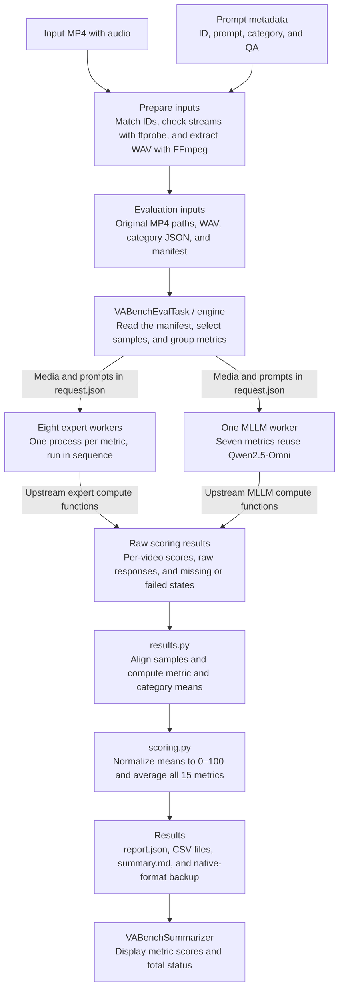
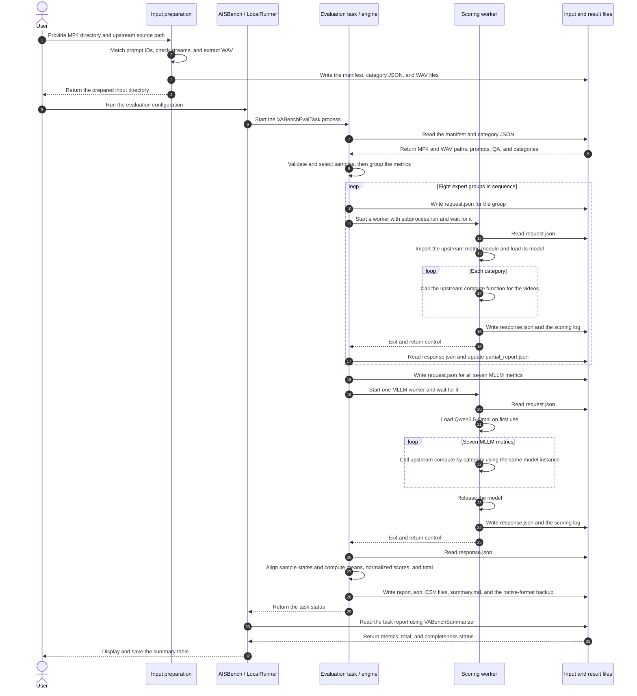

# VABench Audio-Video Evaluation Quick Start

**VABench** evaluates text-to-audio-video (T2AV) generation across audio quality, audio-video consistency, synchronization, and content quality.

AISBench runs all **15 VABench metrics** on GPU using the upstream scoring implementation. It takes existing MP4 files with audio tracks and reports raw means, normalized scores, and an overall score. This guide covers the 778-prompt standard set and comparison against native VABench. Generate the videos before running the evaluation. The AISBench configuration template is `ais_bench/configs/vabench_examples/eval_vabench_custom.py`.

You need a Linux GPU machine, an AISBench source checkout, and Conda. Download VABench in Section 1 and use the AISBench installer in Section 2.5 to set up scoring dependencies. The CLI, environment installer, and native comparison tools are under `ais_bench.tools.vabench`.

Adapt the following paths and GPU selection to your machine.

```bash
export AISBENCH_ROOT=/workspace/code/benchmark
export VABENCH_ROOT=/workspace/code/VABench-main
export VABENCH_CACHE_DIR=/workspace/vabench-cache
export CONDA_ENV=vabench311_new1
export PY=/root/miniconda3/envs/${CONDA_ENV}/bin/python3
export CUDA_VISIBLE_DEVICES=0,1
```

```bash
source /root/miniconda3/etc/profile.d/conda.sh
# Activate an existing environment now, or create it in Section 2.2 first.
if [ -x "${PY}" ]; then
  conda activate "${CONDA_ENV}"
fi
cd "${AISBENCH_ROOT}"
```

> If you already have a working environment and the model weights, you can skip the downloads and installation in Sections 2.2–2.5. Verify the third-party sources in Section 1.1 and run the environment check in Section 2.5, the cache check in Section 2.6, and `doctor` in Section 4.2.

Check that your AISBench checkout contains the VABench integration.

```bash
test -f ${AISBENCH_ROOT}/ais_bench/tools/vabench/cli.py
test -f ${AISBENCH_ROOT}/ais_bench/benchmark/tasks/vabench/eval.py
```

---

## 1. Download the VABench source

The clone uses Git and the manual setup in Section 1.1 uses curl. Install them first if they are missing from your Ubuntu or Debian container and you have root access.

```bash
apt-get update
apt-get install -y git curl ca-certificates
```

Check out the pinned upstream revision.

```bash
git clone https://github.com/tanABCC/VABench.git ${VABENCH_ROOT}
git -C ${VABENCH_ROOT} checkout 12b9617a900a9eca1691da6b7115ce3d58f53a16
```

Verify the source paths and, for a Git checkout, the revision.

```bash
ls ${VABENCH_ROOT}/evaluate.py
ls ${VABENCH_ROOT}/vabench/config.yaml

# Verify the revision for a Git checkout. Skip this check for an extracted archive.
if [ -d ${VABENCH_ROOT}/.git ]; then
  git -C ${VABENCH_ROOT} rev-parse HEAD
fi
```

Expected revision for a Git checkout.

```text
12b9617a900a9eca1691da6b7115ce3d58f53a16
```

You can reuse an existing checkout. If you extracted the source from an archive, record its origin and revision.

### 1.1 Set up third-party sources

The pinned upstream checkout ships ViCLIP and SyncNet evaluation code. DNSMOS and Synchformer require these additional files for `first_dnsmos` and `second_desync`.

```text
${VABENCH_ROOT}/third_party/Synchformer/scripts/train_utils.py
${VABENCH_ROOT}/third_party/Synchformer/dataset/transforms.py
${VABENCH_ROOT}/third_party/DNS-Challenge/DNSMOS/dnsmos_local.py
```

On a fresh environment, `environment install` in Section 2.5 fills in missing sources and supports the `buffalo_l` cache layout. When reusing an environment with AISBench already installed, complete this section manually after downloading the cache in Section 2.3.

Link the Synchformer checkout in `synchformer/Synchformer/` from the model cache.

```bash
mkdir -p "${VABENCH_ROOT}/third_party"
if [ ! -e "${VABENCH_ROOT}/third_party/Synchformer" ] && \
   [ ! -L "${VABENCH_ROOT}/third_party/Synchformer" ]; then
  ln -s "${VABENCH_CACHE_DIR}/synchformer/Synchformer" \
        "${VABENCH_ROOT}/third_party/Synchformer"
fi
```

Fetch the single DNSMOS source file from the pinned Microsoft revision. An existing DNS-Challenge checkout can supply the same file.

```bash
mkdir -p "${VABENCH_ROOT}/third_party/DNS-Challenge/DNSMOS"
if [ ! -e "${VABENCH_ROOT}/third_party/DNS-Challenge/DNSMOS/dnsmos_local.py" ]; then
  curl -fL --retry 3 \
    -o "${VABENCH_ROOT}/third_party/DNS-Challenge/DNSMOS/dnsmos_local.py" \
    https://raw.githubusercontent.com/microsoft/DNS-Challenge/591184a9fcb2cbdec02520fed81a32bbbf9d73ff/DNSMOS/dnsmos_local.py
fi
```

The cache's `dns_mos/` directory supplies the `sig_bak_ovr.onnx` and `model_v8.onnx` weights. Place `dnsmos_local.py` under `third_party/DNS-Challenge/DNSMOS/`. The commands preserve existing files and links. If an existing path points to the wrong revision, verify its source and contents before replacing it. For GitHub access behind a proxy or a private CA, see Section 2.1 and configure `CURL_CA_BUNDLE` or `curl --cacert` as needed.

Check all three source files.

```bash
test -f ${VABENCH_ROOT}/third_party/Synchformer/scripts/train_utils.py
test -f ${VABENCH_ROOT}/third_party/Synchformer/dataset/transforms.py
test -f ${VABENCH_ROOT}/third_party/DNS-Challenge/DNSMOS/dnsmos_local.py
```

---

## 2. Prepare the tools, weights, and scoring environment

### 2.1 System tools

For an Ubuntu or Debian container with root access, install the tools below.

```bash
apt-get update
apt-get install -y git curl wget ffmpeg libsndfile1 build-essential ca-certificates unzip
```

Check the GPU and media tools.

```bash
nvidia-smi
ffmpeg -version | head -1
ffprobe -version | head -1
```

If your network uses a private CA, set the certificate path for the relevant tools.

```bash
export PIP_CERT=/root/ca-bundle.crt
export SSL_CERT_FILE=/root/ca-bundle.crt
export REQUESTS_CA_BUNDLE=/root/ca-bundle.crt
export GIT_SSL_CAINFO=/root/ca-bundle.crt
```

For wget, use `--ca-certificate=/root/ca-bundle.crt` if needed. Configure `http_proxy` and `https_proxy` for GitHub or Hugging Face access. Pip's `--index-url` selects a Python package index. Git and model downloads use their own network settings.

### 2.2 Create the Conda environment

```bash
conda create -n ${CONDA_ENV} python=3.11 pip -y
conda activate ${CONDA_ENV}
python3 --version
```

### 2.3 Download model weights

Download the model cache separately from the Python packages. The cache takes tens of gigabytes of disk space.

```bash
${PY} -m pip install "huggingface-hub==0.35.3" \
  --index-url https://repo.huaweicloud.com/repository/pypi/simple

mkdir -p ${VABENCH_CACHE_DIR}

hf download tanABBCC/VABENCH_CACHE_DIR \
  --repo-type dataset \
  --revision aa0c3da973d86f2994e9c8860f28785ce0cc6152 \
  --local-dir ${VABENCH_CACHE_DIR}
```

Use the pinned `huggingface-hub` version and the `hf` executable from the active Conda environment. If the command is missing, activate the environment and run `command -v hf`. For CLI changes in version 1, see the [Hugging Face migration guide](https://huggingface.co/docs/huggingface_hub/en/concepts/migration).

Confirm that `Qwen2.5_omni_7B/` is directly under the cache root.

```text
/workspace/vabench-cache/Qwen2.5_omni_7B/
```

### 2.4 Download the LSA auxiliary weights

```bash
CACHE=${VABENCH_CACHE_DIR}
AUX="${CACHE}/checkpoints/auxiliary"

mkdir -p "${AUX}/models"

# Face detection model
wget -O "${AUX}/sfd_face.pth" \
  https://huggingface.co/ByteDance/LatentSync-1.5/resolve/main/auxiliary/sfd_face.pth

# InsightFace buffalo_l
wget -O /tmp/buffalo_l.zip \
  https://github.com/deepinsight/insightface/releases/download/v0.7/buffalo_l.zip
unzip -q -o /tmp/buffalo_l.zip -d "${AUX}/models/buffalo_l"
```

Verify at least these files.

```text
${AUX}/sfd_face.pth
${AUX}/models/buffalo_l/det_10g.onnx
${AUX}/models/buffalo_l/2d106det.onnx
```

If `checkpoints/auxiliary/buffalo_l/` already exists, create a link at `models/buffalo_l/` if that path is missing.

```bash
mkdir -p "${AUX}/models"
ln -sfn ../buffalo_l "${AUX}/models/buffalo_l"
```

### 2.5 Install VABench Python dependencies

Run the installer **before installing AISBench** in this Conda environment. Start from the AISBench source root.

```bash
cd ${AISBENCH_ROOT}

${PY} -m ais_bench.tools.vabench.environment install \
  --source-root ${VABENCH_ROOT} \
  --cache-dir ${VABENCH_CACHE_DIR} \
  --work-dir /workspace/vabench-env-audit \
  --install-system-deps \
  --index-url https://repo.huaweicloud.com/repository/pypi/simple
```

Use `--install-system-deps` only in an Ubuntu or Debian container with root access. Omit it when the tools in Section 2.1 are already installed or when you manage them separately. This also lets you proceed if the package mirror's certificate prevents `apt-get update`.

> The installer stops if AISBench is already installed in the target environment. Run `environment check` for an existing environment or use a fresh scoring environment for a new installation.

The installer sets up PyTorch 2.6.0 with CUDA 12.4, torchvision, torchaudio, Transformers, ONNX Runtime, InsightFace, CLAP, and the pinned Git revisions of ImageBind, PyTorchVideo, and CLIP. It applies the NISQA 2.0.post2 metadata patch, pins setuptools to 80.9.0, and prepares the missing sources described in Section 1.1.

Check the installed environment.

```bash
${PY} -m ais_bench.tools.vabench.environment check \
  --source-root ${VABENCH_ROOT} \
  --cache-dir ${VABENCH_CACHE_DIR} \
  --work-dir /workspace/vabench-env-audit
```

In a shared environment, `pip_check` can report known metadata conflicts involving Pillow, fsspec, tqdm, or decord. Review these against the verified environment and make sure `versions`, `git`, `nisqa`, `probes`, and `missing_resources` are clear before proceeding. To keep the scoring dependencies separate, point `BACKEND_PYTHON` at a dedicated scoring environment.

### 2.6 Check the model cache

```bash
test -f ${VABENCH_CACHE_DIR}/Qwen2.5_omni_7B/config.json
test -f ${VABENCH_CACHE_DIR}/checkpoints/auxiliary/sfd_face.pth
test -e ${VABENCH_CACHE_DIR}/checkpoints/auxiliary/models/buffalo_l
```

Run `doctor` in Section 4.2 to check the remaining resources. If `missing_resources` lists any paths, fill them in before scoring.

---

## 3. Prepare the generated videos

### 3.1 Directory and naming

Place the videos for one model under a single input directory.

```text
/workspace/video/
├── angry goose honking loudly.mp4
├── angry turkey gobbling loudly.mp4
├── bats echolocate in dark caves.mp4
├── bee buzzing near flower stamens.mp4
├── busy caf with chatter and coffee.mp4
├── kitten curled up meowing.mp4
└── news anchor delivers evening news.mp4
```

- Name each file `<idx>.mp4` using the official ID, and include an audio track.
- Supply exactly one MP4 per ID and keep different models in separate directories.
- Use IDs from the 778-prompt set. Files can be flat or grouped by category.
- File names can contain spaces. Quote paths when passing them to the shell.
- Keep the source MP4 paths and contents intact after running `prepare`. Evaluation verifies the media hashes.

List the input files.

```bash
find /workspace/video -type f -name '*.mp4' -printf '%f\n' | sort
```

### 3.2 Export the standard 778 prompts

```bash
cd ${AISBENCH_ROOT}

${PY} -m ais_bench.tools.vabench.cli catalog \
  --source-root ${VABENCH_ROOT} \
  --subset standard \
  --output /workspace/t2av_778_prompts.json
```

The upstream JSON files contain 848 prompts. The standard set consists of the 778 prompts that match `mapping/final_idx_to_prompt.csv` exactly. Use `entries[].metadata.prompt_en` for generation and `entries[].idx` as the MP4 file stem.

### 3.3 Prepare a custom subset

Run this command to evaluate the MP4 files already in your directory. `prepare` matches file names to official prompts and extracts their audio tracks.

```bash
cd ${AISBENCH_ROOT}

${PY} -m ais_bench.tools.vabench.cli prepare \
  --source-root ${VABENCH_ROOT} \
  --subset custom \
  --videos /workspace/video \
  --output /workspace/prepared_videos
```

The output contains the evaluation manifest, per-category metadata, and extracted audio.

```text
/workspace/prepared_videos/
├── manifest.json
├── json/
└── ... extracted WAV files
```

Choose a fresh output directory for each preparation. An unknown ID or a video without an audio track causes an error. If you see `Prepared protocol differs from installed protocol`, rebuild the prepared directory with the current AISBench checkout so it records the correct protocol hash.

### 3.4 Prepare all 778 standard prompts

The full archive contains 778 videos generated by MiniMax H3. [Download the full video archive (ZIP)](https://aisbench.obs.cn-north-4.myhuaweicloud.com/datasets/vabench/minimax_h3_vabench_778_full_video.zip)

Extract the archive, set `--videos` below to the directory containing the MP4 files, and run `prepare`.

```bash
${PY} -m ais_bench.tools.vabench.cli prepare \
  --source-root ${VABENCH_ROOT} \
  --subset standard \
  --videos /workspace/generated_standard \
  --output /workspace/prepared_standard
```

### 3.5 Get the VABench Mini subset

The archived videos for the Mini subset are available on Modelers. [VABench Mini dataset](https://modelers.cn/datasets/AISBench/vabench_mini)

---

## 4. Install AISBench and run the evaluation

### 4.1 Install AISBench dependencies

Use the Conda environment from Section 2. Install the AISBench runtime dependencies with the pins for the shared environment. The following command leaves the scoring environment's Pillow version in place.

```bash
cd ${AISBENCH_ROOT}

sed -e 's/^gradio-client$/gradio-client==1.14.0/' \
    -e 's/^openai$/openai==1.109.1/' \
    requirements/runtime.txt \
  | grep -viE '^\s*Pillow\s*==' \
  > /workspace/aisbench_runtime_unified.txt

printf 'anyio==4.10.0\n' >> /workspace/aisbench_runtime_unified.txt

${PY} -m pip install \
  -r /workspace/aisbench_runtime_unified.txt \
  --index-url https://repo.huaweicloud.com/repository/pypi/simple
```

Install AISBench in editable mode using the dependencies already installed.

```bash
${PY} -m pip install \
  -e ${AISBENCH_ROOT} \
  --no-deps \
  --no-build-isolation
```

Restore the fsspec and tqdm versions used by the shared environment.

```bash
${PY} -m pip install \
  "fsspec==2025.9.0" "tqdm==4.66.2" \
  --index-url https://repo.huaweicloud.com/repository/pypi/simple
```

Verify the installation and save the output and exit status from `pip check`.

```bash
ais_bench --help
${PY} -c "import ais_bench; print(ais_bench.__file__)"
${PY} -m pip check > /workspace/vabench_pip_check.txt 2>&1
PIP_CHECK_STATUS=$?
cat /workspace/vabench_pip_check.txt
echo "pip check exit status: ${PIP_CHECK_STATUS}"
```

> In a script that uses `set -e`, capture the exit status in a conditional branch. Review any conflicts against the verified environment, including the known declarations involving Pillow, fsspec, tqdm, or decord. You can use a dedicated scoring environment by pointing `BACKEND_PYTHON` at its Python executable.

### 4.2 Diagnose the scoring environment

```bash
cd ${AISBENCH_ROOT}

${PY} -m ais_bench.tools.vabench.cli doctor \
  --source-root ${VABENCH_ROOT} \
  --cache-dir ${VABENCH_CACHE_DIR}
```

Check that all 15 metric modules are discoverable, the cache is complete, CUDA, decord, and ONNX Runtime are available, and `missing_resources` is empty.

`doctor` checks module discovery and resource completeness, then runs a small tensor operation and copies its result back to CPU. The default is `--device cuda:0`. An unavailable device or a failed operation produces a nonzero exit status. For CPU-only diagnostics, pass `--device cpu` explicitly. See the `environment check` probes in Section 2.5 and the scoring logs for module imports, decord decoding, and ONNX provider checks.

### 4.3 Configure the evaluation

Copy the template.

```bash
cp ${AISBENCH_ROOT}/ais_bench/configs/vabench_examples/eval_vabench_custom.py \
   /workspace/eval_vabench.py
```

Set the following fields in `/workspace/eval_vabench.py`.

```python
PREPARED_DIR = '/workspace/prepared_videos'
SOURCE_ROOT = '/workspace/code/VABench-main'
CACHE_DIR = '/workspace/vabench-cache'

DEVICE = 'cuda:0'
BACKEND_PYTHON = '/root/miniconda3/envs/vabench311_new1/bin/python3'
NUM_DEVICES = 2
```

Set `PREPARED_DIR` to the output of the preparation step for your input set. When AISBench and VABench share a Conda environment, use that environment's `bin/python3` as `BACKEND_PYTHON`. The template supplies the `models`, `datasets`, `eval`, and `summarizer` configuration.

### 4.4 Run the evaluation

```bash
cd ${AISBENCH_ROOT}

ais_bench /workspace/eval_vabench.py \
  -m eval \
  -w /workspace/vabench_runs/run_$(date +%Y%m%d_%H%M%S)
```

- `-m eval` runs the evaluation phase on existing results.
- `-w` sets the output root. AISBench creates a timestamped subdirectory. Use a fresh directory for each run.
- One run of all 15 metrics on 7 videos took about 10 minutes. Timing depends on available GPU resources, media length, and the cache.

#### 4.4.1 Console output and field reference

AISBench organizes the 15 metrics into nine scoring groups. Progress at `9/9` means all nine groups have finished. Check the summary table to see which metrics have valid scores. The following excerpt is from a custom run with six videos. The total row retains the label printed by AISBench, which means “custom subset preview total (non-official).”

```text
model         dataset/dimension           raw direction  raw mean  score/100  expected  scored  LSA omitted  missing  failed  coverage %  status
custom_all_7  vabench_t2av/first_dnsmos    higher          1.68562      17.14         6       6            0        0       0       100.0  complete
custom_all_7  vabench_t2av/second_desync   lower           0.18333      90.83         6       6            0        0       0       100.0  complete
custom_all_7  vabench_t2av/second_lsa      higher          2.35772      23.58         6       2            4        4       0        33.3  incomplete
custom_all_7  vabench_t2av/total           higher                —      67.88        15      15            —        0       —           —  自定义子集预览总分（非官方）
```

| Column | Meaning for a metric row |
| --- | --- |
| `model` | Model abbreviation from the AISBench configuration, typically `models[0]['abbr']` for a single-model run |
| `dataset/dimension` | Dataset abbreviation and metric name, for example `vabench_t2av/second_lsa` |
| `raw direction` | `higher` means a larger raw score is better. `lower` means a smaller score is better, as for `second_desync` |
| `raw mean` | Arithmetic mean of valid raw scores, with equal weight per video |
| `score/100` | Raw mean converted to a 0–100 display score using the fixed formula in the appendix |
| `expected` / `scored` | Number of input videos and number with valid scores for the metric |
| `LSA omitted` | Missing `second_lsa` records. These are also counted in `missing`. Check the logs for the reason. Other metric rows show 0 here |
| `missing` / `failed` | Counts of videos with missing scoring records or with a recorded failure, such as a backend error or invalid score |
| `coverage %` | `scored / expected × 100` |
| `status` | `complete` means all inputs have valid scores and there are no backend errors. `incomplete` indicates missing scores or errors. `not_evaluated` indicates that the metric was skipped |

The `total` row counts metrics. In this example, `expected=15`, `scored=15`, and `missing=0` mean all 15 metrics have a valid mean. LSA has a valid mean but covers only `2/6 = 33.3%` of the inputs, so the run has a preview total. `raw mean`, `LSA omitted`, `failed`, and `coverage %` display `—` on the total row. Runs that request only some metrics omit the total row.

### 4.5 Inspect the results

```text
/workspace/vabench_runs/run_<timestamp>/
└── <aisbench_timestamp>/
    ├── summary/
    │   └── summary_<timestamp>.md
    └── results/
        └── <model>/<dataset>_artifacts/
            ├── summary.md
            ├── metrics.csv
            ├── total.csv
            ├── samples.csv
            ├── scenes.csv
            ├── report.json
            └── official_eval_results/
```

The framework's `summary/` directory contains the combined table. Set `AISBENCH_ARTIFACTS` to the actual result directory for the model you want to inspect.

```bash
export AISBENCH_ARTIFACTS=/workspace/vabench_runs/run_TIMESTAMP/AISBENCH_TIMESTAMP/results/MODEL/DATASET_artifacts
cat "${AISBENCH_ARTIFACTS}/summary.md"
cat "${AISBENCH_ARTIFACTS}/metrics.csv"
cat "${AISBENCH_ARTIFACTS}/total.csv"
```

| File or directory | What to look for |
| --- | --- |
| `summary.md`, `metrics.csv`, `scenes.csv` | Summary, per-metric statistics, and per-category statistics. The CSV fields `mean`, `normalized_score`, and `omitted` correspond to `raw mean`, `score/100`, and `LSA omitted` |
| `total.csv` | Total `score`, `status`, number of valid metrics in `valid_dimensions`, and zero-filled metrics in `zero_filled_dimensions` |
| `samples.csv`, `report.json` | Sample status by `idx`. `score` is the valid value used in the mean. `original_score` retains the numeric value returned by the scorer for diagnosis. `report.json` also stores metric results, scoring details, and run provenance |
| `official_eval_results/` | Raw scores in native VABench format for `compare-official` |
| `input_manifest.json`, `partial_report.json` | Actual inputs and the report saved after the latest completed scoring group |
| `job_00/` and other scoring group directories | `request.json`, `response.json`, and `process.log` for worker settings, responses, and errors |

All 15 metrics carry equal weight in the AISBench total.

- A **formal total** requires valid means for all 15 metrics, 100% coverage, and no backend errors.
- Missing or failed samples, LSA omissions, and backend errors produce a **preview total**.
- If all 15 metrics were requested and a metric has no valid mean, it contributes 0 to the preview total. The denominator stays at 15, the raw mean stays blank, and `zero_filled_dimensions` lists the affected metrics.
- When only some metrics are requested, the 15-metric total is unavailable.

For example, if 14 metrics score 60 and LSA has no valid mean, the preview total is 56. If all requested metrics lack valid scores in a full run, AISBench saves a zero preview total and marks the task as failed. A clean LSA omission can still allow task completion if other requested metrics have valid results. Missing results in other metrics, parse failures, and backend errors fail the task. The total is an AISBench reporting convention. Use the raw means for comparison with upstream VABench.

Check logs for the cause of an LSA omission, which can occur when no face is detected, confidence is zero, or an internal error occurs. Synchformer expects a five-second input and can report `backend_error` for a shorter video. CLAP can select different audio windows from longer inputs as described below.

### 4.5.1 Why CLAP scores can vary

The upstream `vabench/second_clap.py` calls `processor(text=..., audio=..., sampling_rate=48000)` without an explicit truncation argument. The cached `clap/laion__clap-htsat-unfused/preprocessor_config.json` specifies the following.

```json
{
  "truncation": "rand_trunc",
  "max_length_s": 10,
  "nb_max_samples": 480000,
  "sampling_rate": 48000
}
```

For audio longer than 10 seconds, Transformers' `ClapFeatureExtractor` chooses a random 10-second window.

```python
overflow = len(waveform) - max_length
idx = np.random.randint(0, overflow + 1)
waveform = waveform[idx:idx + max_length]
```

That window can change the CLAP similarity and `video_results` across runs. `PYTHONHASHSEED=42` controls Python hashing. The CLAP call uses NumPy's random state, which can also be affected by upstream `omni_runtime` initialization and the execution order of scenes and scoring workers. Audio up to 10 seconds avoids this specific random-crop branch.

If CLAP scores differ, check the inputs, preprocessing configuration, and random state. Under matching conditions, formal acceptance still requires a raw mean within the tolerance in Section 4.7. An external launcher can control the random state while keeping upstream files intact. A comparison that excludes CLAP covers only the other 14 metrics.

### 4.6 Run native VABench for comparison (optional)

Prepare the upstream `data_dir` from the same videos used in AISBench. Set `--videos` to the directory for your run. When invoked by file path, `official_prepare.py` uses the Python standard library, FFmpeg, and the upstream source. From the AISBench checkout, you can also run `python3 -m ais_bench.tools.vabench.official_prepare --help`.

```bash
STAMP=$(date +%Y%m%d_%H%M%S)
export OFFICIAL_DATA=/workspace/vabench_official_data_${STAMP}
export OFFICIAL_RUN=/workspace/vabench_official_run_${STAMP}
export OFFICIAL_RESULT=/workspace/vabench_result_${STAMP}

${PY} "${AISBENCH_ROOT}/ais_bench/tools/vabench/official_prepare.py" \
  --source-root ${VABENCH_ROOT} \
  --videos /workspace/video \
  --output ${OFFICIAL_DATA}
```

- Each MP4 stem must exactly match an upstream `idx`.
- The script copies the video and extracts the first audio track into a WAV file.
- It creates `video/<category>/<idx>.mp4`, `audio/<category>/<idx>.wav`, and `json/<category>.json` for the supplied inputs.
- Pass a new or empty directory as `--output`.

Check the sample counts printed by the script and inspect the directory layout.

```bash
find ${OFFICIAL_DATA} -maxdepth 3 -type f | sort
```

Upstream `evaluate.py` reads `./mapping_text/final_idx_to_prompt.csv` relative to its working directory. Link the upstream `mapping/` directory into the new working directory as `mapping_text`.

```bash
mkdir -p ${OFFICIAL_RUN}
ln -sfn ${VABENCH_ROOT}/mapping ${OFFICIAL_RUN}/mapping_text
cd ${OFFICIAL_RUN}

test -f mapping_text/final_idx_to_prompt.csv && echo mapping-ok
```

Run the native evaluator from that working directory.

```bash
cd ${OFFICIAL_RUN}
set -o pipefail

CUDA_VISIBLE_DEVICES=0,1 \
VABENCH_CACHE_DIR=${VABENCH_CACHE_DIR} \
${PY} -u ${VABENCH_ROOT}/evaluate.py \
  --data_dir ${OFFICIAL_DATA} \
  --output_dir ${OFFICIAL_RESULT} \
  2>&1 | tee ${OFFICIAL_RESULT}.log
```

Choose `CUDA_VISIBLE_DEVICES` for your machine. The default upstream configuration uses logical devices 0 and 1 with `max_memory: {0: "80GB", 1: "80GB"}`. If your GPUs have different memory limits, pass your own copy of the configuration with `--config`. Use `PY` from the desired scoring environment and set `VABENCH_CACHE_DIR` before Python starts. Check both the log and the result files because the upstream entry point can catch evaluation exceptions.

```text
${OFFICIAL_RESULT}/<category>/
├── <category>_<timestamp>_eval_results.json
├── <category>_<timestamp>_eval_results.csv
└── <category>_<timestamp>_full_info.json
```

`eval_results.json` contains per-sample raw scores, and `full_info.json` lists the prompts used in the run. A CSV value of `-1` indicates a missing score and should be excluded from the mean. Verify that each category contains the expected metrics and samples before comparing the two runs.

### 4.7 Compare raw means and per-sample values (optional)

```bash
${PY} -m ais_bench.tools.vabench.cli compare-official \
  --aisbench "${AISBENCH_ARTIFACTS}" \
  --official "${OFFICIAL_RESULT}" \
  --output /workspace/vabench_compare_official.json
```

`AISBENCH_ARTIFACTS` can point to the directory from Section 4.5 or its `official_eval_results/` subdirectory. Set `OFFICIAL_RESULT` to the native evaluator's output directory.

The comparison aligns `video_results` by category, metric, and media file stem, ignoring absolute path prefixes. It averages valid paired videos with equal weight. When the absolute official mean exceeds `1e-6`, the relative error must be strictly below `1%`. For smaller or equal magnitudes, the absolute error must be at most `1e-6`. Every requested metric needs valid pairs, and missing samples, metrics, or categories and non-numeric results block a pass.

`passed` combines the metric-mean checks and structural checks. The report also records `metric_means_passed` and `sample_values_passed` separately. With matching valid samples, an individual value can be outside the sample tolerance while the metric means still pass.

Use separate directories for the two runs. Multiple result files for a category are rejected to keep runs from mixing. Verify that the inputs, source revision, weights, parameters, and failure or omission sets match. For CLAP differences, check the random audio cropping described in Section 4.5.1.

### 4.8 `compare-official` output field reference

This excerpt compares the same six videos used in the console example.

```text
Official VABench raw-mean comparison: FAIL
  official: /workspace/vabench_result_20261105_071201
  aisbench: .../results/custom_all_7/vabench_t2av_artifacts/official_eval_results
  categories: 3, dimensions: 15, compared values: 86
  differences: 7
  per-sample numeric diagnostic: FAIL
  first_dnsmos: PASS official_mean=1.6856217 aisbench_mean=1.6856217 valid_pairs=6
  second_clap: FAIL official_mean=0.24987 aisbench_mean=0.242165 valid_pairs=6
  second_lsa: PASS official_mean=2.357725 aisbench_mean=2.357725 valid_pairs=2
Differences:
  [value] easy_bioacoustics/second_clap / angry goose honking loudly: official=0.22342 aisbench=0.20722 delta=0.0162 rel=7.2509%
  [mean_mismatch] ?/second_clap: {'kind': 'mean_mismatch', ...}
```

| Output field | Meaning |
| --- | --- |
| `Official VABench raw-mean comparison` | Overall result, stored as `passed` in JSON. Every requested metric mean must meet the tolerance and the result structure and valid samples must align |
| `official` / `aisbench` | Native `evaluate.py` output and the AISBench backup in native format |
| `categories` / `dimensions` | Number of categories across both runs and number of requested metrics |
| `compared values` | Number of valid video–metric pairs. The example has six pairs for each of 14 metrics and two LSA pairs, for 86 total |
| `differences` | Number of per-sample, metric-mean, and structural differences |
| `per-sample numeric diagnostic` | `sample_values_passed`, which fails when a sample exceeds the tolerance or the results have a structural difference |
| Per-metric `PASS` / `FAIL` | The mean check for that metric. `official_mean` and `aisbench_mean` use the same valid pairs. `valid_pairs` gives their count |

A `[value]` entry in `Differences`, recorded as `value_mismatch` in JSON, identifies the category, metric, and sample `idx`. `delta` is the absolute raw-score difference. `rel` divides the difference by the absolute official score. A `[mean_mismatch]` entry shows a difference in the metric mean across categories, so the category position is `?`. Its details include `absolute_error`, `relative_error`, and the tolerance `rule` (`relative` or `absolute`). Missing samples, categories, or metrics, non-numeric values, and scoring failures have their own entries.

The command returns `0` when the overall comparison passes and `1` when it fails. In the example, the CLAP mean exceeds the tolerance, so the overall result is `FAIL`. The JSON saved through `--output` includes `metric_means_passed`, `thresholds`, `summary` with counts and mean comparisons, the full `differences` list, and `selected_files`. For input and model provenance, check `input_manifest.json`, `report.json`, and the logs.

## Appendix. Evaluation data flow and process sequence

The eight expert metrics run in separate worker processes in sequence. The seven MLLM metrics share a worker that reuses Qwen2.5-Omni.



The sequence below shows how the AISBench task hands input to a series of workers through `request.json` and reads their results from `response.json`.



### Fixed scoring formulas

For each metric, calculate the mean `m` over valid videos, then apply its formula and clamp the result to 0–100. The full total is the equally weighted mean of all 15 normalized scores. Missing metrics contribute 0 to the preview total.

| Metric | Normalization from the raw mean `m` |
| --- | --- |
| DNSMOS, NISQA, and the five `third_*` metrics | `(m − 1) / 4 × 100` |
| AudioBox | `(m + 1.75) / 9 × 100` |
| ViCLIP, CLAP, ImageBind | `(m + 1) / 2 × 100` |
| Desync | `(1 − m / 2) × 100`, with smaller raw offsets scoring higher |
| LSA | `m / 10 × 100`, with 10 as the fixed display anchor |
| Both QA metrics | `m × 100` |
