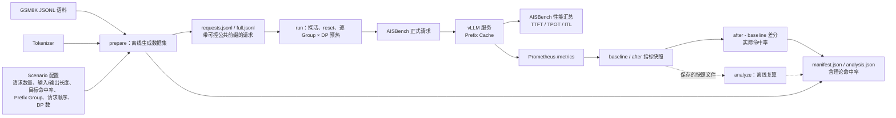

# 变长与指定prefix cache命中率数据生成/压测和多模态数据生成

## 概述

AISBench Prefix Cache 插件用于生成变长与指定的prefix cache命中率数据集并执行压测，可以生成两类数据集：

- **纯文本数据集**：支持可控变长的输入/输出长度分布、公共前缀比例、Prefix Group 分组和请求顺序，并可指定全局理论 Prefix Cache 命中率（如 60%），生成带可控公共前缀的请求数据。针对纯文本数据集，prefix cache插件先离线计算理论 Prefix Cache 命中率，`run` 再通过 AISBench 与 vLLM 采集实际命中率并进行对比。它适用于验证输入长度、公共前缀比例、Prefix Group、请求顺序以及单入口多 DP 对缓存命中率的影响
- **多模态数据集**：基于 MMMU 图片生成固定图片场景的多模态请求（单图 1080P、五图 720P），见[「多模态数据集生成与压测」](#多模态数据集生成与压测)。

插件整体流程：按 Scenario 配置从 GSM8K 语料中选取样本，结合 tokenizer 离线构造带可控公共前缀的请求数据并计算理论命中率；`run` 将请求发送到 vLLM 执行压测；最后通过 Prometheus 指标在压测前后的差分得到实际命中率，并与理论值对比：



插件提供五个子命令：

| 命令         | 作用                                   |
| ---------- | ------------------------------------ |
| `inspect`  | 预览场景配置、理论命中率可达范围与长度分布。               |
| `prepare`  | 生成正式请求数据、Manifest 与理论分析。             |
| `validate` | 校验已有产物是否被修改、截断或换序。                   |
| `run`      | 探活、reset、按组逐 DP 预热并执行 AISBench 正式压测。 |
| `analyze`  | 使用两份 Prometheus 快照离线复算实际命中率。         |

***

## 前置条件

1. **Python 3.10 或更高版本**。
2. **可正常使用的 AISBench 仓库及依赖**。
3. **与目标 vLLM 服务一致的 tokenizer**。tokenizer 不一致会造成 token 长度、Block 边界和理论命中率偏差。
4. **JSONL 语料**。每个非空行必须是 JSON 对象，并包含 Scenario 中 `corpus.field` 指定的文本字段，默认是 GSM8K 数据集中的`question`，若想用gsm8k类似的语料，需要参考gsm8k的格式。
5. **正确的 Prefix Cache Block 大小**。`tokenizer.block_size` 必须与目标服务实际值一致。
6. **在线** **`run`** **所需服务能力**：`/v1/completions`、`/metrics`、可选 `/reset_prefix_cache`；多 DP 时还需支持 `X-data-parallel-rank` 定向路由和带 `engine` 标签的分 DP 指标。

***

## 安装

以下命令假设当前目录是 AISBench 仓库根目录。

**仅生成数据集**：只使用 `inspect`、`prepare`、`validate`、`analyze` 等离线命令时，安装插件本身即可：

```shell
conda create --name ais_bench python=3.10 -y
conda activate ais_bench
pip3 install -e ./plugins/prefix_cache
```

**执行在线压测**：`run` 需要以 `perf` 模式启动 AISBench 正式压测，请先参考 [AISBench 工具安装文档](../get_started/install.md) 安装 AISBench 及服务化压测依赖（推荐使用 Conda 管理环境）：

```shell
pip3 install -e ./ --use-pep517
pip3 install -r requirements/api.txt
pip3 install -r requirements/extra.txt
ais-bench-prefix-cache --help
```

`-e` 表示 editable 安装，修改当前仓库源码后通常不需要重新安装。

***

## 快速开始

复制示例 Scenario：

```shell
cp ./plugins/prefix_cache/config_examples/scenario.example.json ./scenario.json
```

至少检查 `tokenizer.path`、`tokenizer.block_size` 和 `corpus.path`。需要模拟 cold 多 DP 路由或生成 warmup 计划时，还应让 `service.dp_size` 与目标服务一致。执行在线压测前还要核对 `service` 下的 URL、`model` 以及 `aisbench.config`。

一个最小示例。该示例生成一个纯文本 Prefix Cache 数据集：

- 100 条正式请求，每条输入固定 1024 token、最多输出 32 token，自然后缀语料从 GSM8K 中按种子随机选取；
- 所有请求属于同一个 Prefix Group，按组内交错顺序发送；
- 目标全局理论 Prefix Cache 命中率为 60%，缓存模式为 `warmup`，`run` 时会先逐 `Prefix Group × DP rank` 预热缓存再正式压测；
- 目标服务为单个 HTTP 入口，内部 2 个 DP rank。

```json
{
  "schema_version": "1.0",
  "run": {
    "run_id": "gsm8k-prefix-cache-60",
    "random_seed": 42,
    "output_dir": "./outputs/gsm8k-prefix-cache-60"
  },
  "tokenizer": {
    "path": "/path/to/tokenizer",
    "block_size": 16
  },
  "corpus": {
    "path": "./GSM8K.jsonl",
    "field": "question",
    "selection": {"mode": "random"}
  },
  "requests": {
    "count": 100,
    "input_length": {"mode": "fixed", "value": 1024},
    "output_length": {"mode": "fixed", "value": 32}
  },
  "prefix_cache": {
    "mode": "warmup",
    "target_hit_rate": 0.6,
    "seed_blocks": 1,
    "groups": {"count": 1, "assignment": {"mode": "uniform"}},
    "order": {"strategy": "interleave"}
  },
  "service": {"dp_size": 2}
}
```

示例中各字段的含义：

| 字段                             | 说明                                   |
| ------------------------------ | ------------------------------------ |
| `run.run_id`                   | 任务名称；执行时会自动追加时间戳。                    |
| `run.random_seed`              | 数据生成和随机选择的全局种子，相同配置可复现。              |
| `run.output_dir`               | Prefix Cache 产物基础目录。                 |
| `tokenizer.path`               | Tokenizer 路径，必须与目标 vLLM 服务一致。        |
| `tokenizer.block_size`         | Prefix Cache Block 大小，必须与服务实际值一致。    |
| `corpus.path` / `corpus.field` | GSM8K JSONL 语料路径和问题文本字段名。            |
| `corpus.selection.mode`        | 语料选择模式；`random` 表示按种子确定性打乱。          |
| `requests.count`               | 正式请求总数。                              |
| `requests.input_length`        | 输入 token 长度规则；示例为固定 1024 token。      |
| `requests.output_length`       | 最大输出 token 长度规则；示例为固定 32 token。      |
| `prefix_cache.mode`            | 缓存模式：`cold` 或 `warmup`；示例为 `warmup`。 |
| `prefix_cache.target_hit_rate` | 期望的全局 Prefix Cache 命中率。              |
| `prefix_cache.seed_blocks`     | 每条请求唯一 seed 占用的 Block 数。             |
| `prefix_cache.groups`          | Prefix Group 数量与分配规则；示例为 1 组、均匀分配。   |
| `prefix_cache.order.strategy`  | 正式请求排列策略；示例为按组交错。                    |
| `service.dp_size`              | 单实例内部 DP rank 数量。                    |

完整参数见下文[「Scenario 参数说明」](#scenario-参数说明)。多模态压测还需追加 `multimodal` 段，见[「多模态数据集生成与压测」](#多模态数据集生成与压测)。

依次执行推荐工作流：

```shell
ais-bench-prefix-cache inspect --scenario ./scenario.json
ais-bench-prefix-cache prepare --mode text --scenario ./scenario.json
ais-bench-prefix-cache validate --manifest \
  ./outputs/gsm8k-prefix-cache-60_<时间戳>/result/gsm8k-prefix-cache-60_<时间戳>.manifest.json
ais-bench-prefix-cache run --scenario ./scenario.json
```

各命令的作用：

- `inspect`：离线预览场景配置、理论命中率可达范围与长度分布，不生成正式产物、不访问服务；
- `prepare --mode text`：离线生成带可控公共前缀的正式请求数据，以及 Manifest 和理论分析等产物；
- `validate`：校验已有产物是否被手工修改、截断、换序或版本不符；manifest 路径中的时间戳目录可从 `prepare` 输出 JSON 的 `manifest` 字段获取；
- `run`：连接 vLLM 执行在线压测，先探活、reset、按组逐 DP 预热，再运行 AISBench 正式请求，采集实际命中率与 TTFT/TPOT/ITL 等性能指标。

详细用法见下文[「命令详解」](#命令详解)。

***

## 命令详解

### `inspect`：检查配置和理论范围

```shell
ais-bench-prefix-cache inspect --scenario ./scenario.json
```

作用：

- 只解析 Scenario，生成长度、分组、顺序、cold DP 路由和共享前缀理论计划，不加载 tokenizer/GSM8K、不构造 prompt；
- 展示 requested / effective / theoretical 命中率、组分布、输入/输出长度摘要和 cold DP 路由；
- 不访问 vLLM、不发送请求。

其中 requested 是 Scenario 请求的目标命中率，effective 是求解器选择的最近可达目标，theoretical 是按最终发送顺序模拟的理论值。

每次 `inspect` 创建新的 `_YYYYMMDD_HHMMSS` 时间戳目录，产物包括：

- `output_dir_<时间戳>/log/<run_id>_<时间戳>.inspect.log`：详细日志；
- `output_dir_<时间戳>/result/<run_id>_<时间戳>.manifest.json`：轻量 Manifest，`status="inspected"`，摘要在 `inspect.summary`；
- stdout 输出 JSON 摘要，主要字段如下。

| 字段                                | 说明                            |
| --------------------------------- | ----------------------------- |
| `run_id`                          | Scenario 中未追加时间戳的任务名。         |
| `mode`                            | `cold` 或 `warmup` 模式。         |
| `requested_target_hit_rate`       | 用户请求的目标命中率。                   |
| `effective_target_hit_rate`       | 最近可达目标命中率。                    |
| `theoretical_hit_rate`            | 预计理论命中率。                      |
| `reachable_min` / `reachable_max` | 全局最小/最大可达命中率。                 |
| `target_reachable`                | 请求目标是否处于可达区间。                 |
| `trajectory`                      | 求解策略、轨迹状态（`PASS`/`BEST_EFFORT`）和问题列表。 |
| `group_reachability`              | 各 Prefix Group 的可达范围。         |
| `groups`                          | 各 Group 的请求数量。                |
| `input_tokens` / `output_tokens`  | 输入/输出长度统计和总 token 数。          |
| `dp_route_counts`                 | 各 DP rank 的正式请求数。             |
| `sends_requests`                  | 是否发送在线请求；inspect 固定为 `false`。 |
| `planning_only`                   | 固定为 `true`，表示只做配置级理论规划。       |
| `content_validation_deferred_to_prepare` | 固定为 `true`，语料、canonical 前缀和 tokenizer round-trip 留到 prepare 校验。 |
| `log` / `manifest`                | 日志文件和 inspect Manifest 路径。    |

后续 `prepare` / `run` 可通过匹配的 Manifest 复用同一时间戳目录。

大规模 cold 场景按 `(Prefix Group, DP rank)` 分 lane 构造，使每条独立 lane 的累计命中率平缓收敛到有效目标；小型不规则场景保留受限 beam search。cold 轨迹按 lane 检查，不会把另一个 lane 的首次必然 miss 误报为全局回落。某条 lane 无法平滑或进入精确回退时，状态为 `BEST_EFFORT` 并只告警。

设 `N` 为请求数、`cap_i` 为请求 `i` 可用的 Prefix Block 数、`T` 为全部生成 prompt 的输入 token 数：

| 条件 | 规划路径 | 复杂度/限制 |
| --- | --- | --- |
| warmup | 累计输入比例分配 | `O(N)`。 |
| cold 且 `256 × Σ(cap_i + 1) <= 2,000,000` | 受限 beam search | 最多保留 256 个状态，状态转移受阈值限制。 |
| cold、大于阈值且 lane 内长度/容量非递减 | scalable lane 构造 | `O(N log N)` 时间、`O(N)` 空间。 |
| cold、大于阈值但不满足 scalable 前提 | exact lane fallback | 保证最终 hit token 精确，并在 `trajectory.issues` 记录回退原因。 |

`inspect` 只执行上述规划；`prepare` 还要对总计 `T` 个输入 token 进行 prompt 构造、tokenizer round-trip 和落盘，端到端约为 `O(T + N log N)`。实际时间由 tokenizer、CPU、磁盘和 prompt 总长度决定。1818 请求、总输入 156,377,088 token、`block_size=128` 的大规格验证场景估算为 312,524,800 次 beam 状态转移，因此直接选择 scalable 路径。

### `prepare`：生成正式数据产物

```shell
ais-bench-prefix-cache prepare --mode text --scenario ./scenario.json
```

- `--mode`：必填。`text` 生成文本压测数据；`mm` 生成多模态压测数据（见[多模态数据集生成与压测](#多模态数据集生成与压测)和 [MULTIMODAL.md](https://github.com/AISBench/benchmark/blob/master/plugins/prefix_cache/MULTIMODAL.md)）。
- `--scenario`：Scenario 文件路径。
- `--overwrite`：可选。只覆盖本次时间戳目录内该 run 对应的产物文件，不会清理整个输出目录。

`prepare` 根据 Scenario 确定性生成并校验四个文件：

- `result/<run_id>_<时间戳>.full.jsonl`
- `result/<run_id>_<时间戳>.requests.jsonl`
- `result/<run_id>_<时间戳>.manifest.json`（`status="prepared"`）
- `result/<run_id>_<时间戳>.analysis.json`（`status="prepared"`）

执行时先在 stderr 显示 prompt 生成进度，最后一行结果 JSON 写入 stdout：

```text
Generate prompts [###############---------------] 50/100  50%
Generate prompts [##############################] 100/100 100%
{"full":"...","requests":"...","manifest":"...","analysis":"...","log":"..."}
```

例如配置为 `run_id: gsm8k-prefix-cache-60`、`output_dir: ./outputs/gsm8k-prefix-cache-60` 时，实际目录为：

```text
./outputs/gsm8k-prefix-cache-60_20260825_123456/
├── log/
│   └── gsm8k-prefix-cache-60_20260825_123456.prepare.log
└── result/
    ├── gsm8k-prefix-cache-60_20260825_123456.full.jsonl
    ├── gsm8k-prefix-cache-60_20260825_123456.requests.jsonl
    ├── gsm8k-prefix-cache-60_20260825_123456.manifest.json
    └── gsm8k-prefix-cache-60_20260825_123456.analysis.json
```

`prepare` 会自动发现最近一次与当前 Scenario SHA-256 匹配的 `inspected` Manifest，并在同一路径把它升级为正式 `prepared` Manifest；否则创建新时间戳。修改 Scenario 后旧 Manifest 自动失配并创建新时间戳，正常工作流不需要手动修改 `run_id` 或 `output_dir`。

### `validate`：校验已有产物

```shell
ais-bench-prefix-cache validate --manifest \
  ./outputs/gsm8k-prefix-cache-60_<时间戳>/result/gsm8k-prefix-cache-60_<时间戳>.manifest.json
```

- `--manifest`：待校验的 Manifest 路径，校验逻辑根据 Manifest 的 `benchmark_mode` 自动区分 text/mm。

作用：不生成数据、不访问 vLLM，只检查：

- Manifest、full 和 requests 行数是否一致；
- `sequence_index` 是否连续；
- requests 是否严格只含 `question`、`answer` 以及 `output.output_key` 指定的可选第三字段；
- requests 与 full 是否逐行对应；
- full 和 requests 的 SHA-256 是否匹配 Manifest。

它用于发现文件被手工编辑、截断、换序或使用了错误版本。stdout 输出 `ok`、`rows`、`run_id`，详细日志写入 Manifest 所在时间戳目录的 `log/<run_id>_<时间戳>.validate.log`。

### `run`：执行 vLLM Prefix Cache 压测

```shell
ais-bench-prefix-cache run --scenario ./scenario.json
ais-bench-prefix-cache run --scenario ./scenario.json --config ./my_prefix_cache_perf.py
```

- `--scenario`：提供数据构造、服务、验证和 AISBench 参数。
- `--config`：可选，仅 text 模式支持，临时覆盖本次运行使用的 AISBench Python 配置模板，不修改 Scenario。

`run` 执行前需要已有匹配的 `prepared` Manifest（即先执行 `prepare`），执行时自动识别 text/mm 模式并复用同时间戳产物。完整流程为：

1. 校验本时间戳的产物；
2. 逐 DP 探活，多 DP 请求使用 `X-data-parallel-rank` 定向路由；
3. reset Prefix Cache；未配置 `reset_url` 或 reset 失败时，只有 `service.assume_empty_cache=true` 才会告警后继续；
4. warmup 模式按 Manifest 的 `warmup.plan` 逐 `Prefix Group × DP rank` 定向预热；
5. 采集 baseline，将 Scenario 中的 AISBench 配置渲染为临时 Python 配置并以 `perf` 模式启动 AISBench 正式请求；期间按 `service.poll_interval_seconds` 周期采样 KV Cache 用量（设为 `0` 可关闭）；
6. 采集 after，以 `after - baseline` 计算每 DP 和全局实际命中率，并把 `runtime`、`actual`、理论/实际差值和告警写回 analysis。

产物包括：

- `log/<run_id>_<时间戳>.run.log`：插件阶段日志，不回显到终端；
- `result/<run_id>_<时间戳>.analysis.json`：追加 `runtime`、`actual` 和偏差字段，`status="complete"`；
- AISBench 子进程结果：默认写入 `aisbench.work_dir`（`./outputs/default`），TTFT/TPOT/ITL 等性能汇总位于 `performances/<model-abbr>/`，可用 `ais-bench-prefix-cache report --manifest <manifest路径>` 查看；
- stdout：先打印 AISBench 风格的结果标题，再以 `Prefix Cache Metric | Value` 两列表格展示总体目标命中率、总体理论命中率、总体实际命中率、理论与实际偏差、理论与目标偏差，最后输出完整 analysis 路径。

补充说明：

- 正式请求默认使用 vLLM SSE 流式响应（`aisbench.model.stream=true`），生成 TTFT、TPOT、ITL、E2EL 与吞吐量指标；设为 `false` 后仍可统计 Prefix Cache 命中率，但不能生成完整 TTFT、TPOT 和 ITL。
- 插件 warmup 与 AISBench 自带的 `--num-warmups` 是两套独立机制。若要求 baseline 后只包含正式请求，应在 Scenario 中设置 `"extra_args": {"--num-warmups": 0}`（示例 Scenario 已默认配置）。
- 多 DP 使用同一个 HTTP 入口，要求服务支持 `X-data-parallel-rank` 定向路由及带 `engine` 标签的分 DP Prometheus 指标。

### `analyze`：使用 Prometheus 快照离线复算

```shell
ais-bench-prefix-cache analyze \
  --manifest <manifest路径> \
  --baseline ./baseline.prom \
  --after ./after.prom
```

- `--manifest`：prepared Manifest；命令先校验产物完整性，再从 `effective_config.service` 读取 `dp_size`、`engine_label_map` 和告警阈值。
- `--baseline`：正式统计窗口开始前保存的完整 Prometheus 文本。
- `--after`：正式统计窗口结束后保存的完整 Prometheus 文本；queries/hits 是累计 counter，应不小于 baseline。

该命令不连接 vLLM、不运行 AISBench，只解析两份快照，按 DP 计算增量后汇总实际命中率并与理论值比较，以 `status="analyzed"` 写回 Manifest 对应的 analysis 文件，stdout 输出完整 analysis JSON。插件日志写入 `log/<run_id>_<时间戳>.validate.log`。

`baseline.prom` 和 `after.prom` 不是 `prepare` 生成的数据集文件，而是同一个 vLLM 服务 `/metrics` 端点在正式统计窗口前后的完整文本快照。手工采集时，应先完成 reset；warmup 场景还要先完成插件预热，然后在第一条正式请求前保存 baseline，并在最后一条正式请求完成后立即保存 after：

```shell
METRICS_URL="http://127.0.0.1:8000/metrics"
curl -fsS "$METRICS_URL" -o baseline.prom
# 在这里执行正式压测请求，期间不要重启 vLLM 或重置指标
curl -fsS "$METRICS_URL" -o after.prom
```

两份快照必须来自同一服务进程并覆盖全部 DP rank，多 DP 指标需保留 `engine` 标签。正常执行 `run` 时插件已自动采集这两个时点，并把原始文本写入 analysis 的 `runtime.metrics_baseline.raw_prometheus` 和 `runtime.metrics_after.raw_prometheus`，如需离线复算可导出：

```shell
ANALYSIS="./outputs/<run_id_时间戳>/result/<run_id_时间戳>.analysis.json"
jq -r '.runtime.metrics_baseline.raw_prometheus' "$ANALYSIS" > baseline.prom
jq -r '.runtime.metrics_after.raw_prometheus' "$ANALYSIS" > after.prom
```

`analyze` 适用于历史结果复核、解析逻辑升级后的重算、外部压测流量分析和 CI 校验；成功的 `run` 已在线完成同样的差分分析，通常无需再次执行。

***

## Scenario 参数说明

完整逐字段参考见 [Scenario 配置参数说明](https://github.com/AISBench/benchmark/blob/master/plugins/prefix_cache/config_examples/scenario.example.md)。Scenario 采用严格白名单，未列出的字段会被拒绝；省略的字段使用示例默认值。

| 配置路径                                                     | 简短说明                                                                                                                                                                                                                                                                                                                                                                                                                                                                                  |
| -------------------------------------------------------- | ------------------------------------------------------------------------------------------------------------------------------------------------------------------------------------------------------------------------------------------------------------------------------------------------------------------------------------------------------------------------------------------------------------------------------------------------------------------------------------- |
| `schema_version`                                         | Scenario 配置格式版本；默认 `"1.0"`，当前只能为该值。                                                                                                                                                                                                                                                                                                                                                                                                                                                   |
| `run`                                                    | 任务标识、随机性和输出控制。                                                                                                                                                                                                                                                                                                                                                                                                                                                                        |
| `run.run_id`                                             | 任务名称，例 `"gsm8k-prefix-cache-60"`；执行时会追加时间戳，并作为四类产物的文件名前缀。                                                                                                                                                                                                                                                                                                                                                                                                                             |
| `run.random_seed`                                        | 数据生成和随机选择的全局种子，例 `42`；控制语料选择、长度采样、组分配、顺序和唯一 seed，相同配置可复现。                                                                                                                                                                                                                                                                                                                                                                                                                             |
| `run.output_dir`                                         | Prefix Cache 产物基础目录，例 `"./outputs/gsm8k-prefix-cache-60"`；执行时在最后一级目录名后追加时间戳。                                                                                                                                                                                                                                                                                                                                                                                                          |
| `run.overwrite`                                          | 是否允许覆盖同名正式产物；默认 `false`，重建使用 `prepare --overwrite`。                                                                                                                                                                                                                                                                                                                                                                                                                                   |
| `tokenizer`                                              | Tokenizer 加载与 Block 配置。                                                                                                                                                                                                                                                                                                                                                                                                                                                               |
| `tokenizer.path`                                         | Tokenizer 模型或目录路径，例 `"/home/weights/Qwen3.6-27B"`；传给 `AutoTokenizer.from_pretrained`，必须与 vLLM 服务端一致。                                                                                                                                                                                                                                                                                                                                                                                  |
| `tokenizer.block_size`                                   | Prefix Cache 的 token Block 大小，例 `16`；公共前缀和 seed 按它对齐，必须与服务端实际值一致。                                                                                                                                                                                                                                                                                                                                                                                                                     |
| `tokenizer.revision`                                     | Tokenizer 的分支、tag 或 commit，用于固定版本；默认 `null`。                                                                                                                                                                                                                                                                                                                                                                                                                                          |
| `tokenizer.trust_remote_code`                            | 是否执行模型仓库的自定义 tokenizer 代码；默认 `false`，只应对可信仓库启用。                                                                                                                                                                                                                                                                                                                                                                                                                                       |
| `corpus`                                                 | 自然后缀语料配置。                                                                                                                                                                                                                                                                                                                                                                                                                                                                             |
| `corpus.path`                                            | JSONL 语料文件路径，例 `"./GSM8K.jsonl"`；语料格式需与 GSM8K 一致。                                                                                                                                                                                                                                                                                                                                                                                                                                     |
| `corpus.field`                                           | JSONL 中的问题文本字段名，默认 `"question"`；只使用该字段，不拼接标准答案。                                                                                                                                                                                                                                                                                                                                                                                                                                       |
| `corpus.selection`                                       | 语料样本选择规则，默认 `{"mode": "random"}`。                                                                                                                                                                                                                                                                                                                                                                                                                                                     |
| `corpus.selection.mode`                                  | 选择模式：`random`（按 `run.random_seed` 确定性打乱，例 `{"mode": "random"}`）、`indices`（零基行号，例 `{"mode": "indices", "values": [0, 15, 72]}`）、`question_sha256`（规范化 question 的 SHA-256，例 `{"mode": "question_sha256", "values": ["<64位SHA-256>"]}`）、`mixed`（先 `indices` 后 `question_sha256`，例 `{"mode": "mixed", "indices": [0, 15], "question_sha256": ["<SHA-256>"]}`）。                                                                                                                            |
| `corpus.selection.values`                                | 非 mixed 模式的行号或哈希值列表，例 `[0, 15, 72]`；指定样本不足时按已选顺序循环复用。                                                                                                                                                                                                                                                                                                                                                                                                                                 |
| `corpus.selection.indices`                               | mixed 模式的零基行号列表，例 `[0, 15]`。                                                                                                                                                                                                                                                                                                                                                                                                                                                          |
| `corpus.selection.question_sha256`                       | mixed 模式的问题 SHA-256 列表，例 `["<规范化问题的SHA-256>"]`；与 `indices` 不能同时为空。                                                                                                                                                                                                                                                                                                                                                                                                                    |
| `requests`                                               | 正式请求数量和长度分布。                                                                                                                                                                                                                                                                                                                                                                                                                                                                          |
| `requests.count`                                         | 正式请求总数，例 `100`；必须是正整数，warmup 请求不计入。                                                                                                                                                                                                                                                                                                                                                                                                                                                   |
| `requests.input_length`                                  | 输入 token 长度生成规则，默认 `{"mode": "fixed", "value": 1024}`；所有长度必须为正整数，数量必须等于对应请求数。                                                                                                                                                                                                                                                                                                                                                                                                         |
| `requests.input_length.mode`                             | 输入长度模式：`fixed`（固定长度，例 `{"mode": "fixed", "value": 1024}`）、`explicit`（显式长度列表，例 `{"mode": "explicit", "values": [512, 768, 1024, 2048]}`）、`range`（闭区间采样，例 `{"mode": "range", "ranges": [{"min": 512, "max": 1024, "count": 80}, {"min": 2048, "max": 4096, "count": 20}]}`）、`truncated_normal`（截断正态分布，只接受 `[min,max]` 内的整数采样，例 `{"mode": "truncated_normal", "min": 512, "max": 2048, "mean": 1024, "std": 256}`）、`csv`（从 CSV 文件读取，例 `{"mode": "csv", "path": "./input_lengths.csv"}`）。 |
| `requests.input_length.value`                            | `fixed` 模式的固定长度，例 `1024`；省略时默认 1024。                                                                                                                                                                                                                                                                                                                                                                                                                                                  |
| `requests.input_length.values`                           | `explicit` 模式的长度列表，例 `[512, 768, 1024, 2048]`；元素数量必须等于对应请求数。                                                                                                                                                                                                                                                                                                                                                                                                                          |
| `requests.input_length.ranges`                           | `range` 模式的区间列表；每个区间含 `min`、`max`（均含）和 `count`，例 `{"min": 512, "max": 1024, "count": 80}`；所有 `count` 之和必须等于对应请求数，采样由 `random_seed` 决定。                                                                                                                                                                                                                                                                                                                                                |
| `requests.input_length.ranges[].min`                     | 单个采样区间下界（含），例 `512`。                                                                                                                                                                                                                                                                                                                                                                                                                                                                  |
| `requests.input_length.ranges[].max`                     | 单个采样区间上界（含），例 `1024`。                                                                                                                                                                                                                                                                                                                                                                                                                                                                 |
| `requests.input_length.ranges[].count`                   | 单个区间生成的请求数，例 `80`。                                                                                                                                                                                                                                                                                                                                                                                                                                                                    |
| `requests.input_length.min`                              | `truncated_normal` 分布下界，例 `512`；`min=max` 等价于固定长度。                                                                                                                                                                                                                                                                                                                                                                                                                                    |
| `requests.input_length.max`                              | `truncated_normal` 分布上界，例 `2048`。                                                                                                                                                                                                                                                                                                                                                                                                                                                     |
| `requests.input_length.mean`                             | `truncated_normal` 均值，例 `1024`；默认取区间中点。                                                                                                                                                                                                                                                                                                                                                                                                                                               |
| `requests.input_length.std`                              | `truncated_normal` 标准差，例 `256`；默认按区间宽度推导，显式设置时必须大于 0。                                                                                                                                                                                                                                                                                                                                                                                                                                 |
| `requests.input_length.path`                             | `csv` 模式的长度文件路径，例 `"./input_lengths.csv"`；需包含 `input_prompt_tokens`、`content_tokens` 或 `input_tokens` 中的一列，行数必须等于对应请求数。                                                                                                                                                                                                                                                                                                                                                               |
| `requests.output_length`                                 | 最大输出 token 长度生成规则，默认 `{"mode": "fixed", "value": 32}`；该值写入 requests 的 `max_tokens`，所有长度必须为正整数，数量必须等于对应请求数。                                                                                                                                                                                                                                                                                                                                                                            |
| `requests.output_length.mode`                            | 输出长度模式：`fixed`（例 `{"mode": "fixed", "value": 32}`）、`uniform`（区间均匀采样，例 `{"mode": "uniform", "min": 16, "max": 64}`）、`truncated_normal`（例 `{"mode": "truncated_normal", "min": 16, "max": 128, "mean": 64, "std": 16}`）、`csv`（例 `{"mode": "csv", "path": "./output_lengths.csv"}`）。                                                                                                                                                                                                     |
| `requests.output_length.value`                           | `fixed` 模式的固定长度，例 `32`；省略时默认 32。                                                                                                                                                                                                                                                                                                                                                                                                                                                      |
| `requests.output_length.min`                             | `uniform` / `truncated_normal` 模式下界，例 `16`。                                                                                                                                                                                                                                                                                                                                                                                                                                           |
| `requests.output_length.max`                             | `uniform` / `truncated_normal` 模式上界，例 `64`；要求 `max >= min`，`min=max` 时返回固定值。                                                                                                                                                                                                                                                                                                                                                                                                          |
| `requests.output_length.mean`                            | `truncated_normal` 均值，例 `64`；默认取区间中点。                                                                                                                                                                                                                                                                                                                                                                                                                                                 |
| `requests.output_length.std`                             | `truncated_normal` 标准差，例 `16`。                                                                                                                                                                                                                                                                                                                                                                                                                                                        |
| `requests.output_length.path`                            | `csv` 模式的长度文件路径，例 `"./output_lengths.csv"`；列名必须为 `output_tokens`，行数必须等于对应请求数。                                                                                                                                                                                                                                                                                                                                                                                                         |
| `output`                                                 | 精简请求文件的字段控制。                                                                                                                                                                                                                                                                                                                                                                                                                                                                          |
| `output.output_key`                                      | 可选输出长度字段名：`null`（默认，每行只有 `question`、`answer`）、`"max_tokens"` 或 `"output_tokens"`（追加第三字段，值来自该请求的最大输出 token 数，例 `{"output_key": "max_tokens"}`）；`full.jsonl` 始终保留 `max_tokens`，省略不影响运行。                                                                                                                                                                                                                                                                                                 |
| `prefix_cache`                                           | Prefix Cache 数据和运行策略。                                                                                                                                                                                                                                                                                                                                                                                                                                                                 |
| `prefix_cache.mode`                                      | 缓存模式，默认 `warmup`：`cold`（每个 `(group_id, dp_rank)` lane 从零缓存水位开始，同一组的请求按组内出现顺序 round-robin 路由到各 DP rank）或 `warmup`（为每个 `Prefix Group × DP rank` 生成预热计划写入 Manifest 的 `warmup.plan`，`run` 在正式 baseline 之前定向预热；warmup 请求不写入 `requests.jsonl`，也不进入正式统计）。                                                                                                                                                                                                                                    |
| `prefix_cache.target_hit_rate`                           | 期望的全局 token 加权命中率，例 `0.6` 表示 60%；范围 `[0,1]`。                                                                                                                                                                                                                                                                                                                                                                                                                                          |
| `prefix_cache.seed_blocks`                               | 每条请求唯一 seed 占用的 Block 数，默认 `1`；seed 长度为 `seed_blocks × block_size`（例 `1 × 16 = 16` token），seed token 序列全局唯一，防止公共前缀结束后继续误共享。                                                                                                                                                                                                                                                                                                                                                           |
| `prefix_cache.minimum_non_shared_length`                 | 每条请求至少保留的非共享 token 数，例 `16`；默认等于 seed 长度，不能小于 seed 长度；公共前缀最大长度为 `floor((input_length - minimum_non_shared_length) / block_size) × block_size`。                                                                                                                                                                                                                                                                                                                                        |
| `prefix_cache.groups`                                    | Prefix Group 数量、分配和覆盖配置；每个 Group 独立生成 canonical 前缀并统计理论命中率。                                                                                                                                                                                                                                                                                                                                                                                                                           |
| `prefix_cache.groups.count`                              | Prefix Group 总数，例 `1`；插件生成 `group-0`、`group-1` 等 ID。                                                                                                                                                                                                                                                                                                                                                                                                                                  |
| `prefix_cache.groups.assignment`                         | 请求到 Group 的分配规则，默认 `{"mode": "uniform"}`。                                                                                                                                                                                                                                                                                                                                                                                                                                             |
| `prefix_cache.groups.assignment.mode`                    | Group 分配模式：`uniform`（尽量均匀分配，例 `{"mode": "uniform"}`）、`zipf`（用 `exponent` 控制热点集中程度，例 `{"mode": "zipf", "exponent": 1.0}`）、`weights`（用 `weights` 提供各组相对权重，例 `{"mode": "weights", "weights": [0.5, 0.3, 0.15, 0.05]}`）。                                                                                                                                                                                                                                                                  |
| `prefix_cache.groups.assignment.exponent`                | `zipf` 分布热点指数，例 `1.0`；必须大于 0，越大越集中于热点组（热度与 `1/rank^exponent` 成正比）。                                                                                                                                                                                                                                                                                                                                                                                                                    |
| `prefix_cache.groups.assignment.weights`                 | `weights` 模式的各组相对权重，例 `[0.5, 0.3, 0.15, 0.05]`；数量必须等于 `groups.count`，不能为负且总和大于 0，无需归一化。                                                                                                                                                                                                                                                                                                                                                                                               |
| `prefix_cache.groups.overrides`                          | 各 Group 的可选独立覆盖，默认 `{}`；ID 必须是 `group-0` 到 `group-(count-1)`。                                                                                                                                                                                                                                                                                                                                                                                                                         |
| `prefix_cache.groups.overrides.group-N.input_length`     | 指定 Group 的输入长度规则，例 `{"mode": "fixed", "value": 2048}`；支持全部全局模式，数量必须等于该组实际请求数。                                                                                                                                                                                                                                                                                                                                                                                                         |
| `prefix_cache.groups.overrides.group-N.output_length`    | 指定 Group 的输出长度规则，例 `{"mode": "fixed", "value": 64}`；数量必须等于该组实际请求数。                                                                                                                                                                                                                                                                                                                                                                                                                    |
| `prefix_cache.groups.overrides.group-N.corpus_selection` | 指定 Group 的语料选择规则，例 `{"mode": "indices", "values": [0, 1, 2]}`。                                                                                                                                                                                                                                                                                                                                                                                                                        |
| `prefix_cache.order`                                     | 正式请求排列规则，默认 `{"strategy": "interleave"}`；理论命中率始终按最终发送顺序重新模拟。                                                                                                                                                                                                                                                                                                                                                                                                                          |
| `prefix_cache.order.strategy`                            | 排列策略：`sequential`（保持生成顺序）、`within_group_shuffle`（每个 Group 内确定性打乱）、`interleave`（不同 Group 按轮次交错）、`global_shuffle`（全局确定性打乱）、`input_len_asc`（每个 Group 内按输入长度从短到长排序，再按组轮转交错，例 `{"strategy": "input_len_asc"}`）。要模拟“无预热、短请求到长请求逐步建立 Cache”，使用 `cold` + `input_len_asc`。                                                                                                                                                                                                                     |
| `service`                                                | 在线推理服务与指标采集配置。                                                                                                                                                                                                                                                                                                                                                                                                                                                                        |
| `service.inference_url`                                  | vLLM 推理接口地址，例 `"http://127.0.0.1:8000/v1/completions"`；`--mode text` 使用 Completions 接口，`--mode mm` 必须改为 Chat Completions（例 `http://127.0.0.1:8000/v1/chat/completions`）。                                                                                                                                                                                                                                                                                                              |
| `service.metrics_url`                                    | Prometheus 指标接口地址，例 `"http://127.0.0.1:8000/metrics"`。                                                                                                                                                                                                                                                                                                                                                                                                                                |
| `service.reset_url`                                      | Prefix Cache 重置接口地址，例 `"http://127.0.0.1:8000/reset_prefix_cache"`；为空或失败时仅在 `assume_empty_cache=true` 时继续。                                                                                                                                                                                                                                                                                                                                                                            |
| `service.model`                                          | 请求体中的服务模型名，例 `"model-name"`。                                                                                                                                                                                                                                                                                                                                                                                                                                                          |
| `service.dp_size`                                        | 单实例内部 DP rank 数量，默认 `2`；离线用于 cold 路由/warmup 计划，在线用于逐 DP 探活和指标校验。                                                                                                                                                                                                                                                                                                                                                                                                                      |
| `service.assume_empty_cache`                             | 无重置接口时是否假定缓存为空，默认 `false`；启用后记录 `ASSUME_EMPTY_CACHE`。                                                                                                                                                                                                                                                                                                                                                                                                                                 |
| `service.engine_label_map`                               | Prometheus `engine` 标签到 DP rank 的显式映射，默认 `{}`；未配置时尝试解析标签尾部数字。                                                                                                                                                                                                                                                                                                                                                                                                                         |
| `service.timeout_seconds`                                | 探活、预热和指标请求超时秒数，默认 `30`。                                                                                                                                                                                                                                                                                                                                                                                                                                                               |
| `service.api_key`                                        | 推理服务 Bearer Token，默认 `""`；不会明文落盘。                                                                                                                                                                                                                                                                                                                                                                                                                                                     |
| `service.poll_interval_seconds`                          | 正式压测期间 KV 指标采样间隔，默认 `5.0`；设为 `0` 可关闭周期采样（baseline/after 仍会采集）。                                                                                                                                                                                                                                                                                                                                                                                                                        |
| `validation`                                             | 结果偏差告警阈值，单位为百分点（pp）。                                                                                                                                                                                                                                                                                                                                                                                                                                                                  |
| `validation.target_warning_pp`                           | 理论值偏离目标的告警百分点，默认 `1.0`；例 60% 与 58.5% 相差 1.5 pp。                                                                                                                                                                                                                                                                                                                                                                                                                                       |
| `validation.actual_warning_pp`                           | 实际值偏离理论值的告警百分点，默认 `5.0`。                                                                                                                                                                                                                                                                                                                                                                                                                                                              |
| `aisbench`                                               | AISBench 正式压测启动配置。                                                                                                                                                                                                                                                                                                                                                                                                                                                                    |
| `aisbench.config`                                        | AISBench Python 配置模板路径，例 `"./plugins/prefix_cache/config_examples/prefix_cache_perf.py"`；可用 CLI `--config` 临时覆盖。                                                                                                                                                                                                                                                                                                                                                                      |
| `aisbench.work_dir`                                      | AISBench 结果基础目录，例 `"./outputs/default"`；相对 Scenario 所在目录解析，AISBench 会在其下追加执行时间戳。                                                                                                                                                                                                                                                                                                                                                                                                      |
| `aisbench.extra_args`                                    | 附加 CLI 参数键值对象，例 `{"--num-warmups": 0}`（展开为 `--num-warmups 0`）；标量展开为一个值、数组展开为同一参数的多个值，布尔 `true` 只输出参数名、`false` 不输出。                                                                                                                                                                                                                                                                                                                                                                    |
| `aisbench.dataset`                                       | Dataset reader 和 Prompt 映射配置；为保证理论 token 与实际 prompt 一致，`input_columns`、`output_column`、`prompt_template` 三个数据契约字段必须保持示例值，`abbr` / `pred_role` 可改。                                                                                                                                                                                                                                                                                                                                     |
| `aisbench.dataset.abbr`                                  | Dataset 展示简称，默认 `null`（使用带时间戳的 `run_id`）。                                                                                                                                                                                                                                                                                                                                                                                                                                             |
| `aisbench.dataset.input_columns`                         | Dataset reader 的输入列，默认 `["question", "max_out_len"]`；当前必须保持该值。                                                                                                                                                                                                                                                                                                                                                                                                                        |
| `aisbench.dataset.output_column`                         | Dataset reader 的参考答案列，默认 `"answer"`。                                                                                                                                                                                                                                                                                                                                                                                                                                                  |
| `aisbench.dataset.prompt_template`                       | 正式请求的 Prompt 模板，默认 `"{question}"`。                                                                                                                                                                                                                                                                                                                                                                                                                                                    |
| `aisbench.dataset.pred_role`                             | 预测结果的角色名称，默认 `"BOT"`。                                                                                                                                                                                                                                                                                                                                                                                                                                                                 |
| `aisbench.model`                                         | AISBench API Model 配置；旧 Scenario 省略时自动使用示例默认值。                                                                                                                                                                                                                                                                                                                                                                                                                                        |
| `aisbench.model.abbr`                                    | Model 展示简称，默认 `null`（使用 `<run_id>-vllm`）。                                                                                                                                                                                                                                                                                                                                                                                                                                             |
| `aisbench.model.attr`                                    | 模型属性；当前只能为 `"service"`，用于启用 AISBench service 性能链路和 TTFT 等指标汇总。                                                                                                                                                                                                                                                                                                                                                                                                                        |
| `aisbench.model.stream`                                  | 是否使用 SSE 流式响应，默认 `true`。                                                                                                                                                                                                                                                                                                                                                                                                                                                              |
| `aisbench.model.max_out_len`                             | Model 层的兜底最大输出长度，默认 `1`；正式请求优先使用 full.jsonl 中每行的 `max_tokens`。                                                                                                                                                                                                                                                                                                                                                                                                                        |
| `aisbench.model.retry`                                   | API 请求失败重试次数，默认 `2`。                                                                                                                                                                                                                                                                                                                                                                                                                                                                  |
| `aisbench.model.batch_size`                              | AISBench API 最大并发基值，默认 `1`。                                                                                                                                                                                                                                                                                                                                                                                                                                                           |
| `aisbench.model.generation_kwargs`                       | 透传给 vLLM 的生成参数，例 `{"temperature": 0, "ignore_eos": true}`。                                                                                                                                                                                                                                                                                                                                                                                                                            |

***

## 产物说明

所有正式数据产物位于时间戳输出目录的 `result/` 下，详细日志位于同级 `log/` 下：

```text
outputs/gsm8k-prefix-cache-60_20260825_123456/
├── log/
│   ├── gsm8k-prefix-cache-60_20260825_123456.inspect.log
│   ├── gsm8k-prefix-cache-60_20260825_123456.prepare.log
│   ├── gsm8k-prefix-cache-60_20260825_123456.validate.log
│   └── gsm8k-prefix-cache-60_20260825_123456.run.log
└── result/
    ├── gsm8k-prefix-cache-60_20260825_123456.full.jsonl
    ├── gsm8k-prefix-cache-60_20260825_123456.requests.jsonl
    ├── gsm8k-prefix-cache-60_20260825_123456.manifest.json
    └── gsm8k-prefix-cache-60_20260825_123456.analysis.json
```

| 产物               | 作用                                                                                                |
| ---------------- | ------------------------------------------------------------------------------------------------- |
| `full.jsonl`     | 完整审计数据，包括组、DP lane、输入长度、公共前缀、唯一 seed、GSM8K 来源、理论水位和碰撞状态。                                          |
| `requests.jsonl` | 最小 AISBench 请求；默认只有 `question`、`answer`，可由 `output.output_key` 追加 `max_tokens` 或 `output_tokens`。 |
| `manifest.json`  | 复现和校验入口：有效配置、输入哈希、tokenizer 指纹、长度分布、可达范围、组、DP、warmup 计划和产物哈希。                                     |
| `analysis.json`  | requested/effective/theoretical/actual 命中率、baseline/after 快照、分组/分 DP 统计、偏差与 warnings。             |

`service.api_key` 明文不会写入 Manifest，只记录 `api_key_configured`。

### `requests.jsonl` 字段

| 字段              | 说明                               |
| --------------- | -------------------------------- |
| `question`      | 发送给模型的完整 Prompt。                 |
| `answer`        | AISBench 使用的参考答案，当前固定为 `"none"`。 |
| `max_tokens`    | 可选的最大输出 token 数。                 |
| `output_tokens` | `max_tokens` 的可选别名。              |

`max_tokens` 和 `output_tokens` 由 `output.output_key` 二选一追加；默认 `null` 时都不出现。`full.jsonl.max_tokens` 始终保留，AISBench 从 full 读取生成长度，因此默认省略不影响运行。

### `full.jsonl` 字段

| 字段                              | 说明                                              |
| ------------------------------- | ----------------------------------------------- |
| `request_id`                    | 全局唯一的请求标识。                                      |
| `sequence_index`                | 最终发送顺序中的全局序号。                                   |
| `group_id`                      | 请求所属 Prefix Group。                              |
| `occurrence_index_within_group` | 请求在组内的出现序号。                                     |
| `dp_rank`                       | cold 模式下的目标 DP rank；warmup 正式请求为 `null`。        |
| `lane_sequence`                 | `(group_id, dp_rank)` lane 内序号；warmup 为 `null`。 |
| `target_input_tokens`           | 配置期望的输入 token 数。                                |
| `actual_input_tokens`           | Tokenizer 验证后的实际输入 token 数。                     |
| `max_tokens`                    | 该请求允许生成的最大 token 数。                             |
| `shared_prefix_tokens`          | 可复用公共前缀的 token 数。                               |
| `seed_tokens`                   | 全局唯一 seed 的 token 数。                            |
| `natural_suffix_tokens`         | 自然后缀的 token 数。                                  |
| `question`                      | 公共前缀、seed 和后缀组成的完整 Prompt。                      |
| `answer`                        | AISBench 参考答案。                                  |
| `gsm_indices`                   | 自然后缀使用的 GSM8K 零基行号。                             |
| `gsm_hashes`                    | 自然后缀对应问题的 SHA-256。                              |
| `canonical_prefix_sha256`       | 所属组 canonical 前缀摘要。                             |
| `seed_sha256`                   | 当前请求唯一 seed 摘要。                                 |
| `request_random_seed`           | 当前请求派生出的随机种子。                                   |
| `watermark_before`              | 请求前该缓存 lane 的模拟水位。                              |
| `theoretical_hit_tokens`        | 当前请求理论命中的 token 数。                              |
| `watermark_after`               | 请求后该缓存 lane 的模拟水位。                              |
| `theoretical_hit_rate`          | 当前请求理论命中率。                                      |
| `divergence_block_sha256`       | 用于验证分歧 Block 的摘要。                               |
| `divergence_unique`             | 分歧 Block 是否全局唯一。                                |
| `collision_status`              | 前缀或 seed 碰撞检查结果，成功产物为 `"pass"`。                 |

### `manifest.json` 顶层字段

| 字段                                             | 说明                           |
| ---------------------------------------------- | ---------------------------- |
| `schema_version`                               | Manifest 数据结构版本。             |
| `plugin_version`                               | 生成产物的插件版本。                   |
| `status`                                       | `inspected` 或 `prepared` 状态。 |
| `run_id`                                       | 带执行时间戳的任务标识。                 |
| `scenario_path` / `scenario_sha256`            | 原始 Scenario 路径及摘要。           |
| `effective_config` / `effective_config_sha256` | 补齐默认值后的有效配置及其摘要。             |
| `corpus_sha256`                                | GSM8K 语料文件摘要。                |
| `tokenizer`                                    | Tokenizer 身份和 Block 信息。      |
| `requests`                                     | 请求数、总 token 和长度摘要。           |
| `prefix_cache`                                 | 模式、命中率和可达性结果。                |
| `groups`                                       | 每个 Prefix Group 的独立统计。       |
| `dp`                                           | DP 数量和 cold 路由策略。            |
| `warmup`                                       | 是否启用及 Group × DP 预热计划。       |
| `divergence`                                   | seed/分歧块唯一性汇总。               |
| `artifacts`                                    | 各产物路径、大小和摘要。                 |
| `inspect`                                      | inspect-only Manifest 的预览信息。 |

正式 Manifest 使用除 `inspect` 外的上述字段；inspect-only Manifest 的 `status="inspected"`，预览结果保存在 `inspect.summary`。

### `analysis.json` 顶层字段

| 字段                                     | 说明                                                     |
| -------------------------------------- | ------------------------------------------------------ |
| `schema_version`                       | Analysis 数据结构版本。                                       |
| `run_id`                               | 对应的带时间戳任务标识。                                           |
| `status`                               | `prepared`、`complete`（run 后）或 `analyzed`（analyze 后）状态。 |
| `requested_target_hit_rate`            | Scenario 请求的目标命中率。                                     |
| `effective_target_hit_rate`            | 求解器选择的最近可达目标。                                          |
| `theoretical_hit_rate`                 | 按最终顺序模拟的理论命中率。                                         |
| `target_difference_pp`                 | 理论值与目标的绝对百分点差。                                         |
| `target_signed_difference_pp`          | 理论值减目标值的带符号百分点差。                                       |
| `target_absolute_difference_pp`        | 理论值与目标的绝对百分点差。                                         |
| `validation`                           | 可达性、状态和告警策略。                                           |
| `theory`                               | 理论 token、Group 和 DP 统计。                                |
| `warnings`                             | 本次产生的告警列表。                                             |
| `runtime`                              | baseline/after 快照、KV 采样等运行期信息；由 run/analyze 追加。        |
| `actual`                               | 指标差分得到的实际命中统计；由 run/analyze 追加。                        |
| `theory_actual_difference_pp`          | 实际值与理论值的绝对百分点差。                                        |
| `theory_actual_signed_difference_pp`   | 实际值减理论值的带符号百分点差。                                       |
| `theory_actual_absolute_difference_pp` | 实际值与理论值的绝对百分点差。                                        |

***

## 多模态数据集生成与压测

多模态模式用于生成固定图片场景的多模态数据集（单图 1080P 或五图 720P，两种场景二选一，如 1319 条单图 1080P 请求），与纯文本模式共用同一个 Scenario JSON 和命令入口：

```shell
ais-bench-prefix-cache prepare --mode mm --scenario ./scenario.json
ais-bench-prefix-cache run --scenario ./scenario.json
```

在文本配置基础上追加 `multimodal` 段即可：

```json
{
  "multimodal": {
    "mmmu_parquet_dir": "../../../../MMMU",
    "scenarios": ["single_1080p"]
  }
}
```

| 配置路径                          | 简短说明                                                                                                                                                                 |
| ----------------------------- | -------------------------------------------------------------------------------------------------------------------------------------------------------------------- |
| `multimodal`                  | 多模态压测（`--mode mm`）的图片场景配置。                                                                                                                                           |
| `multimodal.mmmu_parquet_dir` | MMMU Parquet 目录；`--mode mm` 时必填，相对路径以 Scenario 文件目录为基准。                                                                                                              |
| `multimodal.scenarios`        | 图片场景，`single_1080p` 与 `multi_720p_5` 只能二选一：`single_1080p` 为每请求 1 张相同的原生 1920×1080 MMMU 图片，`multi_720p_5` 为每请求重复同一张原生 1280×720 MMMU 图片 5 次；可省略，默认 `["single_1080p"]`。 |

多模态模式复用文本配置中的 `tokenizer.path`、`corpus`、`requests`、`run.output_dir`、`service` 和 `aisbench` 段；但 `requests.input_length` / `requests.output_length` 必须为 `fixed`，且不使用 `tokenizer.block_size` 和 `prefix_cache` 段（可省略，保留也不会对多模态文本长度施加 Block、共享前缀或非共享区限制）。`run`、`validate`、`report` 从 prepare 生成的 Manifest 中读取 `benchmark_mode`，不再接收 `--mode`。

图片按原生尺寸从 MMMU Parquet 的 `image_1`～`image_7` bytes 字段中严格选择，不进行缩放；图片编码为 Base64 data URL 发送，服务端无需访问本地 MMMU 路径。`stream=true` 是获得有效 TTFT、TPOT、ITL 的必要条件。完整说明见 [MULTIMODAL.md](https://github.com/AISBench/benchmark/blob/master/plugins/prefix_cache/MULTIMODAL.md)。

***

## 告警与退出码

| 告警                   | 条件                                             |
| -------------------- | ---------------------------------------------- |
| `TARGET_UNREACHABLE` | 请求目标不在 `[reachable_min, reachable_max]` 内。     |
| `TARGET_DEVIATION`   | 理论值与请求目标的绝对差超过 `validation.target_warning_pp`。 |
| `ACTUAL_DEVIATION`   | 实际值与理论值的绝对差超过 `validation.actual_warning_pp`。  |

这些告警只把 `analysis.json` 的展示状态改为 `PASS_WITH_WARNING`，不改变成功退出码。配置错误、产物损坏、服务能力不足或 AISBench 执行失败才会返回非零退出码。

***

## 更多资料

- [Prefix Cache 插件 README](https://github.com/AISBench/benchmark/blob/master/plugins/prefix_cache/README.md)
- [Scenario 配置参数说明](https://github.com/AISBench/benchmark/blob/master/plugins/prefix_cache/config_examples/scenario.example.md)
- [多模态压测 MULTIMODAL.md](https://github.com/AISBench/benchmark/blob/master/plugins/prefix_cache/MULTIMODAL.md)

