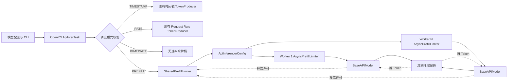
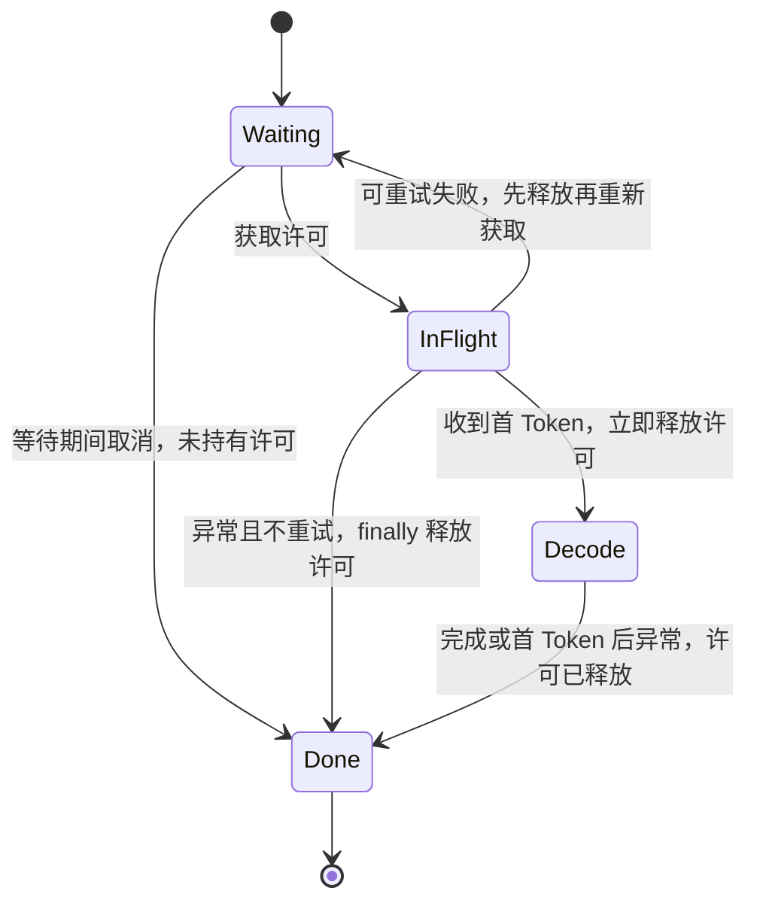
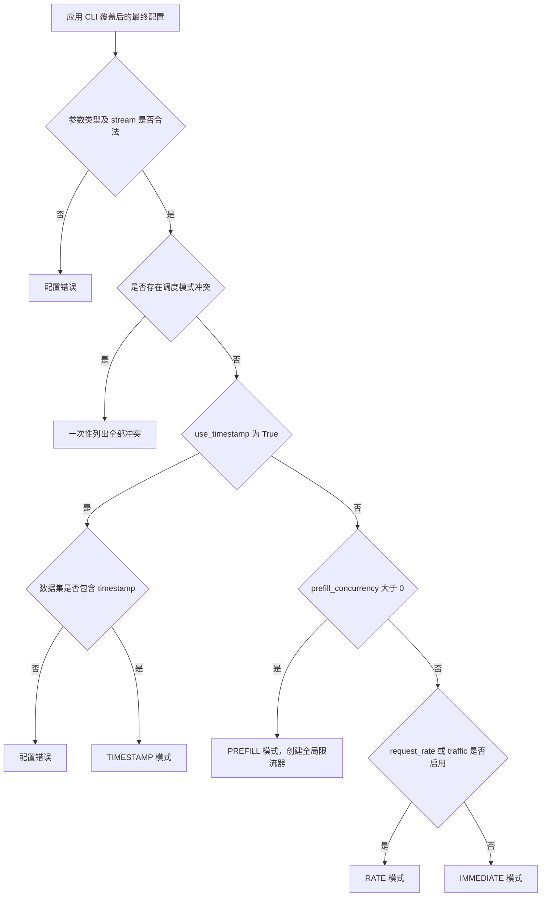
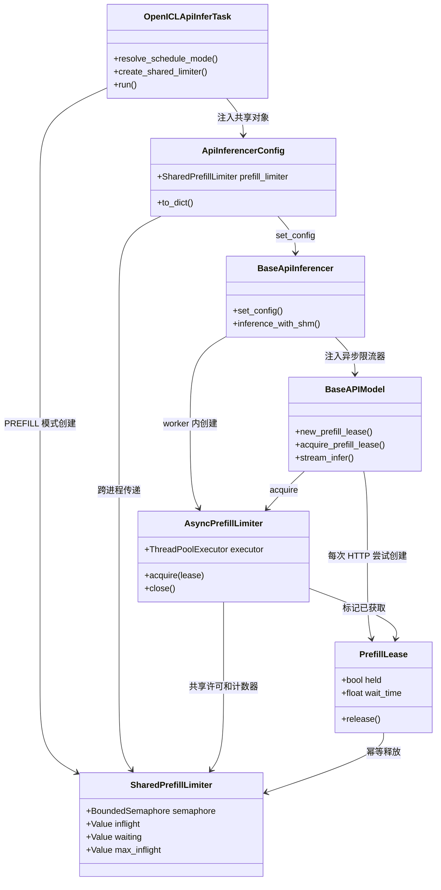
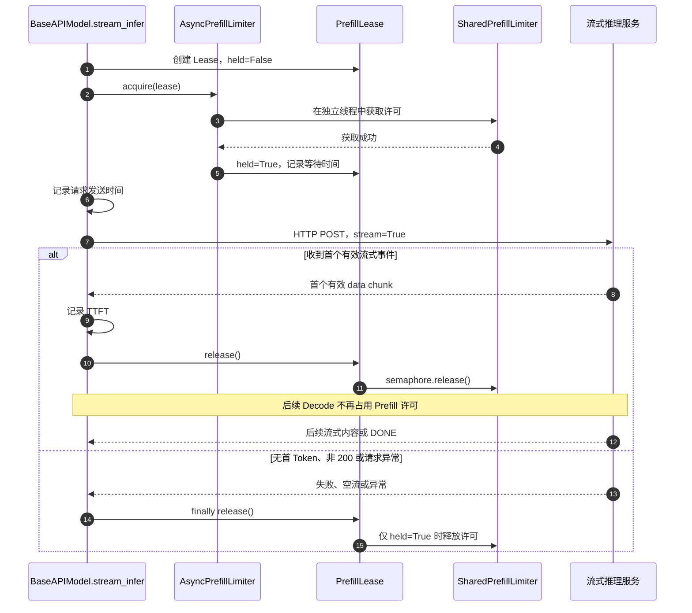

# [RFC] 新增基于首 Token 反馈的 Prefill 闭环并发控制

# 0. 基础信息

**状态（Status）：** Draft  
**作者（Authors）：** @待填写  
**创建日期（Created）：** 2026-11-05  
**更新日期（Updated）：** 2026-11-05  
**相关 Issue/PR：** 待填写

# 1. 概述

## 1.1 简介

本提案为 AISBench 新增 `prefill_concurrency` 参数，用于限制全局“已发送 HTTP 请求、但尚未收到首 Token”的请求数量。当参数为非零正整数时，客户端只有在该数量低于设定阈值时才发送新的请求；请求收到首 Token 后立即释放许可，后续 Decode 阶段不再占用该许可。

该机制以首 Token 返回作为服务端处理能力的反馈信号，使请求注入速度随 TTFT 动态变化，形成闭环控制。它主要面向流式性能测评中的 Prefill 承载能力探测、服务端保护和自适应负载注入场景。

为降低配置理解成本，本提案将调度模式定义为：

```text
时间戳模式 > Prefill 闭环并发模式 > Request Rate 模式
```

三种模式互斥。优先级用于配置检查和错误提示，不表示自动忽略低优先级参数；同时配置多个模式时直接报错，由用户显式选择最终模式。

## 1.2 动机

AISBench 当前支持通过 `request_rate` 和 `traffic_cfg` 进行开环速率控制，也支持通过数据集时间戳复现请求计划。但在以下场景中，固定速率难以准确匹配服务端的 Prefill 处理能力：

1. **输入长度和 TTFT 动态变化**：相同 RPS 在不同 Prompt 长度、缓存命中率和服务端负载下产生的 Prefill 压力差异明显。
2. **固定 RPS 过高**：请求在客户端或服务端堆积，TTFT 和尾延迟升高，难以区分服务端处理能力与请求注入过量的影响。
3. **固定 RPS 过低**：Prefill 节点容量闲置，无法充分评估服务端吞吐能力。
4. **多进程客户端缺乏阶段级全局限制**：现有 `batch_size` 控制完整请求生命周期，不能单独限制首 Token 之前的请求数量。

`prefill_concurrency` 将控制对象从“单位时间注入多少请求”改为“允许多少请求停留在首 Token 之前”：

```text
服务端变慢
  → TTFT 增大
  → Prefill 许可占用时间变长
  → 新请求发送自动减慢

服务端变快
  → TTFT 减小
  → Prefill 许可更快释放
  → 新请求发送自动加快
```

在许可持续饱和、系统处于稳态时，根据 Little's Law，可近似表示为：

```text
实际 RPS ≈ prefill_concurrency / 平均首 Token 等待时间
```

因此，`prefill_concurrency` 并不直接指定 RPS，而是通过闭环反馈自适应地影响实际 RPS。

## 1.3 目标

### 目标

- 新增模型配置项 `prefill_concurrency` 及对应 CLI 参数 `--prefill-concurrency`。
- 默认值为 `0`，不启用新能力，保持现有行为。
- 仅在流式推理模式下生效。
- 实现跨 worker、跨进程的全局 Prefill 并发硬上限。
- 在每次 HTTP 请求真正发送前获取许可，在首 Token 到达时释放许可。
- 覆盖正常结束、HTTP 错误、超时、解析异常、请求取消和重试等路径，避免许可泄漏或重复释放。
- 明确时间戳、Prefill 闭环并发和 Request Rate 三种模式的互斥关系及配置错误信息。
- 提供 Prefill 等待时间、当前在途数等观测数据，支持参数调优与结果分析。
- 保持现有时间戳、Request Rate 和默认立即发送模式的可回归性。

### 非目标

- 不直接获取或服务端内部 Prefill 引擎的真实并发、队列长度和计算状态。
- 不将 `prefill_concurrency` 定义为固定 RPS 或固定请求发送间隔。
- 不限制首 Token 之后的 Decode 并发；Decode 和完整请求并发仍由现有总并发机制及服务端自身能力控制。
- 不在本提案中修改现有 TTFT 指标口径。
- 不实现 Prefill 并发的自动调参、动态扩缩容或服务端反馈协议。
- 不保证时间戳模式下的真实 HTTP 发送时间与数据集时间戳严格一致；本提案也不改变现有时间戳调度器。
- 不在运行中重置被异常强杀 worker 所持有的共享许可；此类情况按整个任务异常终止处理。

# 2. 用例分析

## 2.1 Prefill 承载能力探测

用户希望评估服务端在不同 Prefill 在途请求数下的 TTFT、吞吐和稳定性，而不需要预先猜测合适的固定 RPS。

```python
models = [
    dict(
        stream=True,
        batch_size=64,
        request_rate=0,
        use_timestamp=False,
        prefill_concurrency=8,
        # 其他模型配置
    )
]
```

预期行为：

- 初始最多发送 8 个请求。
- 任一请求收到首 Token 后释放一个许可，允许发送一个新请求。
- 已收到首 Token 的请求继续 Decode，不占用 Prefill 许可。
- 所有 worker 共享同一个全局上限，任意时刻 Prefill 在途请求数不超过 8。

## 2.2 TTFT 波动下的自适应注入

当输入长度增加或服务端处理速度下降时，许可占用时间自然变长，请求注入速度随之下降；当服务端恢复后，许可回收加快，请求注入速度随之上升。

该机制降低固定速率配置不当造成的冲击，但不承诺消除所有客户端等待，也不承诺任意阈值下都能使 Prefill 吞吐饱和。阈值过低仍可能导致容量闲置，阈值过高仍可能增加服务端排队和 TTFT。

## 2.3 与完整请求并发协同

`batch_size` 和 `prefill_concurrency` 控制不同阶段：

- `batch_size`：控制完整请求生命周期相关并发和资源规模。
- `prefill_concurrency`：仅控制已发送、未首 Token 的请求。

例如 `batch_size=64`、`prefill_concurrency=8` 时，允许较多请求处于 Decode 或完整请求处理阶段，但首 Token 之前的请求最多为 8 个。

## 2.4 调度模式互斥

| 时间戳模式 | Prefill 并发 | Request Rate/Traffic | 结果 |
| --- | --- | --- | --- |
| 关闭 | 0 | 未启用 | 现有立即发送模式 |
| 关闭 | 0 | 启用 | 现有 Request Rate 模式 |
| 关闭 | 大于 0 | 未启用 | 新增 Prefill 闭环模式 |
| 开启 | 0 | 未启用 | 现有时间戳模式 |
| 开启 | 大于 0 | 任意 | 配置错误 |
| 开启 | 0 | 启用 | 配置错误 |
| 关闭 | 大于 0 | 启用 | 配置错误 |

`use_timestamp=True` 但数据集无时间戳时，沿用现有错误行为。数据包含时间戳但未启用 `use_timestamp` 时，不视为启用时间戳模式，沿用现有忽略提示。

## 2.5 使用约束与 DFX 要求

- 必须配置 `stream=True`。
- 参数必须为非负整数，布尔值、负数、浮点数和其他类型均报错。
- `prefill_concurrency > batch_size` 可以允许，但超出部分通常不会产生额外效果，只给出提示，不作为错误。
- 多进程、多 worker、Debug 单进程和 Warmup 均不得突破各自阶段配置的全局上限。
- 功能关闭时不得改变现有调度、TTFT、输出内容和错误处理语义。
- 日志和指标仅记录并发数及时间数据，不额外记录 Prompt、响应文本或其他敏感内容。

# 3. 方案设计

## 3.1 总体方案

### 3.1.1 控制对象定义

定义全局 Prefill 在途请求为：

```text
已经真正调用 HTTP POST，但尚未触发首 Token 事件的请求
```

定义 `C(t)` 为时刻 `t` 的全局在途数，配置阈值为 `K`。Prefill 模式必须满足：

```text
0 <= C(t) <= K
```

许可生命周期为：

```text
请求体构造完成
      ↓
等待 Prefill 许可
      ↓ 获取成功
记录发送时间并调用 HTTP POST
      ↓
收到首 Token
      ↓ 立即释放许可
继续 Decode，直至请求结束
```

许可获取必须发生在发送时间记录之前，避免客户端等待许可的时间被计入 TTFT。

总体组件及数据流如下：



### 3.1.2 请求状态机

```text
WAITING_PERMIT
      ↓ 获取许可
IN_FLIGHT_BEFORE_FIRST_TOKEN
      ↓ 首 Token
DECODE（已释放许可）
      ↓
DONE
```

包含异常和重试的状态迁移如下：



异常路径：

- 等待许可期间取消：请求不持有许可，由异步获取逻辑处理后台获取竞态。
- HTTP 非 200、连接失败、超时、解析异常、空流正常结束：若仍持有许可，在 `finally` 中释放。
- 首 Token 后异常：许可已释放，不重复释放。
- 重试：当前 HTTP 尝试释放许可，下一次尝试创建新 Lease 并重新获取。

### 3.1.3 配置解析顺序

```text
加载模型配置
      ↓
应用 CLI 覆盖
      ↓
校验参数类型、stream 和模式冲突
      ↓
加载数据集并确认时间戳是否存在
      ↓
确定最终调度模式
      ↓
创建对应调度资源
```

配置冲突检查及模式选择流程如下：



配置校验必须基于 CLI 覆盖后的最终配置，避免遗漏命令行引入的冲突。

## 3.2 技术选型

| 方案 | 优点 | 缺点 | 结论 |
| --- | --- | --- | --- |
| 每 worker 一个 `asyncio.Semaphore(K)` | 实现简单，异步等待自然 | 多进程下实际上限变为 worker 数乘 K | 不采用 |
| 父任务创建跨进程 `multiprocessing.BoundedSemaphore(K)` | 可提供全局硬上限，复用现有进程派生机制 | 同步获取接口需要异步适配 | 采用 |
| 在事件循环中直接阻塞获取跨进程信号量 | 代码量少 | 会阻塞首 Token 处理，可能形成死锁 | 禁止 |
| 独立中心调度进程，通过 IPC 分发请求许可 | 易于集中维护状态和公平队列 | 架构和 IPC 复杂度高，故障处理成本大 | 本期不采用 |
| 完整响应结束后释放许可 | 实现简单 | 退化为完整请求并发，无法形成 Prefill 闭环 | 不采用 |
| 收到首 Token 即释放许可 | 与 TTFT 反馈一致，Decode 不占许可 | 依赖流式首事件判定 | 采用 |

共享信号量负责并发正确性，监控计数器只用于观测，不能采用“先读取计数器、再判断是否获取”的方式替代信号量，否则存在竞态。

## 3.3 功能与性能设计

### 3.3.1 共享数据结构

父任务在创建 worker 前构造共享对象，并通过现有 `ApiInferencerConfig` 传递。共享信号量、计数器与 worker `Process` 必须使用相同的 multiprocessing context，并仅在进程创建参数中传递，避免 Windows spawn 等启动方式下的运行时序列化问题：

```python
class SharedPrefillLimiter:
    def __init__(self, concurrency):
        self.semaphore = mp.BoundedSemaphore(concurrency)

        # 以下字段仅用于监控，不参与许可正确性控制。
        self.inflight = mp.Value("i", 0)
        self.waiting = mp.Value("i", 0)
        self.max_inflight = mp.Value("i", 0)
```

每次 HTTP 尝试在 worker 内创建独立 Lease：

```python
class PrefillLease:
    def __init__(self, shared_limiter):
        self.shared = shared_limiter
        self.held = False
        self.wait_time = 0.0

    def release(self):
        # 首 Token 和 finally 均可调用，保证幂等。
        if not self.held:
            return

        self.held = False

        with self.shared.inflight.get_lock():
            self.shared.inflight.value -= 1

        self.shared.semaphore.release()
```

Lease 不跨请求、不跨重试复用。是否持有许可由 `held` 判断，不依赖 `output.time_points`，避免非 perf 模式不记录时间点、重试清空时间点等行为导致误判。

核心类及其协作关系如下：



### 3.3.2 异步获取适配

`multiprocessing.BoundedSemaphore.acquire()` 是同步接口，不能直接阻塞 asyncio 事件循环。每个 worker 创建独立的异步适配器和单线程执行器，使用带短超时的获取操作支持取消和退出。

```python
class AsyncPrefillLimiter:
    def __init__(self, shared_limiter):
        self.shared = shared_limiter
        self.executor = ThreadPoolExecutor(max_workers=1)

    async def acquire(self, lease):
        wait_start = time.perf_counter()

        with self.shared.waiting.get_lock():
            self.shared.waiting.value += 1

        try:
            while True:
                acquire_once = functools.partial(
                    self.shared.semaphore.acquire,
                    timeout=0.1,
                )
                job = self.executor.submit(acquire_once)

                try:
                    acquired = await asyncio.wrap_future(job)
                except asyncio.CancelledError:
                    # 协程取消后，后台线程仍可能随后取得许可。
                    job.add_done_callback(self._release_if_acquired)
                    raise

                if acquired:
                    lease.held = True
                    lease.wait_time = time.perf_counter() - wait_start

                    with self.shared.inflight.get_lock():
                        self.shared.inflight.value += 1
                        self.shared.max_inflight.value = max(
                            self.shared.max_inflight.value,
                            self.shared.inflight.value,
                        )
                    return
        finally:
            with self.shared.waiting.get_lock():
                self.shared.waiting.value -= 1

    def _release_if_acquired(self, job):
        if job.cancelled() or job.exception() is not None:
            return
        if job.result():
            self.shared.semaphore.release()

    def close(self):
        self.executor.shutdown(wait=True, cancel_futures=True)
```

短超时仅用于响应取消和进程退出，不作为正常许可获取的固定等待间隔；许可可用时，阻塞获取应立即返回。

### 3.3.3 获取与释放位置

许可获取位置：

- 数据读取、请求体构造和现有总并发控制之后；
- `output.record_time_point()` 记录请求发送时间之前；
- `session.post()` 之前。

许可释放位置：

- 首个有效流式事件记录 TTFT 后立即释放；
- `finally` 中再次幂等释放，覆盖无首 Token 和异常路径。

首版首 Token 判定与现有 TTFT 口径保持一致：收到首个非空、非注释、非 `id:`、非 `[DONE]` 的流式 `data` 事件即触发。该事件不一定包含真实文本内容，此限制需要在用户文档中明确。

### 3.3.4 流式请求伪代码

```python
async def stream_infer(self, request_body, output):
    lease = self.new_prefill_lease()  # 未启用时返回空 Lease

    try:
        await self.acquire_prefill_lease(lease)
        output.prefill_wait_time = lease.wait_time

        # 许可等待不计入 TTFT。
        await output.record_time_point()

        async with self.session.post(
            url=self.url,
            json=request_body,
            headers=self.headers,
        ) as response:
            if response.status != 200:
                output.error_info = response.reason
                output.success = False
                return

            async for raw_chunk in self.iter_lines(response.content):
                chunk = raw_chunk.strip()
                if not chunk:
                    continue

                chunk = chunk.decode("utf-8")
                if chunk.startswith(":") or chunk.startswith("id:"):
                    continue

                chunk = chunk.removeprefix("data:").strip()
                if chunk == "[DONE]":
                    break

                # 与现有 TTFT 使用同一个首事件位置。
                await output.record_time_point()
                lease.release()

                data = json.loads(chunk)
                await self.parse_stream_response(data, output)
                self._accumulate_response_anomaly_payload(data, output)

            output.success = True
    finally:
        # 已释放时为空操作，否则覆盖异常和无首 Token 场景。
        lease.release()
```

正常首 Token 与异常退出的许可时序如下：



### 3.3.5 重试、多轮对话与 Warmup

- **重试**：每次 HTTP 尝试独立获取和释放许可；首 Token 后发生重试时，新尝试必须重新获取。
- **多轮对话**：每一轮 HTTP 请求独立受限，不使用逻辑样本级的一次许可覆盖所有轮次。
- **Pressure 模式**：每次实际 HTTP 尝试仍受限；本提案不改变其现有速率调度语义。
- **Warmup**：Prefill 模式使用独立的单进程共享限流器及异步适配器，避免 Warmup 绕过限制；时间戳和 Request Rate 模式保持现有 Warmup 行为。
- **Debug 单进程**：复用相同的共享限流器实现，避免维护两套语义不同的控制逻辑。

### 3.3.6 调度资源创建

```python
mode = resolve_schedule_mode(model_cfg, timestamps_available)

if mode == PREFILL:
    shared_prefill_limiter = SharedPrefillLimiter(
        model_cfg["prefill_concurrency"]
    )
    # 不创建 request_rate 或 timestamp 调度令牌桶。
    token_producer = create_immediate_token_producer(...)
else:
    shared_prefill_limiter = None
    token_producer = create_existing_token_producer(...)
```

Prefill 模式下，worker 无速率令牌分支中的现有 `BLOCK_INTERVAL` 首版可以保留，以避免任务瞬间膨胀；高 RPS 场景需要通过测试确认其是否形成额外开环节流点。

### 3.3.7 观测指标

建议至少提供：

| 指标 | 含义 |
| --- | --- |
| `prefill_concurrency` | 本次任务配置的全局阈值 |
| `prefill_inflight` | 当前已获取且尚未释放的许可数 |
| `prefill_waiting` | 当前等待许可的请求数 |
| `prefill_max_inflight` | 任务期间最大 Prefill 在途数 |
| `prefill_wait_time` | 每次 HTTP 尝试等待许可的耗时 |

可在后续增强中增加等待时间分位数、许可释放原因统计和实际发送 RPS 曲线。重试场景需要明确按 HTTP 尝试记录列表、求和或仅保留末次等待时间，不能用末次值冒充全部尝试的汇总。指标不用于绕过信号量进行并发判断。

### 3.3.8 预计代码影响范围

- `ais_bench/benchmark/cli/argument_parser.py`：新增 CLI 参数。
- `ais_bench/benchmark/utils/config/build.py`：参数剥离和基础校验。
- `ais_bench/benchmark/cli/config_manager.py`：CLI 覆盖和配置冲突检查。
- `ais_bench/benchmark/tasks/openicl_api_infer.py`：模式确认、共享限流器创建及分发。
- `ais_bench/benchmark/openicl/icl_inferencer/icl_base_api_inferencer.py`：worker 配置扩展和模型注入。
- `ais_bench/benchmark/models/api_models/base_api.py`：许可获取、首 Token 释放和异常兜底。
- 对应单元测试、集成测试、配置说明和性能指标文档。

`prefill_concurrency` 是调度控制参数，不作为模型构造函数的业务参数传入；共享对象通过 worker 控制面配置注入。

## 3.4 安全隐私与 DFX 设计

### 兼容性

- 默认 `prefill_concurrency=0`，现有默认配置行为不变。
- 现有时间戳与 Request Rate 同时配置时，时间戳覆盖 Request Rate；本提案将此类配置改为显式错误，属于有意的配置行为变化，需要在发布说明中标注。
- 未启用 Prefill 时，不创建共享信号量、线程执行器或新增等待步骤。

### 可靠性

- 使用 `BoundedSemaphore` 和幂等 Lease 防止重复释放。
- 通过 `try/finally` 覆盖所有已获取许可的退出路径。
- 通过后台获取完成回调处理“协程已取消、线程随后取得许可”的竞态。
- worker 被强杀时共享许可可能无法归还，不尝试在运行中重置，任务按异常终止处理。
- 等待协程不得阻塞事件循环，避免首 Token 无法处理而形成死锁。

### 可维护性与适配范围

- 首 Token 记录与许可释放放在同一位置，避免 TTFT 和限流出现两套判定。
- 自定义模型若完全重写 `stream_infer()` 且绕过公共路径，不得静默宣称支持本功能；实现阶段应明确支持清单，并对不支持路径给出错误或警告。
- `prefix_cache` 插件等非标准 `base_url` 模型路径需要单独验证。
- 新增日志不输出 Prompt 和响应正文，仅输出配置、计数和耗时。

### 性能

- 功能关闭时仅增加空值判断，不引入跨进程锁和额外线程。
- 功能启用时，每次 HTTP 尝试增加一次许可获取和一次释放。
- 正常许可释放不得等待 Decode 完成，避免闭环反馈被人为延迟。
- 共享监控计数器不得成为发送路径上的复杂计算或额外 IPC 瓶颈。

## 3.5 编程与调用设计

### 3.5.1 编程模型基本设计

本功能复用 AISBench 现有 Python、asyncio、aiohttp、多进程 worker 和共享内存数据加载框架，不引入新的第三方依赖，也不要求服务端新增接口。

支持范围以继承并复用公共流式请求路径的服务模型为主。验收环境应覆盖单进程 Debug 和多进程 worker 两种模式，并使用可控首 Token 延迟的流式测试服务验证闭环行为。

### 3.5.2 接口定义与设计

#### 模型配置项

| 参数名称 | 输入/输出 | 类型 | 描述 | 取值范围 |
| --- | --- | --- | --- | --- |
| `prefill_concurrency` | 输入 | `int` | 全局已发送、未首 Token 请求数上限 | `0` 表示关闭；正整数表示启用 |

#### CLI 参数

```text
--prefill-concurrency PREFILL_CONCURRENCY
```

异常处理：

- 类型或取值非法：配置构建失败。
- 非流式模式下大于 `0`：配置构建失败。
- 与时间戳或 Request Rate 模式同时启用：配置构建失败并列出冲突项。

配置示例：

```python
models = [
    dict(
        stream=True,
        batch_size=64,
        prefill_concurrency=8,
        request_rate=0,
        use_timestamp=False,
        # 其他模型配置
    )
]
```

命令行示例：

```bash
ais_bench --models your_stream_model --prefill-concurrency 8
```

典型冲突错误：

```text
调度配置冲突：
1. use_timestamp=True 与 prefill_concurrency=8 不能同时启用；
2. prefill_concurrency=8 与 request_rate=10 不能同时启用。
请仅保留时间戳、Prefill 闭环并发、Request Rate 三种调度模式之一。
```

### 3.5.3 编程手册设计

需要更新现有用户文档，至少包含：

- 参数定义、默认值和流式限制。
- Prefill 在途请求与完整请求并发的区别。
- 三种调度模式的优先级、互斥矩阵和错误示例。
- `实际 RPS ≈ prefill_concurrency / 平均 TTFT` 的稳态解释及适用条件。
- 首 Token 判定与现有 TTFT 口径一致的限制。
- 多进程全局上限、重试、多轮、Warmup 和异常行为。
- 指标含义、参数调优方法和典型使用示例。

# 4. 测试设计

## 4.1 单元测试

### 配置校验

- 默认值、正整数、零值通过。
- 负数、浮点数、字符串、布尔值报错。
- 非流式模式下大于 `0` 报错。
- 时间戳与 Prefill、时间戳与 Request Rate、Prefill 与 Request Rate 两两冲突报错。
- 三者同时启用时一次性列出所有冲突。
- 数据包含时间戳但未启用 `use_timestamp` 时，不触发模式冲突。
- `use_timestamp=True` 且无时间戳数据时保持现有报错。

### Lease 和异步适配器

- 首 Token 和 `finally` 连续调用释放时仅释放一次。
- 许可耗尽后，第 `K+1` 个请求等待；任一许可释放后仅增加一个在途请求。
- 非 200、连接异常、超时、JSON 异常、空流正常结束均无许可泄漏。
- 首 Token 后发生异常不重复释放。
- 等待协程取消时，若后台线程随后取得许可，完成回调自动归还。
- worker 退出时执行器能够正常关闭，不存在无限阻塞线程。

## 4.2 集成测试

- 单进程 Debug 模式下任意时刻 `inflight <= K`。
- 多 worker、多进程下共享上限仍为 `K`，而不是每 worker 为 `K`。
- `K=1` 时，第二个请求等待许可不会阻塞第一个请求的首 Token 处理。
- 首 Token 返回后旧请求继续 Decode，新请求能够发送。
- 每次重试、多轮请求均独立受限。
- Warmup 不突破配置上限。
- Prefill 模式关闭时，现有时间戳、Request Rate 和立即发送测试全部保持通过。

## 4.3 端到端与闭环行为测试

使用可控流式测试服务，分别设置不同首 Token 延迟：

1. 固定 `K`，提高 TTFT，观察实际发送 RPS 自动下降。
2. 固定 `K`，降低 TTFT，观察实际发送 RPS 自动上升。
3. 固定 TTFT，提高 `K`，观察 Prefill 在途数和稳态吞吐变化。
4. 在稳态且许可持续饱和时，验证实际 RPS 与 `K / 平均 TTFT` 基本一致，并允许合理调度误差。
5. 验证 Decode 阶段延长不会继续占用 Prefill 许可，但仍受现有完整请求并发和服务端资源影响。
6. 高 RPS 场景评估现有 `BLOCK_INTERVAL` 是否成为额外瓶颈。

# 5. 缺点和风险

| 风险 | 影响 | 应对措施 |
| --- | --- | --- |
| 首事件可能不是真实文本 Token | 空 delta、role-only 或 usage 帧可能提前释放许可 | 首版与现有 TTFT 口径一致并明确文档；严格 Token 判定作为社区讨论项 |
| 跨进程同步原语增加复杂度 | 取消、强杀和重试路径容易出现许可泄漏 | 幂等 Lease、`finally`、取消完成回调及专项测试 |
| 客户端仍可能堆积等待任务 | Prefill 上限保护服务端，但不自动停止数据生产 | 暴露 waiting 和 wait_time；保留现有有界资源机制并评估 BLOCK_INTERVAL |
| 阈值仍可能配置不当 | 过低导致吞吐不满，过高导致 TTFT 上升 | 文档提供调优方法，指标辅助判断 |
| 自定义模型绕过公共路径 | 可能出现功能未生效但用户不知情 | 明确支持范围，对不支持路径提示或报错 |
| 既有冲突配置由忽略改为报错 | 部分旧配置需要调整 | 发布说明标注行为变化，错误信息给出明确修改建议 |
| 额外同步和线程开销 | 高并发下可能影响客户端性能 | 禁用路径零额外线程；启用路径进行性能对比测试 |
| worker 强杀导致许可残留 | 任务可能无法继续 | 不在运行中重置，任务异常终止并输出明确原因 |

# 6. 现有技术

常见负载发生方式包括：

- **开环速率控制**：按固定 RPS、流量曲线或时间戳注入请求，适合构造确定的输入负载，但不根据服务端响应自动调整。
- **闭环并发控制**：限制在途请求数，请求完成或达到某个阶段后释放名额，使注入速度随处理时延变化。

AISBench 现有 `request_rate`、`traffic_cfg` 和时间戳机制属于计划调度；现有 `batch_size` 更接近完整请求生命周期并发控制。本提案借鉴闭环负载发生思想，但将反馈边界从“完整请求结束”提前到“首 Token 返回”，从而单独控制 Prefill 阶段，避免 Decode 时长干扰 Prefill 许可回收。

与直接限制完整请求并发相比，本提案的区别是：

- 首 Token 后立即释放许可；
- Decode 请求与新 Prefill 请求可以并存；
- 许可占用时间直接反映客户端 TTFT；
- 全局上限需要跨 AISBench worker 进程共享。

# 7. 未解决问题

以下问题建议在 RFC 评审期间确认：

1. **首 Token 判定口径**：首版是否确定沿用现有 TTFT 的首个有效 SSE `data` 事件，还是要求 `content`、`reasoning_content` 或 `text` 非空。若改为后者，需要同步评估 TTFT 指标口径。
2. **自定义模型支持策略**：对于完全重写 `stream_infer()` 的模型，是首版直接报“不支持”，还是要求各模型自行接入统一 Lease Hook。
3. **`traffic_cfg` 活跃配置判定**：采用“非空即冲突”，还是仅在存在实际速率调度效果时判定冲突，需要与现有配置默认值兼容。
4. **监控指标落盘形式**：首版仅输出日志和任务级汇总，还是同步扩展样本级输出及性能指标分位数。
5. **Prefill 模式的任务创建节流**：保留现有 `BLOCK_INTERVAL`，还是在高 RPS 场景改用有界待发送队列，避免其成为额外开环瓶颈。

# 附录

## 参考资料

- AISBench RFC 模板：`.github/ISSUE_TEMPLATE/005_rfc.yml`
- API 任务及调度入口：`ais_bench/benchmark/tasks/openicl_api_infer.py`
- 速率与时间戳令牌生产者：`ais_bench/benchmark/tasks/utils.py`
- worker 配置与异步推理：`ais_bench/benchmark/openicl/icl_inferencer/icl_base_api_inferencer.py`
- 公共流式请求及 TTFT 记录：`ais_bench/benchmark/models/api_models/base_api.py`
- Request Rate 参数校验：`ais_bench/benchmark/utils/config/build.py`

## 术语表

| 术语 | 说明 |
| --- | --- |
| Prefill 在途请求 | 已发送 HTTP 请求、但尚未触发首 Token 事件的请求 |
| Prefill 许可 | 允许一个请求进入首 Token 之前阶段的全局名额 |
| Lease | 一次 HTTP 尝试持有的许可状态，支持幂等释放 |
| TTFT | Time To First Token，客户端从发送请求到首 Token 事件的等待时间 |
| 开环控制 | 请求注入计划不根据服务端处理反馈自动调整 |
| 闭环控制 | 通过许可回收和服务反馈动态调节后续请求注入 |
| Decode | 首 Token 之后的持续流式输出阶段 |

## 文档更新计划

RFC 通过并完成实现后，同步更新：

- 服务化模型基础配置和稳定配置说明。
- 性能测评命令行参数说明。
- 性能指标说明和 Prefill 调优示例。
- 调度模式冲突及迁移说明。
- 单元测试、集成测试和端到端测试说明。
