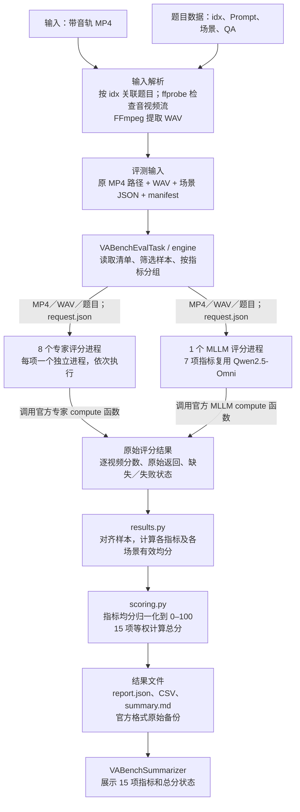
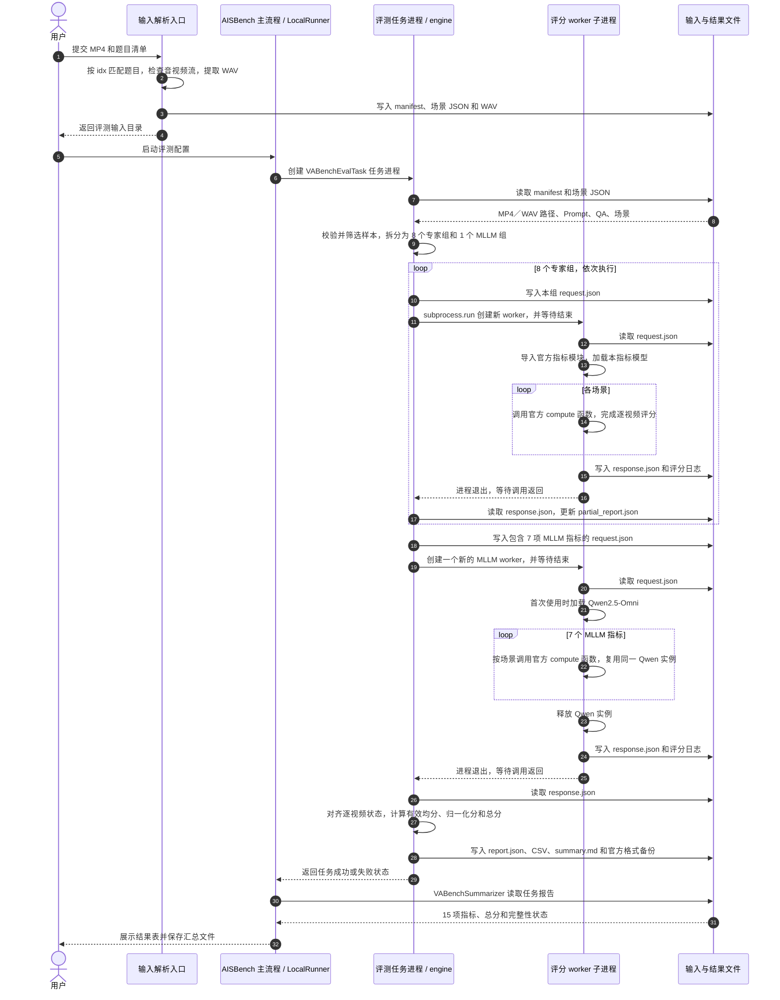

# VABench T2AV 评测方案设计

## 1. 方案目标

将已有带音轨 MP4 接入 AISBench，由 AISBench 调度外部 VABench 官方评分实现，计算 8 个专家指标和 7 个 MLLM 指标，最终展示各项原始均分、归一化分、有效覆盖率及总分。

整体调用链为：**MP4 解析 → 评测输入清单 → 任务进程 → 评分子进程 → 原始结果 → 指标汇总 → 分数展示**。

## 2. 数据流图

图中的两条评分支路表示不同类型的评分组。默认先依次执行 8 个专家组，再执行 1 个 MLLM 组，共 9 个评分子进程。评分函数内部负责各模型需要的视频解码、抽帧、音频预处理和推理。

### 核心代码分工

以下路径以 `ais_bench/` 为根：

| 组件 | 实现位置 | 职责 |
| --- | --- | --- |
| 输入解析 | `benchmark/utils/vabench/data.py` | 将 MP4 与题目关联，产生 WAV、场景 JSON 和 manifest |
| 框架任务 | `benchmark/tasks/vabench/eval.py` | 接收框架配置，读取输入清单，调用评分编排并回传任务状态 |
| 评分编排 | `benchmark/tasks/vabench/engine.py` | 分组、写入请求、创建评分进程、等待退出、收集结果 |
| 评分执行 | `benchmark/tasks/vabench/worker.py` | 在子进程内调用外部 VABench，返回逐视频评分与错误状态 |
| 统计与计分 | `benchmark/summarizers/vabench/results.py`、`scoring.py` | 有效均分、归一化、总分和报告导出 |
| 框架展示 | `benchmark/summarizers/vabench/summarizer.py` | 读取任务报告，输出指标与总分表格 |

`VABenchDataset` 提供数据集注册及独立加载能力；当前评测 Task 直接读取 manifest 和场景 JSON，评分链路不依赖先构造 Dataset 对象。

## 3. 进程调用时序图

下面展示 AISBench 主命令的执行路径。`engine` 与 Task 在同一评测任务进程内；外部 VABench 评分函数在 worker 内执行。

任务进程入口为 `ais_bench.benchmark.tasks.vabench.eval`，评分子进程入口为 `ais_bench.benchmark.tasks.vabench.worker`。父进程通过 `request.json` 传递输入，通过 `response.json` 收集结果；`subprocess.run` 会等待当前评分组退出后再启动下一组。图中重复使用的 worker 泳道代表先后创建的不同进程实例。

7 个 MLLM 指标在同一个 worker 中顺序执行，Qwen 模型由官方运行时缓存复用，完成该组后释放。专家组的模型随各自评分进程退出而释放。仅运行部分指标时，只创建所请求指标对应的评分组。

单个评分组失败时，engine 将错误写入结果，继续收集其余组；报告写出后再判断任务状态。任务进度按已完成评分组数计算，有效覆盖率按成功评分的视频数计算。

## 4. 从原始分到最终展示

### 4.1 计算顺序

1. **逐视频原始分**：保存官方返回值，区分有效评分、缺失、省略和执行失败。
2. **指标原始均分**：只对该指标的有效视频分数求算术平均；跨场景按视频等权。
3. **指标归一化分**：对原始均分应用固定公式，并限制在 0–100。
4. **总分**：15 项归一化分等权平均，分母固定为 15。

| 指标 | 原始均分 m 的归一化公式 |
| --- | --- |
| DNSMOS、NISQA、5 个 third 指标 | `(m−1)/4×100` |
| AudioBox | `(m+1.75)/9×100` |
| ViCLIP、CLAP、ImageBind | `(m+1)/2×100` |
| Desync | `(1−m/2)×100`，原始偏移越小越好 |
| LSA | `m/10×100`，10 为固定展示锚点 |
| 2 个 QA 指标 | `m×100` |

### 4.2 展示内容

| 展示层级 | 内容 | 主要结果文件 |
| --- | --- | --- |
| 逐视频 | 原始返回、有效分、缺失或错误状态 | `report.json`、`samples.csv`、官方格式备份 |
| 指标与场景 | 原始均分、0–100 分、有效数／应评数、失败数、缺失数、覆盖率 | `metrics.csv`、`scenes.csv` |
| 总分 | 15 项等权分数、有效指标数、补零指标、正式／预览状态 | `total.csv`、`summary.md` |
| AISBench 汇总表 | 15 项指标行和总分行 | 框架 summary 目录中的 Markdown／CSV |

请求全部 15 项时，没有有效均分的指标按 0 计入总分，原始均分仍留空，并展示“预览总分／不完整”。例如其余 14 项各 60 分、LSA 缺失，总分为 `(14×60+0)/15=56`。15 项均完整时展示当前评测范围的正式总分；只请求部分指标时不生成 15 项总分。

总分状态与任务状态分别判断：全无有效分时保留 0 分预览，任务返回失败；其他指标缺失或执行异常也返回失败。仅无后端错误的 LSA 官方省略可在其他请求项有有效分时允许任务完成，其总分仍标为预览。

## 5. 与官方结果的比较

使用原生 VABench `evaluate.py` 的结果，与 AISBench 保存的官方格式原始备份比较同一批视频的各项原始均分：

- 相同输入、源码、权重、参数及样本状态是比较前提。
- 官方均分绝对值大于 `1e-6` 时，要求相对误差严格 `<1%`；否则要求绝对误差 `≤1e-6`。
- `compare-official` 分别报告均分验收与逐题数值诊断；空指标、缺失集合不一致和已知错误兜底不能通过。
- 归一化分及 15 项总分属于 AISBench 展示规则；官方对齐以原始指标为准。
