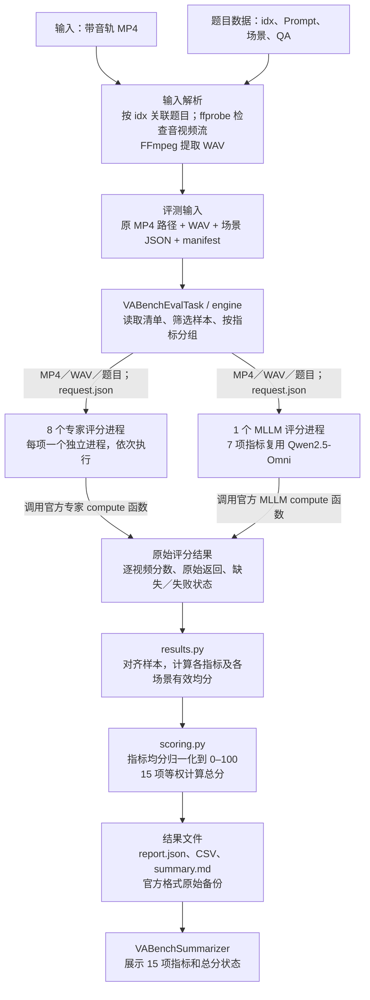
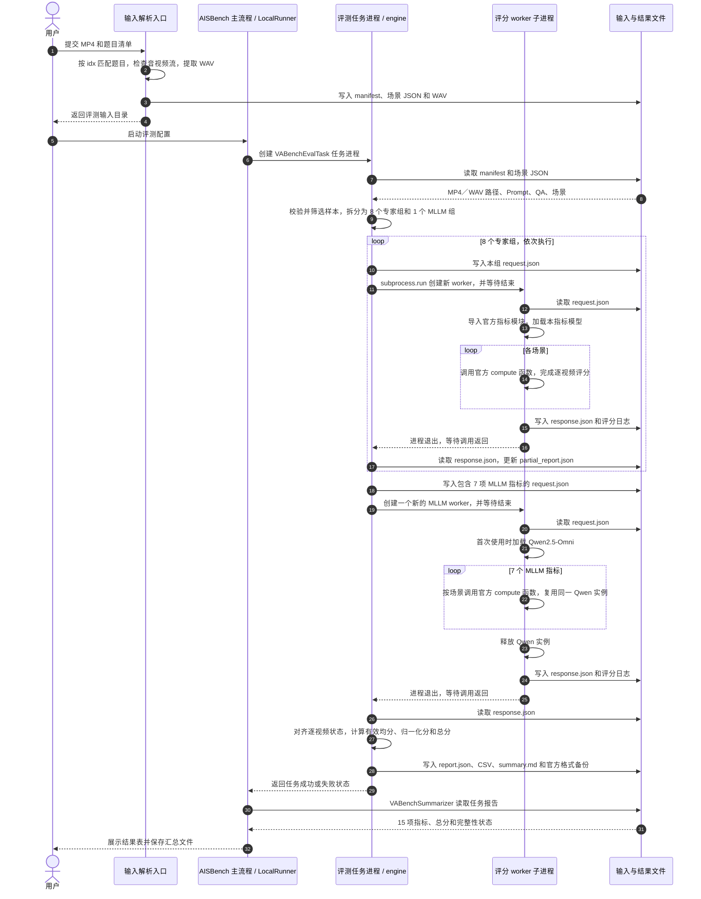

# VABench 音视频评测快速上手

本文介绍 Linux GPU 机器上的手动准备和评测路线，前提是已有 AISBench 源码和 Conda；VABench 源码按第 1 节下载。需要 AISBench 自动准备评分依赖时，第 2.5 节仍使用安装工具，不等同于逐包手工安装。

当前入口统一为 `ais_bench.tools.vabench`。Task、Dataset 和汇总已分别包化；原生官方准备/比较脚本也位于 tools，以下路径与当前实现一致。比较结果使用逐指标原始均分，逐题数值差异另列；GPU精度对齐仍需核验相同输入、权重、参数及失败状态。

固定路径示例，换机器时整体替换：

```bash
export AISBENCH_ROOT=/workspace/code/benchmark
export VABENCH_ROOT=/workspace/code/VABench-main
export VABENCH_CACHE_DIR=/workspace/vabench-cache
export CONDA_ENV=vabench311_new1
export PY=/root/miniconda3/envs/${CONDA_ENV}/bin/python3
export CUDA_VISIBLE_DEVICES=0,1
```

```bash
source /root/miniconda3/etc/profile.d/conda.sh
# 已有环境可先激活；全新环境在第 2.2 节创建后再激活。
if [ -x "${PY}" ]; then
  conda activate "${CONDA_ENV}"
fi
cd "${AISBENCH_ROOT}"
```

> 已有可用环境且模型权重齐全时，跳过第 2.2–2.5 节的下载/安装；但必须先确认第 1.1 节的 `third_party` 外部源码存在，并至少执行 2.5 节的 `environment check`、2.6 节的资源检查和 4.2 节的 `doctor`。

AISBench 源码必须包含 VABench 接入代码；先确认以下两个文件存在：

```bash
test -f ${AISBENCH_ROOT}/ais_bench/tools/vabench/cli.py
test -f ${AISBENCH_ROOT}/ais_bench/benchmark/tasks/vabench/eval.py
```

---

## 1. 下载 VABench 源码

固定使用以下提交：

下面的 clone 需要 Git，第 1.1 节手工补源码需要 curl；若容器缺少这些工具，先安装（Ubuntu/Debian root 容器）：

```bash
apt-get update
apt-get install -y git curl ca-certificates
```

```bash
git clone https://github.com/tanABCC/VABench.git ${VABENCH_ROOT}
git -C ${VABENCH_ROOT} checkout 12b9617a900a9eca1691da6b7115ce3d58f53a16
```

检查：

```bash
ls ${VABENCH_ROOT}/evaluate.py
ls ${VABENCH_ROOT}/vabench/config.yaml

# 只有 git 目录才能核对提交号；解压得到的源码没有 .git 时跳过
if [ -d ${VABENCH_ROOT}/.git ]; then
  git -C ${VABENCH_ROOT} rev-parse HEAD
fi
```

预期提交（git 目录）：

```text
12b9617a900a9eca1691da6b7115ce3d58f53a16
```

已有源码时不要重复 clone；如果源码是压缩包解压的，没有 `.git` 也能运行，但要记录来源和版本。

### 1.1 补齐 third_party 外部源码

固定提交的官方仓库中，`third_party/` 只有 `ViCLIP/`、`syncnet_eval/` 等，**不包含** `Synchformer` 和 `DNS-Challenge`。`first_dnsmos`、`second_desync` 会直接从源码目录加载它们，缺失时这两项会失败。必须存在：

```text
${VABENCH_ROOT}/third_party/Synchformer/scripts/train_utils.py
${VABENCH_ROOT}/third_party/Synchformer/dataset/transforms.py
${VABENCH_ROOT}/third_party/DNS-Challenge/DNSMOS/dnsmos_local.py
```

全新安装时，第 2.5 节的 `environment install` 会在这些路径缺失时自动补齐，不必先手工处理。下面的命令用于复用已有环境、跳过 install，或提前准备；它们依赖 2.3 节下载的缓存，新机器请先完成 2.3 再回来执行。

模型缓存中的 `synchformer/Synchformer/` 是完整源码，软链即可，不必复制约 422 MB：

```bash
mkdir -p "${VABENCH_ROOT}/third_party"
if [ ! -e "${VABENCH_ROOT}/third_party/Synchformer" ] && \
   [ ! -L "${VABENCH_ROOT}/third_party/Synchformer" ]; then
  ln -s "${VABENCH_CACHE_DIR}/synchformer/Synchformer" \
        "${VABENCH_ROOT}/third_party/Synchformer"
fi
```

DNSMOS 只缺一个 Python 源文件，按 AISBench 使用的固定提交下载：

```bash
mkdir -p "${VABENCH_ROOT}/third_party/DNS-Challenge/DNSMOS"
if [ ! -e "${VABENCH_ROOT}/third_party/DNS-Challenge/DNSMOS/dnsmos_local.py" ]; then
  curl -fL --retry 3 \
    -o "${VABENCH_ROOT}/third_party/DNS-Challenge/DNSMOS/dnsmos_local.py" \
    https://raw.githubusercontent.com/microsoft/DNS-Challenge/591184a9fcb2cbdec02520fed81a32bbbf9d73ff/DNSMOS/dnsmos_local.py
fi
```

缓存里的 `dns_mos/` 只有 `sig_bak_ovr.onnx`、`model_v8.onnx` 两个权重，不是 DNS-Challenge 源码，不要把它当成源码复制进 `third_party`。也不需要 clone 整个 DNS-Challenge；已有完整 clone 时保留其中 `DNSMOS/dnsmos_local.py` 即可。

已有源码不覆盖；若已有文件或软链不正确，先核对来源及内容再处理，不能仅以“路径存在”认定版本一致。访问 GitHub 需要代理或自签 CA 时，按 2.1 节设置代理，并给 `curl` 加 `--cacert` 或设置 `CURL_CA_BUNDLE`。

检查：

```bash
test -f ${VABENCH_ROOT}/third_party/Synchformer/scripts/train_utils.py
test -f ${VABENCH_ROOT}/third_party/Synchformer/dataset/transforms.py
test -f ${VABENCH_ROOT}/third_party/DNS-Challenge/DNSMOS/dnsmos_local.py
```

第 2.5 节的 `environment install` 会在目标不存在时自动完成同样的补齐（软链 Synchformer、下载 `dnsmos_local.py`，并兼容 buffalo_l 布局）。但已安装 AISBench 的环境会被 `runtime_guard` 拒绝执行 install；复用已有环境时，必须按本节手动补齐。

---

## 2. 下载必备权重、依赖、工具

### 2.1 系统工具

Ubuntu/Debian root 容器：

```bash
apt-get update
apt-get install -y git curl wget ffmpeg libsndfile1 build-essential ca-certificates unzip
```

检查：

```bash
nvidia-smi
ffmpeg -version | head -1
ffprobe -version | head -1
```

如果机器使用自签 CA，再按实际配置：

```bash
export PIP_CERT=/root/ca-bundle.crt
export SSL_CERT_FILE=/root/ca-bundle.crt
export REQUESTS_CA_BUNDLE=/root/ca-bundle.crt
export GIT_SSL_CAINFO=/root/ca-bundle.crt
```

`wget` 如遇证书错误，加 `--ca-certificate=/root/ca-bundle.crt`。

需要代理访问 GitHub/HuggingFace 时，先设置 `http_proxy`、`https_proxy`；`--index-url` 只影响 PyPI，不会代理 GitHub 或模型下载。

### 2.2 创建 Conda 环境

```bash
conda create -n ${CONDA_ENV} python=3.11 pip -y
conda activate ${CONDA_ENV}
python3 --version
```

### 2.3 下载模型权重

pip 不会下载 VABench 模型权重，必须单独准备。缓存约几十 GB：

```bash
${PY} -m pip install "huggingface-hub==0.35.3" \
  --index-url https://repo.huaweicloud.com/repository/pypi/simple

mkdir -p ${VABENCH_CACHE_DIR}

hf download tanABBCC/VABENCH_CACHE_DIR \
  --repo-type dataset \
  --revision aa0c3da973d86f2994e9c8860f28785ce0cc6152 \
  --local-dir ${VABENCH_CACHE_DIR}
```

这里固定与评分依赖一致的版本，并使用当前 Conda 的 `hf`。不要无版本限制地升级：Hugging Face v1 已移除 `huggingface-cli` 和 `[cli]` extra，见[官方迁移说明](https://huggingface.co/docs/huggingface_hub/en/concepts/migration)。若找不到 `hf`，先确认已激活 `${CONDA_ENV}`，再检查 `command -v hf`。

下载后必须确认 `Qwen2.5_omni_7B/` 直接位于缓存根目录：

```text
/workspace/vabench-cache/Qwen2.5_omni_7B/
```

不能是多套一层目录。

### 2.4 下载 LSA 辅助权重

```bash
CACHE=${VABENCH_CACHE_DIR}
AUX="${CACHE}/checkpoints/auxiliary"

mkdir -p "${AUX}/models"

# 人脸检测模型
wget -O "${AUX}/sfd_face.pth" \
  https://huggingface.co/ByteDance/LatentSync-1.5/resolve/main/auxiliary/sfd_face.pth

# InsightFace buffalo_l
wget -O /tmp/buffalo_l.zip \
  https://github.com/deepinsight/insightface/releases/download/v0.7/buffalo_l.zip
unzip -q -o /tmp/buffalo_l.zip -d "${AUX}/models/buffalo_l"
```

至少确认：

```text
${AUX}/sfd_face.pth
${AUX}/models/buffalo_l/det_10g.onnx
${AUX}/models/buffalo_l/2d106det.onnx
```

如果已有 `checkpoints/auxiliary/buffalo_l/`，但缺少 `models/buffalo_l/`：

```bash
mkdir -p "${AUX}/models"
ln -sfn ../buffalo_l "${AUX}/models/buffalo_l"
```

### 2.5 安装 VABench Python 依赖

**必须在安装 AISBench 本体之前执行。** 在 AISBench 源码根目录运行：

```bash
cd ${AISBENCH_ROOT}

${PY} -m ais_bench.tools.vabench.environment install \
  --source-root ${VABENCH_ROOT} \
  --cache-dir ${VABENCH_CACHE_DIR} \
  --work-dir /workspace/vabench-env-audit \
  --install-system-deps \
  --index-url https://repo.huaweicloud.com/repository/pypi/simple
```

`--install-system-deps` 只适用于 Ubuntu/Debian root 容器；其他系统先手动装好系统工具，再去掉该参数。系统已有 2.1 节工具时也可以直接去掉该参数，避免 `apt-get update` 被代理或自签 CA 阻塞；本机验证时曾因 apt 源证书校验持续重试，改为不带该参数后正常继续。

> 如果当前环境已经安装了 AISBench，`environment install` 会触发 `runtime_guard` 并停止，本次安装没有执行完成。已有环境运行 `environment check`；需要重新安装时使用干净的评分环境，避免改坏已有主环境。

安装器会处理：

- Torch 2.6.0+cu124、torchvision、torchaudio；
- Transformers、ONNX Runtime、InsightFace、CLAP 等；
- 固定 commit 的 ImageBind、PyTorchVideo、CLIP；
- NISQA 2.0.post2 的元数据补丁；
- setuptools 固定为 80.9.0（小于 82）；
- 若 `third_party` 中缺少，软链缓存里的 Synchformer 源码并下载 `dnsmos_local.py`（见第 1.1 节）。

检查：

```bash
${PY} -m ais_bench.tools.vabench.environment check \
  --source-root ${VABENCH_ROOT} \
  --cache-dir ${VABENCH_CACHE_DIR} \
  --work-dir /workspace/vabench-env-audit
```

统一环境里 `environment check` 可能只在 `pip_check` 处返回 FAIL，常见提示是 Pillow、fsspec、tqdm、decord；如果 `versions`、`git`、`nisqa`、`probes`、`missing_resources` 都通过，可以继续评测。要求依赖完全干净时，改用独立评分环境，通过 `BACKEND_PYTHON` 调用。

### 2.6 快速检查缓存

```bash
test -f ${VABENCH_CACHE_DIR}/Qwen2.5_omni_7B/config.json
test -f ${VABENCH_CACHE_DIR}/checkpoints/auxiliary/sfd_face.pth
test -e ${VABENCH_CACHE_DIR}/checkpoints/auxiliary/models/buffalo_l
```

其余权重由第 4.2 节的 `doctor` 统一检查；如果 `doctor` 报 `missing_resources`，按路径补齐。

---

## 3. 归档好 video 视频

### 3.1 目录和命名要求

把待评测视频放到一个目录，例如：

```text
/workspace/video/
├── angry goose honking loudly.mp4
├── angry turkey gobbling loudly.mp4
├── bats echolocate in dark caves.mp4
├── bee buzzing near flower stamens.mp4
├── busy caf with chatter and coffee.mp4
├── kitten curled up meowing.mp4
└── news anchor delivers evening news.mp4
```

规则：

- 每个 `idx` 只能有一个 MP4；
- 文件名必须是 `idx.mp4`，例如 `kitten curled up meowing.mp4`；
- 必须有音轨，不能是无声视频；
- 不能混入同一道题的多模型结果；
- 不能出现 778 题之外的未知视频；
- 可以平铺，也可以按类别分目录；
- 文件名可以包含空格，shell 参数要加引号；
- `prepare` 之后不要移动或改写原始 MP4，否则运行前哈希校验会失败。

查看视频：

```bash
find /workspace/video -type f -name '*.mp4' -printf '%f\n' | sort
```

### 3.2 导出 778 题标准清单

```bash
cd ${AISBENCH_ROOT}

${PY} -m ais_bench.tools.vabench.cli catalog \
  --source-root ${VABENCH_ROOT} \
  --subset standard \
  --output /workspace/t2av_778_prompts.json
```

说明：

- 原始 JSON 有 848 条，AISBench 只使用与 `mapping/final_idx_to_prompt.csv` 精确匹配的 778 条；
- 生成视频时使用 `entries[].metadata.prompt_en` 作为完整 Prompt；
- 视频文件名使用 `entries[].idx`。

### 3.3 准备自定义子集

评测已有视频：

```bash
cd ${AISBENCH_ROOT}

${PY} -m ais_bench.tools.vabench.cli prepare \
  --source-root ${VABENCH_ROOT} \
  --subset custom \
  --videos /workspace/video \
  --output /workspace/prepared_videos
```

输出会包含：

```text
/workspace/prepared_videos/
├── manifest.json
├── json/
└── ... 同源 WAV 等
```

注意：

- `prepare` 不会覆盖已有输出目录，重跑请换新目录；
- 未知视频会报错并列出，不会静默跳过；
- 无声视频不会自动补静音；
- 如果提示 `Prepared protocol differs from installed protocol`，说明 prepared 目录来自旧协议，必须用当前源码重新准备，不能手改 manifest 哈希。

### 3.4 准备 778 题完整集

视频齐全后：

```bash
${PY} -m ais_bench.tools.vabench.cli prepare \
  --source-root ${VABENCH_ROOT} \
  --subset standard \
  --videos /workspace/generated_standard \
  --output /workspace/prepared_standard
```

---

<a id="mini10pct-selection"></a>

### 3.5 选取并获取固定78题子集

#### 清单来源与抽样规则

固定清单位于 AISBench 的 **`ais_bench/configs/vabench_examples/mini10pct.json`**，名称是 `mini10pct`（表示10%），从 **778题标准集选出78题**。768P是视频生成分辨率，与题目数量不同。

该清单来自项目辅助脚本 `VABench/build_mini10pct.py` 及其 `VABench/mini10pct` 产物。下面参照项目 README 的方法说明，并按脚本核实具体选择顺序。它是项目选定集合，不是上游官方发布的子集；AISBench评分时读取固定清单，不重新抽样。

| 项目 | 核验结果 |
| --- | --- |
| 抽样基数 | 可映射的 778 题，不是原始 848 条 |
| 选中数量 | `round(778×10%)=78`，实际占 10.03% |
| 类别覆盖 | 24/24 类，每类 2–4 题 |
| easy / hard | 40/398、38/380 |
| 类别名额 | easy 10 类各 4；hard 14 类先各 2，剩余 10 个名额分给最大的 10 个 hard 类 |
| 类内选择 | 对 `prompt_en + prompt_vision + prompt_audio` 做 TF-IDF，从 medoid 开始选择最远点，idx SHA256 解决同分；没有随机种子参数 |

该算法衡量词面多样性，不保证语义或全部指标适用性；题目覆盖不等于所有生成视频都可获得 LSA 等有效分数。清单保留上游提交、原始 778 清单、选择脚本及输出数据清单的 SHA256，便于审计。

##### 第一步：确定778题候选池

将固定官方源码的 `json_files/json_text/*.json` 与 `mapping/final_idx_to_prompt.csv` 按完整 Prompt 精确匹配，得到778个唯一idx。候选池包含24类，其中easy为10类、398题，hard为14类、380题。AISBench的 `catalog(..., 'standard')` 提供这批候选，子集不从原始848条直接抽取。

##### 第二步：先分配类别名额

目标数量为 `round(778×0.10)=78`，按以下规则分配：

| 分配步骤 | 数量 |
| --- | --- |
| 10个easy类，每类4题 | 40 |
| 14个hard类，每类先2题 | 28 |
| 将剩余10个名额分给候选池最大的10个hard类，每类再加1题 | 10 |
| 合计 | 78 |

hard类按“候选池数量降序、类别名升序”排列。最终easy每类4题，10个hard类各3题，其余4个hard类各2题。仅取2题的类别为：`hard_natural_environment`、`hard_Indoor_Environment_and_Urban_Atmosphere`、`hard_music`、`hard_strong_synchronization_and_rhythmic_movements`。

这里平衡的是类别覆盖和easy/hard总体数量；并非每个类别都恰好抽10%。例如92题的 `hard_Virtual_Environment` 选3题，7题的 `hard_natural_environment` 选2题。

##### 第三步：在每一类中选择词面差异较大的题

1. 拼接每题的 `prompt_en + prompt_vision + prompt_audio`，转为小写。
2. 按脚本固定分词规则和停用词表提取词项，去掉短于3个字符的词。
3. **在当前类别内**计算TF-IDF：词频权重为 `1+ln(词频)`，逆文档频率为 `ln((类别题数+1)/(包含该词的题数+1))+1`；各题向量做L2归一化。
4. 计算题目两两余弦相似度。先选平均相似度分值最高的中心题，即脚本中的medoid起点。
5. 对每个未选候选，计算其与已选集合的**最大相似度**，选择这个值最小的题，直到填满本类名额。这相当于优先补入与已选题都不太相似的题。

选取过程不使用随机数。脚本的确定性同分规则为：中心题取 `(平均相似度, idx的SHA256)` 最大者；后续候选取 `(与已选集合的最大相似度, 平均相似度, idx的SHA256)` 最小者。复现时应使用同一分词规则、停用词表和比较顺序，不能直接替换成另一套TF-IDF默认参数。

##### 第四步：核验并固定清单

合并24类的结果，检查78个idx互不重复、全部属于778题候选池、24类全覆盖、easy为40题、hard为38题，且各类数量符合配额。将idx和category固定到 `mini10pct.json`，连同来源及脚本哈希保存；完整Prompt从对应官方元数据导出。

#### 可选：离线复现选取结果

需要审查“78题如何选出”时，可只调用原辅助脚本的两个选择函数，不执行它的构建入口。`build_mini10pct.py` 是项目辅助文件，**不包含在官方VABench仓库内**；应另行提供该文件，并把下列路径改为实际位置。

```bash
export VABENCH_SELECTION_SCRIPT=/workspace/tools/build_mini10pct.py
cd /workspace/code/benchmark
python3 - <<'PY'
import os
import runpy
from pathlib import Path
from ais_bench.benchmark.utils.vabench.data import catalog, read_json

script = Path(os.environ['VABENCH_SELECTION_SCRIPT'])
assert script.is_file(), f'项目选取脚本不存在：{script}'
# 使用非 __main__ 名称，仅载入函数，不执行原脚本的 main()。
logic = runpy.run_path(str(script), run_name='mini10pct_selection_check')
entries = catalog(os.environ['VABENCH_ROOT'], 'standard')
target, allocation, summary, grouped = logic['allocate'](entries)
chosen = []
for category in sorted(grouped):
    picked, _ = logic['diverse_select'](grouped[category], allocation[category])
    chosen.extend(picked)

fixed = read_json('ais_bench/configs/vabench_examples/mini10pct.json')
actual = {(e['idx'], e['category']) for e in chosen}
expected = {(e['idx'], e['category']) for e in fixed['entries']}
assert target == len(chosen) == len(actual) == fixed['count'] == 78
assert len(allocation) == 24
assert summary['easy_selected'] == 40 and summary['hard_selected'] == 38
assert actual == expected, '选取结果与AISBench固定版本不同，请核对脚本及替换记录'
print('核验通过：778题选78题，24类全覆盖，easy=40、hard=38，与固定清单一致')
PY
```

本段只读取题目并重算选择结果，不写请求文件、不复制视频，也不调用生成API。普通评测直接使用固定清单并执行下文的Prompt导出即可。

#### 与项目README后续替换记录的区别

项目README新增了一次生成平台审核后的替换，类别仍为 `easy_human_nonverbal`：

| 版本 | 对应题目 |
| --- | --- |
| AISBench当前固定清单及原始脚本复现结果 | `teenager spills drink nervously apologizes` |
| 项目README的后续替换记录 | `lost tourists in subway station` |

因此，二者虽然都称78题，题目集合已有一题差异。README描述的替换版本保持其余77题不变；当前AISBench清单尚未包含该替换。比较不同模型前须固定同一个版本，并保存完整清单和替换记录；不能因某题缺视频临时换题后仍视为同一测试集。本说明保留当前AISBench清单。

原脚本的构建入口还包含固定路径、生成请求文件及复制辅助脚本等操作。复用固定清单或执行上述只读核验，不需要运行该入口及 `--force`。

#### 导出完整 Prompt

在 AISBench 根目录执行以下脚本，校验固定清单并从官方源码导出对应元数据。它不调用任何生成 API：

```bash
cd /workspace/code/benchmark
python3 - <<'PY'
import os
from ais_bench.benchmark.utils.vabench.data import catalog, read_json, write_json

selected = read_json('ais_bench/configs/vabench_examples/mini10pct.json')
standard = {e['idx']: e for e in catalog(os.environ['VABENCH_ROOT'], 'standard')}
ids = [e['idx'] for e in selected['entries']]
assert len(ids) == len(set(ids)) == selected['count'] == 78
assert len({e['category'] for e in selected['entries']}) == 24
assert all(standard[e['idx']]['category'] == e['category'] for e in selected['entries'])
write_json('/workspace/mini10pct_prompts.json', {
    'subset': selected['name'], 'count': 78,
    'upstream_commit': selected['upstream_commit'],
    'entries': [standard[idx] for idx in ids],
})
print('已导出 78 题：/workspace/mini10pct_prompts.json')
PY
```

从导出的 `entries[].metadata.prompt_en` 生成视频，保存为 `<idx>.mp4`。同步/复制原有产物时只需这78题对应的MP4；视频是否齐全应按当前清单和实际文件核验，不能用README里的历史下载数量判断本轮输入完整性。

#### 按固定 78 题准备输入

视频齐全后，显式传入全部78题到准备函数。这样缺少任一视频都会报错，避免普通 `--subset custom` 根据已有文件自动缩成一个更小的集合：

```bash
python3 - <<'PY'
from ais_bench.benchmark.utils.vabench.data import prepare, read_json

prompts = read_json('/workspace/mini10pct_prompts.json')
assert prompts['count'] == len(prompts['entries']) == 78
prepare(prompts['entries'], '/workspace/generated_mini10pct',
        '/workspace/prepared_mini10pct', subset='custom')
print('已准备固定 78 题')
PY
```

准备完成后继续第4节执行评分并查看结果。

当前报告scope为 `custom`，应与固化清单、导出的Prompt文件一起归档，并核对 `subset_size=78`。也可以将该准备目录填入主命令配置。若只想先测少量已有视频，可按第3.3节准备自定义输入，并标明实际题数，不能当作78题结果。


---

## 4. AISBench 下载依赖并下发测试

### 4.1 安装 AISBench 依赖

继续使用第 2 节创建的同一个 Conda 环境。先安装 AISBench runtime，并去掉会和 VABench/NISQA 冲突的 Pillow 固定版本：

```bash
cd ${AISBENCH_ROOT}

sed -e 's/^gradio-client$/gradio-client==1.14.0/' \
    -e 's/^openai$/openai==1.109.1/' \
    requirements/runtime.txt \
  | grep -viE '^\s*Pillow\s*==' \
  > /workspace/aisbench_runtime_unified.txt

printf 'anyio==4.10.0\n' >> /workspace/aisbench_runtime_unified.txt

${PY} -m pip install \
  -r /workspace/aisbench_runtime_unified.txt \
  --index-url https://repo.huaweicloud.com/repository/pypi/simple
```

安装 AISBench 本体，不重新解析依赖：

```bash
${PY} -m pip install \
  -e ${AISBENCH_ROOT} \
  --no-deps \
  --no-build-isolation
```

回钉统一环境需要的版本：

```bash
${PY} -m pip install \
  "fsspec==2025.9.0" "tqdm==4.66.2" \
  --index-url https://repo.huaweicloud.com/repository/pypi/simple
```

检查：

```bash
ais_bench --help
${PY} -c "import ais_bench; print(ais_bench.__file__)"
${PY} -m pip check > /workspace/vabench_pip_check.txt 2>&1
PIP_CHECK_STATUS=$?
cat /workspace/vabench_pip_check.txt
echo "pip check exit status: ${PIP_CHECK_STATUS}"
```

> 上述检查在交互式 shell 执行；若脚本设置了 `set -e`，先用条件分支捕获非零状态再保存。统一环境可能出现 Pillow、fsspec、tqdm、decord 的已知声明冲突；须逐条对照已验证环境记录，新增冲突不能一概忽略。要求依赖完全干净时，改用独立评分环境，通过 `BACKEND_PYTHON` 调用。

### 4.2 环境诊断

```bash
cd ${AISBENCH_ROOT}

${PY} -m ais_bench.tools.vabench.cli doctor \
  --source-root ${VABENCH_ROOT} \
  --cache-dir ${VABENCH_CACHE_DIR}
```

必须确认：

- 15 个指标入口都存在；
- 模型缓存没有缺失；
- CUDA、decord、ONNX Runtime 正常；
- `missing_resources` 为空。

`doctor` 检查模块可发现性、严格资源完整性，并在目标设备执行微小张量操作和CPU回拷。默认 `--device cuda:0`，设备不可用或操作失败会返回非零；仅检查CPU时显式传 `--device cpu`。它不代替全部评分模块加载、decord解码或ONNX provider验证，仍需结合第2.5节 `environment check` 的实际探针及后续评分日志。

### 4.3 写评测配置

复制模板：

```bash
cp ${AISBENCH_ROOT}/ais_bench/configs/vabench_examples/eval_vabench_custom.py \
   /workspace/eval_vabench.py
```

编辑 `/workspace/eval_vabench.py`，至少修改以下字段：

```python
PREPARED_DIR = '/workspace/prepared_videos'
SOURCE_ROOT = '/workspace/code/VABench-main'
CACHE_DIR = '/workspace/vabench-cache'

DEVICE = 'cuda:0'
BACKEND_PYTHON = '/root/miniconda3/envs/vabench311_new1/bin/python3'
NUM_DEVICES = 2
```

如果 AISBench 和 VABench 在同一个 Conda 环境，`BACKEND_PYTHON` 就指向该环境的 `bin/python3`。模板中其余字段（`models`、`datasets`、`eval`、`summarizer`）保持不变。

### 4.4 下发测试

```bash
cd ${AISBENCH_ROOT}

ais_bench /workspace/eval_vabench.py \
  -m eval \
  -w /workspace/vabench_runs/run_$(date +%Y%m%d_%H%M%S)
```

参数：

- `-m eval`：只评测，不重新推理；
- `-w`：输出根目录，AISBench 会自动创建时间戳子目录；
- 每次使用新目录，不要覆盖已有结果；
- 现场 7 视频、15 项有约 10 分钟的运行记录；耗时受显卡空闲资源、媒体长度和缓存影响，不能据此保证固定耗时。

### 4.5 查看结果

结果目录：

```text
/workspace/vabench_runs/run_<时间>/
└── <AISBench时间戳>/
    ├── summary/
    │   └── summary_<时间戳>.md
    └── results/
        └── <model>/<dataset>_artifacts/
            ├── summary.md
            ├── metrics.csv
            ├── total.csv
            ├── samples.csv
            ├── scenes.csv
            ├── report.json
            └── official_eval_results/
```

重点看：

```bash
cat <artifacts>/summary.md
cat <artifacts>/metrics.csv
cat <artifacts>/total.csv
```

总分规则：

- 15 项都有有效均分，覆盖率 100%，没有后端错误：正式总分；
- 15 项都有分，但有失败、缺失、LSA 省略或后端错误：预览总分；
- 请求全部 15 项但某项无有效均分：该项按 0 计入，固定除以 15，展示预览总分及 `zero_filled_dimensions`；原始均分仍留空；
- 只跑部分指标：不生成 15 项总分。

例如其余14项各60分、LSA无有效均分，预览总分为56。15项全无有效均分时仍保存0分预览，但任务返回失败。只有无后端错误的LSA省略可以在其他请求项有有效分时允许任务完成；其他指标missing、解析失败和后端异常均不能以补零掩盖。正式/预览状态与任务是否成功分开判断。官方VABench不提供这个总分；`total.csv`是AISBench展示协议。

注意：

- `second_lsa` 可能因无人脸、零置信度或内部异常省略记录；仅凭省略无法确定原因，需查看日志，不能一律判定不是依赖错误；
- `second_desync` 对短于 Synchformer 固定 5 秒输入的视频会报 `backend_error`，不要用这类视频宣称 desync 完整；
- 当前 CLAP 缓存使用随机截取 10 秒片段，长视频重复运行可能波动；短视频可避开这一随机裁剪分支，但不保证所有运算绝对确定。

### 4.5.1 为什么 `second_clap` 会波动

官方 `vabench/second_clap.py` 的预处理存在随机性；两边的子进程、场景顺序和模型生命周期也会影响实际随机状态：

1. 官方代码调用 `processor(text=..., audio=..., sampling_rate=48000)` 时没有传 `truncation`；
2. 当前缓存的 `clap/laion__clap-htsat-unfused/preprocessor_config.json` 配置为：

```json
{
  "truncation": "rand_trunc",
  "max_length_s": 10,
  "nb_max_samples": 480000,
  "sampling_rate": 48000
}
```

3. 音频超过 10 秒时，Transformers 的 `ClapFeatureExtractor` 会执行：

```python
overflow = len(waveform) - max_length
idx = np.random.randint(0, overflow + 1)
waveform = waveform[idx:idx + max_length]
```

也就是每次随机选择不同的 10 秒起点，再计算 CLAP 相似度，所以同一个视频每次运行都可能得到不同的 `video_results`。

4. CLAP 调用处没有单独固定这段 NumPy 随机数；`PYTHONHASHSEED=42` 只影响 Python 哈希，不会固定 `np.random`。官方 `omni_runtime` 初始化另有随机种子设置，跨场景的执行顺序也可能影响后续 CLAP 状态，因此应核查实际调用顺序，不能断言两条路径始终处于相同或完全未设置的随机状态。

5. 音频不超过 10 秒时不会进入这段随机裁剪分支，可减少该来源的波动。

因此 `second_clap` 有差异时，应先核查输入、预处理配置和随机状态。正式验收仍要求同一条件下原始均分相对误差 <1%；可通过外部启动包装控制随机状态而保留官方文件不变。排除 CLAP 只能得到其余 14 项的诊断结果，不能算完成 15 项对齐，也不能将超阈值直接记为通过。

### 4.6 运行官方 VABench 作为对照（可选）

如果要把 AISBench 结果与官方源码原生结果逐样本对比，先生成官方 `data_dir`。下面脚本只依赖 Python、ffmpeg 和官方源码，不依赖 AISBench：

```bash
STAMP=$(date +%Y%m%d_%H%M%S)
export OFFICIAL_DATA=/workspace/vabench_official_data_${STAMP}
export OFFICIAL_RUN=/workspace/vabench_official_run_${STAMP}
export OFFICIAL_RESULT=/workspace/vabench_result_${STAMP}

${PY} "${AISBENCH_ROOT}/ais_bench/tools/vabench/official_prepare.py" \
  --source-root ${VABENCH_ROOT} \
  --videos /workspace/video \
  --output ${OFFICIAL_DATA}
```

脚本规则：

脚本由AISBench工作区的 `tools/vabench/official_prepare.py` 提供，但按文件直接执行时只依赖Python标准库、ffmpeg和官方源码，不需要安装AISBench。也可在AISBench源码根目录执行 `python3 -m ais_bench.tools.vabench.official_prepare --help` 查看参数。

- MP4 文件名去掉 `.mp4` 后必须精确等于官方 `mapping/final_idx_to_prompt.csv` 中的 `idx`；
- 每个 MP4 必须有音轨，脚本用 ffmpeg 抽取第一条音轨为 WAV，不补静音、不重新编码视频；
- 按题目 category 生成 `video/<category>/<idx>.mp4`、`audio/<category>/<idx>.wav`；
- 只为实际视频生成 `json/<category>.json`，不会保留没有视频的题目；
- `--output` 必须是新目录或空目录，已有内容的目录会被拒绝。

脚本会打印每个类别的样本数。确认目录结构：

```bash
find ${OFFICIAL_DATA} -maxdepth 3 -type f | sort
```

官方 `evaluate.py` 读取的是当前工作目录下的相对路径 `./mapping_text/final_idx_to_prompt.csv`，但官方源码里的目录名叫 `mapping/`，所以运行目录必须放一个名为 `mapping_text` 的软链。运行目录可以是任意新目录，不要求使用固定路径：

```bash
mkdir -p ${OFFICIAL_RUN}
ln -sfn ${VABENCH_ROOT}/mapping ${OFFICIAL_RUN}/mapping_text
cd ${OFFICIAL_RUN}

test -f mapping_text/final_idx_to_prompt.csv && echo mapping-ok
```

然后从该运行目录启动官方评测：

```bash
cd ${OFFICIAL_RUN}
set -o pipefail

CUDA_VISIBLE_DEVICES=0,1 \
VABENCH_CACHE_DIR=${VABENCH_CACHE_DIR} \
${PY} -u ${VABENCH_ROOT}/evaluate.py \
  --data_dir ${OFFICIAL_DATA} \
  --output_dir ${OFFICIAL_RESULT} \
  2>&1 | tee ${OFFICIAL_RESULT}.log
```

说明：

- `CUDA_VISIBLE_DEVICES` 按实际机器修改；官方默认 config 使用逻辑卡 0/1 和 `max_memory: {0: "80GB", 1: "80GB"}`，显存配置不同时用 `--config` 指定自己的副本；
- `${PY}` 使用开头 `CONDA_ENV` 对应的环境；若使用 `vabench115`，把开头 `CONDA_ENV` 改为 `vabench115` 即可，官方评测不依赖 AISBench 安装；
- `VABENCH_CACHE_DIR` 必须在启动 Python 前设置；
- 官方入口会捕获异常，不能只靠退出码判断成功，必须同时检查日志和结果文件；
- 结果目录结构为：

```text
${OFFICIAL_RESULT}/<category>/
├── <category>_<时间>_eval_results.json
├── <category>_<时间>_eval_results.csv
└── <category>_<时间>_full_info.json
```

`eval_results.json` 是逐样本原始分，`full_info.json` 是本次实际题目的完整信息；CSV 中的 `-1` 表示该项没有取得分数，不能当作 0 分参与均值。确认每个类别都有预期指标和样本后再进入下一节对比，并把 `${OFFICIAL_RESULT}` 作为 `--official` 参数。

### 4.7 与官方 VABench 比较原始均分及逐题差异（可选）

如果另外跑过官方 `evaluate.py`，可以直接对比两边落盘的原始分：

```bash
${PY} -m ais_bench.tools.vabench.cli compare-official \
  --aisbench <AISBench artifacts 目录或其中的 official_eval_results> \
  --official ${OFFICIAL_RESULT} \
  --output /workspace/vabench_compare_official.json
```

如果使用已有的官方结果目录，把 `${OFFICIAL_RESULT}` 换成该目录路径。

命令按类别、指标和媒体文件名对齐核心分 `video_results`，忽略不同绝对路径前缀，按全部有效视频等权计算每项原始均分。参考均分绝对值 `>1e-6` 时要求相对误差严格 `<1%`；否则要求绝对误差 `≤1e-6`。每个请求指标必须有有效成对分数；双边全空、缺失样本/指标/场景或非数值都不能通过。

输出分别提供 `passed`（均分阈值和样本结构检查）、`metric_means_passed`、`sample_values_passed`。逐题数值有差异但同一有效集合均分达标时，可以均分PASS、逐题诊断FAIL；退出码按 `passed` 返回0或1，不把逐题阈值替代既定均分验收。

双方使用单次运行的新目录；同一场景有多个结果文件会被拒绝，避免混用轮次。正式验收还需核验输入/源码/权重/参数及失败和省略集合。原始备份可能包含模型兜底数值，仅数值相同不等于评分有效。逐指标原始均分的阈值以上述规则为准。

`second_clap` 的随机截断会显示为数值差异，应先确认输入和随机状态，不能直接判为 AISBench 调用错误。

## 附录：评测数据流与进程时序

数据流如下；评分组按顺序执行，8个专家指标各使用一个进程，7个MLLM指标在一个进程内复用Qwen。



主命令中的任务和评分进程时序如下。重复的worker泳道表示先后创建的进程，request.json和response.json用于传递输入与结果。




### 固定计分公式

先对有效视频求原始均分m，再归一化并限制为0–100；总分固定为15项等权，缺项补0并显示预览状态。

| 指标 | 原始均分 m 的归一化公式 |
| --- | --- |
| DNSMOS、NISQA、5 个 third 指标 | `(m−1)/4×100` |
| AudioBox | `(m+1.75)/9×100` |
| ViCLIP、CLAP、ImageBind | `(m+1)/2×100` |
| Desync | `(1−m/2)×100`，原始偏移越小越好 |
| LSA | `m/10×100`，10 为固定展示锚点 |
| 2 个 QA 指标 | `m×100` |
