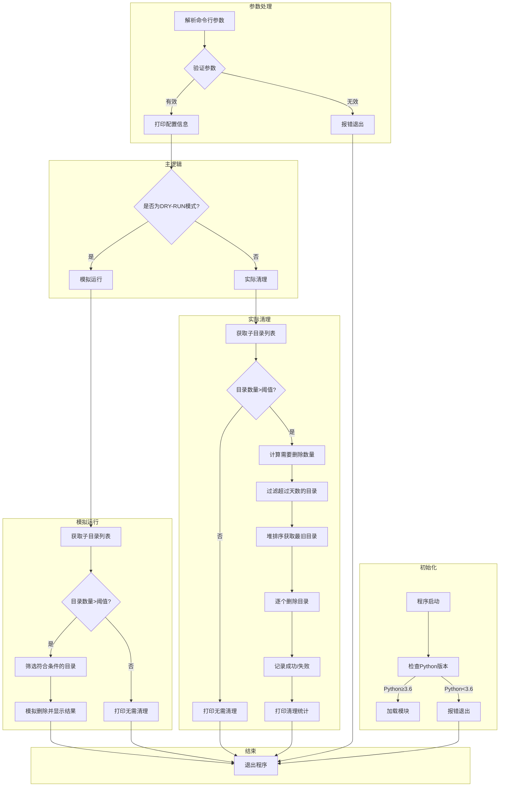
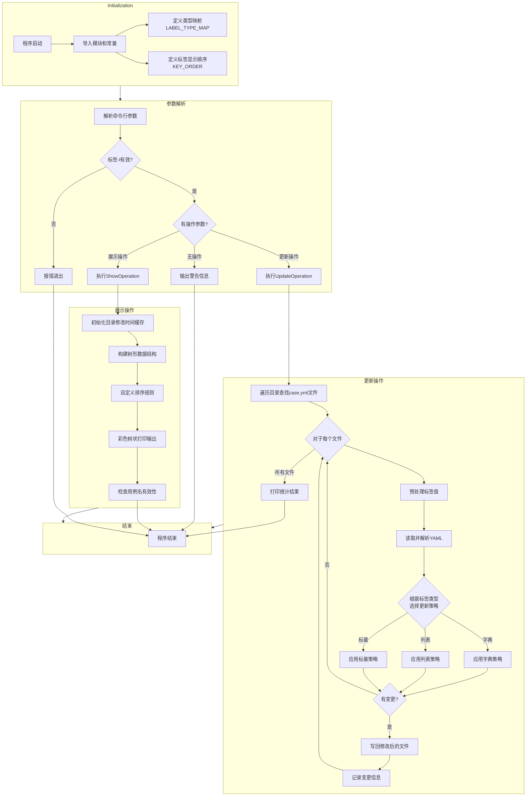

# 🎉 AISBench Smoke 🎉

---

## 🌐 简介
AISBench Smoke 是一个用于 AISBench 基准测试的自动化测试框架，主要包含两个核心目录：framework/ 和 scripts/
本 README 将详细介绍这两个目录的结构、功能以及使用方式，帮助开发者和测试人员快速上手。

---

## 重复执行与资源控制 / Repeat runs and resource controls

用例集合、标签、rank 分组及默认并发 50 保持不变；本优化不以少跑用例换取提速。
`run_steps.sh` 使用同一解释器安装依赖、运行框架和启动 simulator。首次运行保留原有五步 pip 安装；
仅当依赖输入、解释器、仓库路径和已安装包元数据都未改变时跳过安装。
缓存保存在 `smoke_tests/.cache/dependencies/`，与每次新建的 `RunWorkspace/` 分离。
安装失败立即退出，不留下成功标记；元数据不完整、外部 pip 约束/requirements 配置会禁用缓存。
同一解释器的 setup 使用文件锁串行执行；不要同时在同一环境运行其他 pip/conda 命令。

| 配置 | 默认值 / 行为 |
| --- | --- |
| `AISBENCH_SMOKE_PYTHON` | `python3`；可指定虚拟环境 Python（在入口处解析为绝对路径） |
| `AISBENCH_SMOKE_FORCE_INSTALL=1` | 强制重装；也可执行 `python3 smoke_tests/scripts/prepare_env.py --force` |
| `SMOKE_CHECK_UPDATES` | 交互终端默认 `1`；CI/非交互默认 `0`；显式 `0`/`1` 覆盖 |
| `SMOKE_MAX_PARALLEL` | `50`，正整数；不要未经测量就提高并发 |
| `SMOKE_SERVICE_READY_TIMEOUT` | `30` 秒，正整数；立即探测，单次 HTTP 请求最多 2 秒 |
| `case.yml: clean_timeout` | `2` 分钟；清理失败记警告，保留原用例结果 |

非 TTY 不再启动进度动画和终端排版子进程；日志分块汇总，不截断。rank 组结束不再额外休眠 3 秒。
POSIX 超时/中断终止脚本进程组并回收主进程；自行 `setsid` 脱离的进程和 Windows Job Object 不在此保证内。

The same case selection and default concurrency are retained. Successful dependency setup is cached only
when repository inputs, Python identity, and installed distribution metadata match. External pip constraints
bypass the cache; use `AISBENCH_SMOKE_FORCE_INSTALL=1` to force setup. A per-interpreter lock coordinates setup
(not external pip/conda). Noninteractive runs skip remote update checks by default, keep complete streamed
logs, and avoid progress animations and the three-second group cooldown. The table above lists controls.
POSIX timeout handling terminates the script process group; descendants creating separate sessions are excluded.

轻量回归测试 / Lightweight regression tests (no models, NPU, real pip installs or external services):

```bash
python3 -m pip install PyYAML psutil tqdm xlwt pytest
python3 -m pytest tests/UT/smoke_tests -q
```

实际提速需在同一冒烟机比较冷/热启动的 setup 耗时与完整 suite 墙钟，不能由少量 mock 测试推算百分比。
Measure cold/warm setup and full-suite wall time on the same smoke runner before reporting a speedup.

## 🛠️ TODOs

- [ ] Q3需求用例补充
- [ ] 解决工作进程等待任务时（即在 ProcessPoolExecutor 的内部队列等待时）被中断（`Ctrl + C`）导致打印大量堆栈跟踪
- [x] 冒烟流程 `Ctrl + C` 打断后正确释放资源并打屏当前执行结果
- [x] 增加执行动画和信息, 减少打屏繁杂内容输出 (仅记录在邮件附件日志中)
- [x] 修正 Ctrl_C 场景下的多个用例, 定时任务脚本去掉外层的nohup行为
- [x] run_steps.sh流程中检查到无凭证时，可直接创建邮箱的凭证，无需单独调用脚本

---

##  💡逻辑流程图 - 复杂但常用脚本（最下方有滑块可*横向*拖动参看完整图）

### directory_cleaner.py




### manage_labels.py




---

#### Thanks♪(･ω･)ﾉ✨ 感谢使用 AISBench_Smoke 测试框架！🚀
##### 📝 *如有问题，欢迎随时反馈！* 📮
**如何评价本文？**
👍 有用 | 👍👍 很有用 | 👍👍👍 非常有用

---

### 其他
- 冒烟所需数据集压缩包：[smoke_datasets.tar.gz](https://aisbench.obs.cn-north-4.myhuaweicloud.com/datasets/smoke_datasets.tar.gz)