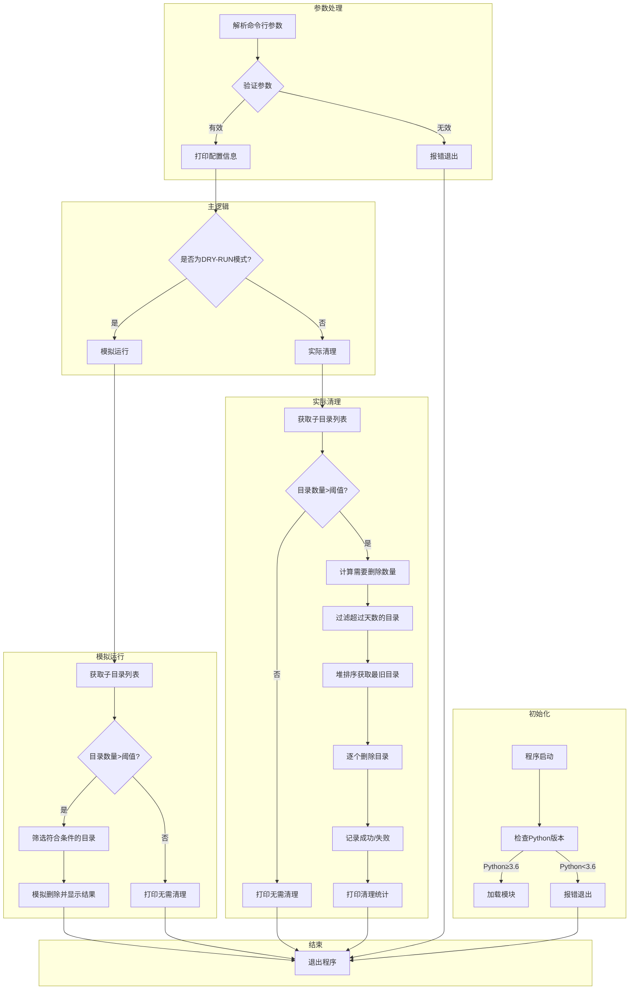
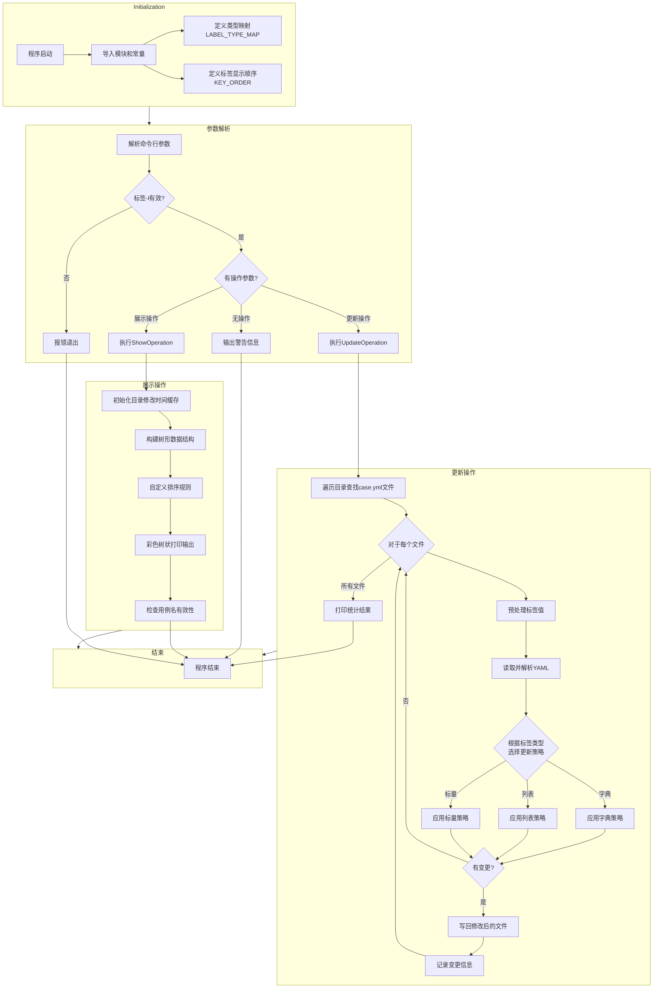

# 🎉 AISBench Smoke 🎉

---

## 🌐 简介
AISBench Smoke 是一个用于 AISBench 基准测试的自动化测试框架，主要包含两个核心目录：framework/ 和 scripts/
本 README 将详细介绍这两个目录的结构、功能以及使用方式，帮助开发者和测试人员快速上手。

---

## 重复执行与资源控制 / Repeat runs and resource controls

用例名称、标签、rank 分组及默认并发 50 保持不变。**快速模式缩小部分普通功能用例的数据覆盖，
不等价于原负载的性能回归**；完整负载可通过 `AISBENCH_SMOKE_FAST=0` 恢复。

`run_steps.sh` 使用同一解释器安装依赖、运行框架和启动 simulator。首次迁移/依赖变化时仍执行五步 pip；
仅当依赖输入、解释器、仓库路径和已安装包元数据匹配时跳过安装。
缓存已移到 checkout 工作区外：Linux 默认 `${XDG_CACHE_HOME:-$HOME/.cache}/aisbench/smoke/dependencies/`；
Windows 默认 `%LOCALAPPDATA%/aisbench/smoke/dependencies/`，macOS 默认 `~/Library/Caches/aisbench/smoke/dependencies/`。
`AISBENCH_SMOKE_CACHE_DIR` 可覆盖；位于仓库内的路径（包括符号链接）会被拒绝，避免被 `git clean -ffdx` 删除。
source `.egg-info` 副本被 checkout 清理不再造成假失效，但真实已安装包变化仍失效。
安装失败不留成功标记，外部 pip 约束/requirements 配置会禁用缓存；日志会显示缓存位置、命中/失效原因和 setup 耗时。
setup 按解释器加锁，默认最多等 120 秒；不要同时在同一环境执行其他 pip/conda。
LPT 历史默认也保存在该持久目录，并按 fast/full 模式隔离；只记录成功用例，长用例优先执行。
自定义 `AISBENCH_SMOKE_HISTORY_PATH` 或直接调用框架时，请自行按模式选择不同历史文件。

| 配置 | 默认值 / 行为 |
| --- | --- |
| `AISBENCH_SMOKE_PYTHON` | `python3`；可指定虚拟环境 Python（在入口处解析为绝对路径） |
| `AISBENCH_SMOKE_FORCE_INSTALL=1` | 强制重装；也可执行 `python3 smoke_tests/scripts/prepare_env.py --force` |
| `AISBENCH_SMOKE_CACHE_DIR` | checkout 外的缓存目录；默认见上文 |
| `AISBENCH_SMOKE_SETUP_LOCK_TIMEOUT` | 最多等锁 `120` 秒，必须为正有限数 |
| `AISBENCH_SMOKE_HISTORY_PATH` | 默认由入口选择持久历史；可覆盖为独立绝对路径 |
| `AISBENCH_SMOKE_FAST` | 入口默认 `1`；PR CI 默认 `1`；**日构建强制 `0`**；手动 CI 默认 `0`；仓库 Variable 仅覆盖 PR/手动选择 |
| `SMOKE_CHECK_UPDATES` | 交互终端默认 `1`；CI/非交互默认 `0`；显式 `0`/`1` 覆盖 |
| `SMOKE_MAX_PARALLEL` | `50`，正整数；不要未经测量就提高并发 |
| `SMOKE_SERVICE_READY_TIMEOUT` | `30` 秒，正整数；立即探测，单次 HTTP 请求最多 2 秒 |
| `case.yml: clean_timeout` | `2` 分钟；清理失败记警告，保留原用例结果 |

快速模式仅标记 11 个普通 OpenAI 兼容性能链路配置：输出上限不超过 32（显式逐样本长度仍优先），
其中三个 GSM8K 配置从最多 100 条变为 20 条，CEval 取固定前 3 科、每科最多 20 条。
只有 simulator 收到精确模型标记 `aisbench-smoke-functional/qwen` 且启用 fast 时，才为该请求使用
非零短延迟（TTFT/E2EL 5ms，TPOT 系数 1ms）；不改全局 YAML 或其他请求。
**压力、高并发、中断/续推、稳态重算、非 OpenAI 后端及原有断言均保持原样。**
真实服务或需要完整数据/时延覆盖时必须使用 `AISBENCH_SMOKE_FAST=0`。

另有两处只影响关键路径的快速模式约束：

- **judge 用例**：裁判模型 `max_out_len` 由 512 降到 16。判分模板只要求输出 `A`/`B`，
  而模拟服务按 token 流式延时，512 上限使每个判分请求约 5 秒，是当前最长的用例。
  8 条 judge 用例的产物断言不变。
- **pressure_dataset_ceval**：CEval 由全部 52 科裁剪到前 3 科、每科 20 条。
  该用例的耗时几乎全在“每个数据集各重算一次性能结果并重绘图表”，52 科会重复约 52 次；
  压力发送窗口仍由 `--pressure-time` 控制。
- **sharegpt 多轮性能用例**：数据集指向运行期生成的 1 条两轮会话。
  `ShareGPTDataset.load` 会整份加载并逐轮分词 ShareGPT 文件（本机实测约 5 分钟），
  而该用例 `test_range` 本来就只取 1 条会话；请求数、协议与产物校验不变。

实测分解见 `[slowest]` 与各用例 `tmplog.txt`；这些裁剪都会降低覆盖，需要用完整负载复核时设为 0。

非 TTY 不启动动画，但每 30 秒输出未完成名单（含排队任务），每条用例输出 start/result 和耗时。
用例耗时包括失败路径和 cleanup；结束时输出 `[slowest]` 前 10 条。
`case_timings.jsonl` 逐条落盘，CI 尝试在失败/取消后也上传，并且只检查当前 run/attempt 的结果。
缺失、未完成或失败的结果不会再被 `Final Check` 当成通过。
日志仍完整分块汇总，rank 组无额外 3 秒冷却。
POSIX 组清理不保证覆盖自行 `setsid` 脱离的后代；Windows 不保证 Job Object 级递归清理。

Case names/default concurrency are retained, **not identical data coverage in fast mode**. Eleven ordinary
OpenAI-compatible performance-chain configs opt into short responses/delays; four dataset configs reduce
samples (CEval: first three subjects). The eight judge cases additionally cap the judge model at 16 output
tokens (it only needs an A/B verdict, while 512 tokens cost ~5 s per judge request against the simulator),
and `pressure_dataset_ceval` keeps three CEval subjects instead of 52 because performance results and charts
are regenerated once per dataset. The sharegpt multi-turn case points at a generated single two-turn
conversation: `ShareGPTDataset.load` loads and tokenizes the whole ShareGPT file (~5 minutes on the smoke
runner) while `test_range` already selected one conversation. Dedicated concurrency, interrupt/reuse, stable-stage
and non-OpenAI cases, assertions and YAML remain unchanged. Use `AISBENCH_SMOKE_FAST=0` for original workloads
or real external services. PR CI defaults to fast; scheduled CI always forces full coverage; manual CI defaults
to full. The repository Variable `AISBENCH_SMOKE_FAST` can override PR/manual runs, but not scheduled runs.
Verify the `[profile]` line rather than assuming a mode.
Cache and mode-specific LPT history now live outside checkout; paths inside the repo are rejected.
The first migrated run is cold; a second run on the same runner/environment should report a cache hit
unless inputs/installed metadata changed. Lock wait is bounded (120 seconds by default).
CI prints per-case wall times including cleanup, a 30-second unfinished-task heartbeat, and the slowest ten;
`case_timings.jsonl` preserves partial evidence. Missing/incomplete results fail instead of claiming success.

轻量回归测试 / Lightweight regression tests (no models, NPU, real pip installs or external services):

```bash
python3 -m pip install -r requirements/test.txt mmengine-lite
python3 -m pytest tests/UT/smoke_tests -q
```

### CI 对照 / CI comparison

1. 记录 runner 名、head SHA、`[profile]`、`[dependencies]` 命中状态；首次迁移一般是冷安装。
2. 同提交、同 runner 分别运行 fast=0/1；不要混用冷/热缓存比较。必要时设置仓库 Variable 后重跑 PR/手动任务，
   并检查实际 `[profile]` 输出确认生效；日构建固定为完整负载，不受该 Variable 影响。
3. 分开记录 Checkout、setup、`共计耗时` 和整个 `Run Smoke Cases`，查看 `[slowest]`，
   不把代理重试或审批/排队算作代码提速。快速模式包含减少测试负载，必须单独说明。

Use the same commit/runner/cache condition, verify the logged mode, compare checkout/setup/suite separately,
and disclose the reduced functional workload. Do not infer suite speedup from mock tests or token-delay ratios.

## 🛠️ TODOs

- [ ] Q3需求用例补充
- [ ] 解决工作进程等待任务时（即在 ProcessPoolExecutor 的内部队列等待时）被中断（`Ctrl + C`）导致打印大量堆栈跟踪
- [x] 冒烟流程 `Ctrl + C` 打断后正确释放资源并打屏当前执行结果
- [x] 增加执行动画和信息, 减少打屏繁杂内容输出 (仅记录在邮件附件日志中)
- [x] 修正 Ctrl_C 场景下的多个用例, 定时任务脚本去掉外层的nohup行为
- [x] run_steps.sh流程中检查到无凭证时，可直接创建邮箱的凭证，无需单独调用脚本

---

##  💡逻辑流程图 - 复杂但常用脚本（最下方有滑块可*横向*拖动参看完整图）

### directory_cleaner.py




### manage_labels.py




---

#### Thanks♪(･ω･)ﾉ✨ 感谢使用 AISBench_Smoke 测试框架！🚀
##### 📝 *如有问题，欢迎随时反馈！* 📮
**如何评价本文？**
👍 有用 | 👍👍 很有用 | 👍👍👍 非常有用

---

### 其他
- 冒烟所需数据集压缩包：[smoke_datasets.tar.gz](https://aisbench.obs.cn-north-4.myhuaweicloud.com/datasets/smoke_datasets.tar.gz)